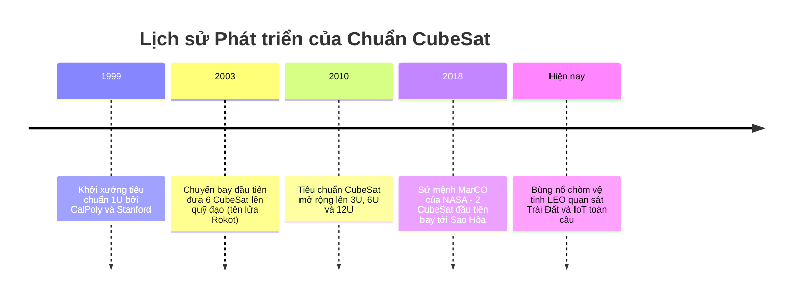
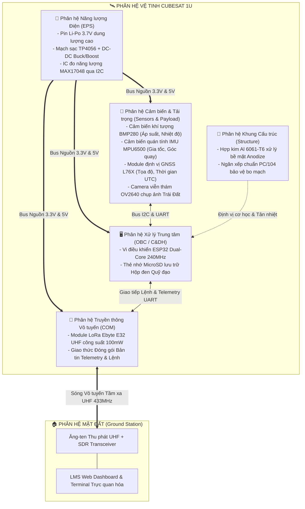

# Lab 0: Giới thiệu Tổng quan Kỹ thuật Không gian & Vệ tinh CubeSat

---

## 📖 Doc 0.1: Lịch sử CubeSat, Tiêu chuẩn Kỹ thuật & Môi trường Quỹ đạo LEO

### 1. Lịch sử Phát triển và Triết lý Tiêu chuẩn Hóa CubeSat
Vệ tinh siêu nhỏ tiêu chuẩn **CubeSat** được khởi xướng vào năm 1999 bởi Giáo sư Jordi Puig-Suari (Đại học Bách khoa Bang California - CalPoly, San Luis Obispo) và Giáo sư Bob Twiggs (Đại học Stanford). Mục tiêu nguyên bản của tiêu chuẩn là tạo ra một cấu trúc vệ tinh đồng nhất, chi phí chế tạo thấp và rút ngắn chu kỳ phát triển từ hàng thập kỷ xuống còn 1 - 2 năm, cho phép các trường đại học và viện nghiên cứu tự tay thiết kế, thử nghiệm và vận hành các khí tài không gian thực thụ.

Trước khi CubeSat ra đời, các vệ tinh truyền thống thường có khối lượng hàng tấn, chi phí phóng lên đến hàng trăm triệu USD và thời gian phát triển kéo dài. CubeSat đã làm thay đổi hoàn toàn cục diện bằng triết lý:
- Tiêu chuẩn hóa kích thước cơ khí và giao diện phóng (Mechanical & Deployment Standardization).
- Khai thác tối đa các linh kiện thương mại có sẵn trên thị trường (**COTS - Commercial Off-The-Shelf**) thay vì chỉ sử dụng linh kiện chuẩn quân sự (Rad-Hard) đắt đỏ.
- Giảm thiểu rủi ro cho tên lửa mẹ bằng hệ thống đóng gói kín (Containerized Launch Integration).

### 2. Thông số Hình học Tiêu chuẩn 1U (1 Unit) theo Quy chuẩn CalPoly
Một vệ tinh CubeSat đơn vị cơ sở (1U) phải tuân thủ nghiêm ngặt các quy định kích thước để đảm bảo khớp hoàn hảo với ống phóng P-POD:

| Thông số Kỹ thuật | Tiêu chuẩn Quy định | Dung sai / Điều kiện Kỹ thuật |
| :--- | :--- | :--- |
| **Kích thước Thân cơ sở ($X \times Y$)** | $100.0 \times 100.0\text{ mm}$ | $\pm 0.1\text{ mm}$ |
| **Chiều dài Dọc trục ($Z$)** | $113.5\text{ mm}$ | Tính cả chiều dài 4 thanh ray trượt nhô ra |
| **Bề rộng Thanh ray (Rails)** | Tối thiểu $8.5\text{ mm}$ | Ở cả 4 góc dọc theo trục Z |
| **Bán kính Bo viền Ray** | Tối thiểu $1.0\text{ mm}$ | Tránh cọ xát góc nhọn vào lòng ống phóng |
| **Khối lượng Tối đa (Mass)** | $1.33\text{ kg}$ (truyền thống) | Có thể mở rộng tới $2.0\text{ kg}$ theo chuẩn hiện đại |
| **Độ nhô linh kiện (Keep-out Zone)** | Tối đa $6.5\text{ mm}$ | Không chi tiết nào được vượt khỏi mặt phẳng ray |
| **Độ nhám bề mặt Ray** | $R_a \le 0.8\text{ }\mu\text{m}$ | Đảm bảo chuyển động trượt êm ái khi đẩy |

### 3. Cơ chế Phóng P-POD (Poly-Picosatellite Orbital Deployer)
Hệ thống phóng **P-POD** là một ống nhôm hình hộp chữ nhật được bắt cố định vào thân tầng trên của tên lửa đẩy. CubeSat được trượt vào lòng ống P-POD với lò xo nén cơ học ở đáy.
- **Quy trình kích hoạt:** Khi tên lửa đạt quỹ đạo đích, một lệnh điện kích hoạt cơ cấu nhả chốt (Non-Explosive Actuator - NEA).
- **Giải phóng động năng:** Cửa P-POD mở ra, lò xo chính giải phóng thế năng đẩy CubeSat ra khỏi ống với vận tốc tương đối an toàn từ $1.0\text{ m/s}$ đến $1.5\text{ m/s}$.
- **Bảo vệ tên lửa mẹ:** Ống P-POD hoạt động như một lớp vỏ bảo vệ cách ly tuyệt đối tên lửa khỏi mọi nguy cơ văng mảnh cơ học hoặc đoản mạch điện từ vệ tinh nhỏ.

### 4. Môi trường Vật lý Khắc nghiệt tại Quỹ đạo Tầm thấp (LEO)
Quỹ đạo Trái Đất Tầm thấp (**Low Earth Orbit - LEO**) nằm ở độ cao từ $400\text{ km}$ đến $800\text{ km}$ so với mặt đất. Đây là một môi trường vô cùng khắc nghiệt đối với mọi hệ thống điện tử:

1. **Môi trường Chân không Cực cao (Ultra-High Vacuum - $10^{-5}$ đến $10^{-8}\text{ Torr}$):**
   - **Triệt tiêu Đối lưu:** Không có không khí, định luật làm mát đối lưu $\dot{Q} = hA(T - T_\infty)$ hoàn toàn không tồn tại. Toàn bộ nhiệt sinh ra từ vi mạch chỉ có thể truyền dẫn qua kim loại và bức xạ vào vũ trụ.
   - **Hiện tượng Thoát khí (Outgassing):** Các chất bay hơi trong polyme, nhựa, keo dán bị hút chân không sôi sục, bốc hơi và ngưng tụ lên bề mặt thấu kính quang học, pin mặt trời làm suy giảm hiệu suất.
   - **Hàn nguội (Cold Welding):** Trong chân không tuyệt đối, lớp màng oxit tự nhiên bảo vệ kim loại không thể tái tạo. Khi hai bề mặt kim loại trần cùng loại (như nhôm - nhôm) chạm vào nhau dưới áp lực, các nguyên tử sẽ liên kết tự do khiến chúng dính chặt vĩnh viễn.

2. **Biến thiên Nhiệt độ Khắc nghiệt:**
   - **Pha Ban ngày (Sunlight):** Vệ tinh hứng chịu bức xạ Mặt Trời trực diện ($1361\text{ W/m}^2$) kết hợp với bức xạ phản xạ từ Trái Đất (Albedo) và bức xạ hồng ngoại của Trái Đất, nhiệt độ vỏ ngoài có thể lên tới $+80^\circ\text{C}$.
   - **Pha Vùng tối (Eclipse):** Khi vệ tinh đi vào bóng tối của Trái Đất, không còn nguồn nhiệt mặt trời, vỏ ngoài bức xạ năng lượng vào không gian sâu ($2.7\text{K}$) khiến nhiệt độ tụt dốc xuống $-40^\circ\text{C}$.
   - Sự luân chuyển nhiệt độ liên tục này gây ứng suất nhiệt phá hủy mối hàn vi mạch (Thermal Fatigue).

3. **Môi trường Bức xạ Vũ trụ & Hạt Mang điện Năng lượng Cao:**
   - Hạt proton năng lượng cao, tia vũ trụ ngân hà (GCR) và đai bức xạ Van Allen bắn phá các bóng bán dẫn CMOS.
   - **SEU (Single Event Upset):** Hạt ion năng lượng cao xuyên qua ô nhớ SRAM làm đảo bit ($0 \to 1$ hoặc $1 \to 0$), gây lỗi chương trình hoặc treo hệ điều hành.
   - **SEL (Single Event Latchup):** Tạo đường dẫn ngắn mạch ký sinh trong cấu trúc PNPN của vi mạch, làm dòng điện tăng vọt thiêu cháy linh kiện nếu không ngắt nguồn kịp thời.
   - **TID (Total Ionizing Dose):** Liều bức xạ tích lũy theo thời gian làm dịch chuyển điện áp ngưỡng của cổng MOSFET, gây rò rỉ dòng và làm chết chip dần dần.

4. **Động học Bay & Vận tốc Quỹ đạo:**
   - Theo định luật hấp dẫn Newton và cân bằng lực quán tính ly tâm:
     $$\frac{G M_E m}{(R_E + h)^2} = \frac{m v^2}{R_E + h} \implies v = \sqrt{\frac{G M_E}{R_E + h}}$$
   - Ở độ cao $h = 500\text{ km}$ ($R_E = 6378\text{ km}$), vận tốc quỹ đạo đạt xấp xỉ:
     $$v \approx 7.61\text{ km/s} \approx 27.400\text{ km/h}$$
   - Chu kỳ quay quanh Trái Đất:
     $$T = 2\pi \sqrt{\frac{(R_E + h)^3}{G M_E}} \approx 94.6\text{ phút} \approx 95\text{ phút}$$
   - Trong mỗi 95 phút, vệ tinh trải qua khoảng 60 phút đón nắng và 35 phút nằm trong bóng tối Trái Đất.

---

### ❓ Câu Hỏi Củng Cố Kiến Thức (Doc 0.1)
1. **Tiêu chuẩn kích thước cơ bản của một vệ tinh CubeSat chuẩn 1U theo quy chuẩn quốc tế là gì?**
   - A. $150 \times 150 \times 150\text{ mm}$
   - B. $200 \times 200 \times 200\text{ mm}$
   - C. $100 \times 100 \times 100\text{ mm}$
   - D. $50 \times 50 \times 50\text{ mm}$
   - *Đáp án:* **C**
   - *Giải thích:* Chuẩn CubeSat 1U (1 Unit) định nghĩa kích thước hình lập phương chuẩn 100 x 100 x 100 mm với khối lượng giới hạn thường không quá 1.33 kg.

2. **Trong điều kiện chân không cực cao quỹ đạo LEO, cơ chế truyền nhiệt chủ đạo từ vệ tinh ra không gian là:**
   - A. Bức xạ nhiệt điện từ vào không gian sâu
   - B. Truyền nhiệt đối lưu qua luồng không khí
   - C. Dẫn nhiệt qua các hạt phân tử khí loãng
   - D. Bốc hơi chất làm mát cưỡng bức bề mặt
   - *Đáp án:* **A**
   - *Giải thích:* Trong môi trường chân không cao, mật độ phân tử khí gần như triệt tiêu nên vệ tinh chỉ có thể giải phóng nhiệt lượng qua bức xạ điện từ theo định luật Stefan-Boltzmann.

3. **Hiện tượng Single Event Upset (SEU) gây ra bởi bức xạ hạt vũ trụ có đặc điểm vật lý nào?**
   - A. Biến dạng cơ học khung sườn nhôm vệ tinh
   - B. Gây ngắn mạch phá hủy vĩnh viễn chip bán dẫn
   - C. Thiêu cháy hoàn toàn các tế bào quang điện
   - D. Làm lật trạng thái bit dữ liệu trong ô nhớ RAM
   - *Đáp án:* **D**
   - *Giải thích:* SEU là lỗi mềm (Soft error) do hạt ion năng lượng cao xuyên qua ô nhớ làm đảo bit 0 thành 1 hoặc ngược lại, có thể khắc phục bằng cách ghi đè hoặc reset vi xử lý.

---

## 📖 Doc 0.2: Kiến trúc Hệ thống Vệ tinh 1U & 6 Phân hệ Cốt lõi

### 1. Kiến trúc Hệ thống Phân rã theo Khối Chức năng
Bộ kit giáo dục vệ tinh **PTITCube** phản ánh đầy đủ mô hình kiến trúc của một vệ tinh 1U không gian thực tế, bao gồm 6 phân hệ cốt lõi hoạt động đồng bộ:

### 2. Chi tiết Vai trò 6 Phân hệ Cốt lõi

#### 1. Phân hệ Xử lý & Quản lý Dữ liệu Lệnh (OBC / C&DH - On-Board Computer)
- Được xem như "Bộ não" của vệ tinh.
- Chịu trách nhiệm khởi tạo phần cứng, kiểm tra sức khỏe hệ thống (Built-in Self Test - BIST).
- Điều phối máy trạng thái hoạt động (Mission Finite State Machine - FSM).
- Thu thập dữ liệu cảm biến định kỳ, định dạng thành các gói tin viễn trắc (Telemetry Packets).
- Tiếp nhận, kiểm tra tính hợp lệ và thực thi các mệnh lệnh viễn lệnh (Telecommands) gửi từ trạm mặt đất.
- Ghi dữ liệu hành trình vào bộ lưu trữ bất biến (Non-volatile Storage - NVS và thẻ MicroSD).

#### 2. Phân hệ Năng lượng Điện (EPS - Electrical Power System)
- Được ví như "Trái tim" cung cấp dòng máu năng lượng cho vệ tinh.
- Nguồn dự trữ sơ cấp: Pin sạc Lithium Polymer (Li-Po) $3.7\text{V}$.
- Khối sạc năng lượng mặt trời: Điều khiển dòng sạc ổn định theo thuật toán CC/CV (Constant Current / Constant Voltage).
- Khối ổn áp chuyển mạch: Mạch Buck chuyển đổi hạ áp xuống $3.3\text{V}$ sạch cho vi xử lý và cảm biến; Mạch Boost nâng áp lên $5.0\text{V}$ cấp nguồn cho khối RF và tải trọng đặc biệt.
- Khối giám sát nhiên liệu: IC đo dung lượng chuyên dụng MAX17048 giao tiếp qua bus I2C giúp OBC biết chính xác dung lượng pin còn lại (State of Charge - SOC).
- Khối bảo vệ an toàn: Công tắc hành trình (Deployment Switch) và chốt rút an toàn trước giờ bay (Remove Before Flight - RBF Pin).

#### 3. Phân hệ Cảm biến & Tải trọng Sứ mệnh (Sensors & Payload)
- Là "Giác quan" của vệ tinh để cảm nhận thế giới xung quanh và thực hiện mục tiêu khoa học.
- **BMP280:** Cảm biến nhiệt độ và áp suất khí quyển với độ phân giải cao, hỗ trợ kiểm tra kín khí và quan trắc môi trường.
- **MPU6500:** Cảm biến quán tính 6 bậc tự do (6-DOF) gồm 3 trục gia tốc kế ($\pm 16\text{g}$) và 3 trục con quay hồi chuyển ($\pm 2000^\circ\text{/s}$), đo vận tốc góc và tư thế quay của vệ tinh.
- **GNSS L76X:** Module định vị toàn cầu đa hệ thống (GPS, GLONASS) cung cấp tọa độ địa lý (kinh độ, vĩ độ, độ cao) và đồng bộ thời gian nguyên tử UTC.
- **Camera OV2640:** Tải trọng quang học chụp ảnh màu phân giải cao, nén JPEG hỗ trợ nhiệm vụ viễn thám Trái Đất.

#### 4. Phân hệ Truyền thông Viễn thông (COM - Communication Subsystem)
- Đóng vai trò là "Giọng nói và Đôi tai" của CubeSat.
- Sử dụng sóng vô tuyến tần số siêu cao UHF ($433\text{ MHz}$) với kỹ thuật điều chế trải phổ LoRa (Chirp Spread Spectrum - CSS) vượt trội về khả năng xuyên nhiễu và độ nhạy thu cực cao (lên tới $-148\text{ dBm}$).
- Đảm bảo luồng truyền tin hai chiều:
  - **Đường xuống (Downlink):** Định kỳ phát bản tin Beacon viễn trắc thông báo điện áp, nhiệt độ và tọa độ về Trái Đất.
  - **Đường lên (Uplink):** Lắng nghe các lệnh điều khiển từ Trạm mặt đất để cấu hình lại hệ thống hoặc kích hoạt tải trọng.

#### 5. Phân hệ Kết cấu Cơ khí (Structure Subsystem)
- Được xem như "Bộ xương" vững chắc của CubeSat.
- Chế tạo bằng hợp kim nhôm hàng không **Al 6061-T6** gia công CNC chính xác cao, mang lại tỷ số độ bền trên khối lượng tối ưu.
- Lớp xử lý bề mặt Anodize cứng Type III trên 4 thanh ray bảo vệ chống mài mòn và chống hàn nguội trong chân không.
- Bảo vệ các bo mạch điện tử bên trong khỏi tải trọng tĩnh gia tốc tên lửa và tải trọng động rung lắc ngẫu nhiên lúc cất cánh.
- Đóng vai trò làm khối tản nhiệt thụ động (Passive Heat Sink) dẫn nhiệt từ các chip công suất ra ngoài không gian.

#### 6. Phân hệ Điều khiển & Ổn định Tư thế (ADCS - Attitude Determination and Control System)
- Thu thập số liệu quán tính từ IMU và từ kế để xác định tư thế vệ tinh trong không gian 3 chiều.
- Dập tắt dao động quay hỗn loạn (Detumbling) sinh ra ngay sau khi vệ tinh bị đẩy văng khỏi ống phóng P-POD.
- Định hướng bề mặt pin hướng về Mặt Trời và hướng ăng-ten truyền thông về phía Trạm mặt đất.

---

### ❓ Câu Hỏi Củng Cố Kiến Thức (Doc 0.2)
1. **Phân hệ nào đóng vai trò là "Bộ não" thu thập dữ liệu viễn trắc và giải mã mệnh lệnh điều khiển trên vệ tinh?**
   - A. Phân hệ Năng lượng (EPS)
   - B. Phân hệ Xử lý Trung tâm (OBC)
   - C. Phân hệ Cơ khí Kết cấu (STR)
   - D. Phân hệ Điều khiển Tư thế (ADCS)
   - *Đáp án:* **B**
   - *Giải thích:* OBC (On-Board Computer) thực thi phần mềm bay, điều phối luồng dữ liệu viễn trắc và quản lý toàn bộ các phân hệ ngoại vi.

2. **Dải tần số vô tuyến và kỹ thuật điều chế được sử dụng cho liên kết truyền thông giữa PTITCube và Trạm mặt đất là:**
   - A. Băng tần UHF 433 MHz điều chế trải phổ LoRa
   - B. Băng tần HF điều chế tín hiệu biên độ AM
   - C. Băng tần Ku 12 GHz điều chế khóa pha số PSK
   - D. Sóng quang học hồng ngoại không gian định hướng
   - *Đáp án:* **A**
   - *Giải thích:* Phân hệ COM sử dụng module LoRa ở băng tần UHF 433 MHz giúp tối ưu hóa khả năng chống suy hao đường truyền và nhạy thu cao trong kích thước anten nhỏ gọn.

3. **Phân hệ Năng lượng (EPS) trên vệ tinh tiêu chuẩn thực hiện chu trình chức năng cốt lõi nào?**
   - A. Nén luồng dữ liệu ảnh chụp và lưu trữ vào bộ nhớ
   - B. Xác định góc hướng la bàn và ổn định tư thế quay
   - C. Thu nhận năng lượng mặt trời, sạc pin và phân phối nguồn
   - D. Giải mã các gói tin lệnh truyền từ trạm thu mặt đất
   - *Đáp án:* **C**
   - *Giải thích:* EPS quản lý toàn bộ chu trình năng lượng từ tấm pin mặt trời, sạc pin Li-Po qua mạch bảo vệ và hạ/tăng áp cấp nguồn ổn định cho các tải.

---

## 💻 Hướng Dẫn Thực Hành: Khám Phá Mô Hình 3D & Thông Số Phân Hệ

1. **Truy cập Giao diện Trực quan 3D trên Web LMS:**
   - Trên thanh điều hướng của Lab 0, chọn thẻ **🔍 Thành phần** (Component Viewer).
   - Mô hình không gian 3D tương tác của CubeSat 1U sẽ được dựng theo thời gian thực nhờ công nghệ WebGL.
2. **Kỹ thuật Thao tác Tương tác:**
   - **Xoay mô hình (Rotate):** Giữ chuột trái và kéo rê để quan sát vệ tinh từ mọi góc độ không gian ($360^\circ$).
   - **Thu phóng (Zoom):** Cuộn con lăn chuột giữa để phóng to chi tiết từng tầng bo mạch ngăn xếp PC/104 hoặc thu nhỏ toàn cảnh.
   - **Dịch chuyển tâm nhìn (Pan):** Giữ chuột phải và kéo rê để dịch chuyển mô hình sang trái, phải, lên, xuống.
3. **Đọc Bảng Thông số Kỹ thuật Chi tiết:**
   - Nhấp chuột trực tiếp vào từng linh kiện nổi bật trên mô hình (Chip ESP32, Khối Pin Li-Po, Khung Nhôm, Ăng-ten LoRa, Cảm biến MPU6500, Camera OV2640).
   - Bảng thông số thuộc tính kỹ thuật tương ứng sẽ hiện ra ở góc phải màn hình, thể hiện mã linh kiện, điện áp hoạt động, dòng tiêu thụ và chức năng trong hệ thống.

### ❓ Câu Hỏi Đánh Giá Kỹ Năng Thực Hành (Lab 0)
1. **Khi tương tác với mô hình 3D trên Web LMS, thao tác nào cho phép xem thông số kỹ thuật chi tiết của linh kiện?**
   - A. Cuộn nhanh con lăn chuột giữa trên màn hình
   - B. Nhấp chuột trực tiếp vào linh kiện trên mô hình
   - C. Nhấn giữ phím Escape kết hợp click chuột phải
   - D. Nhấp đúp chuột trái vào khoảng trống nền trời
   - *Đáp án:* **B**
   - *Giải thích:* Tính năng Component Viewer được lập trình liên kết mô hình WebGL với cơ sở dữ liệu linh kiện, mở bảng thuộc tính kỹ thuật khi có sự kiện click chuột.
