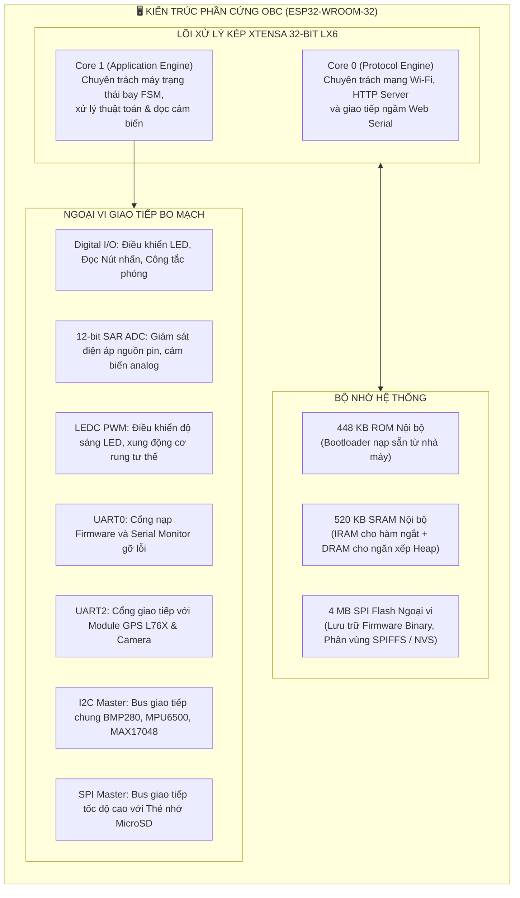
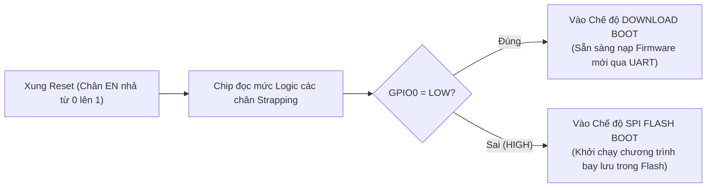
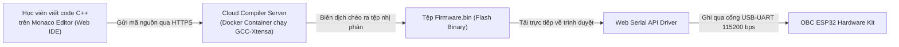
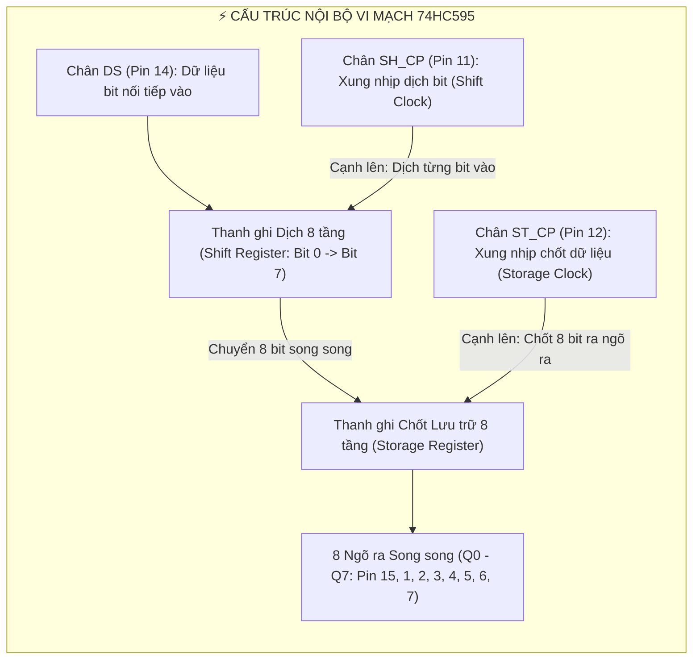
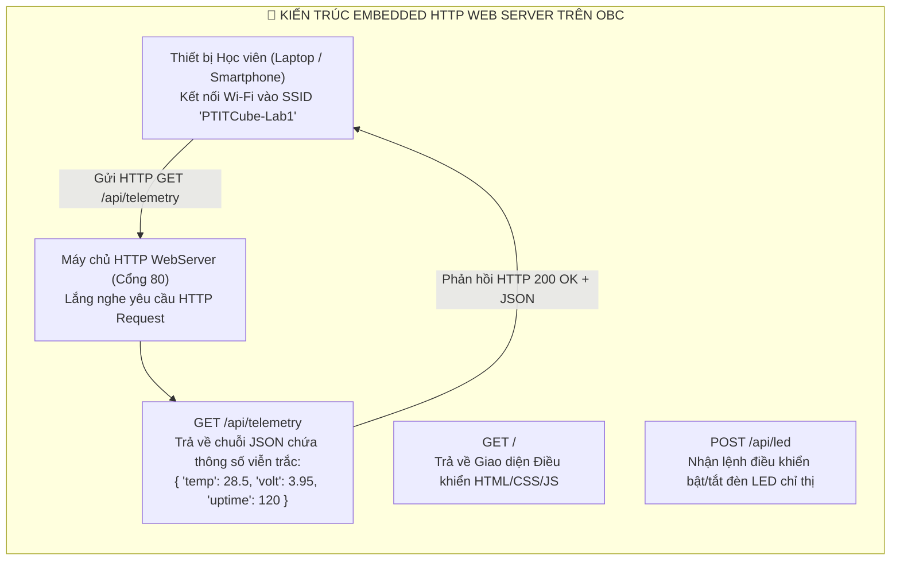

# Lab 1: Máy tính trên Bo mạch (OBC) & Môi trường Lập trình Nhúng

---

## 📖 Doc 1.1: Kiến trúc Phần cứng Vi điều khiển ESP32-WROOM-32 & Các Chuẩn Giao tiếp Ngoại vi

### 1. Vai trò Cốt tử của Phân hệ Máy tính trên Bo mạch (OBC - On-Board Computer)

Trong cấu trúc phân tầng của một vệ tinh nhân tạo CubeSat 1U, phân hệ Máy tính trên Bo mạch (**OBC - On-Board Computer**) đóng vai trò như "bộ não hạt nhân" chỉ huy, điều phối và liên kết toàn bộ các phân hệ chức năng khác thành một thực thể thống nhất. Nếu không có OBC hoạt động tin cậy, vệ tinh sẽ chỉ là một khối kim loại vô tri lơ lửng ngoài không gian.

Các nhiệm vụ sống còn mà OBC đảm nhiệm bao gồm:

1. **Khởi động & Quản lý Trình tự Nạp Hệ thống (Bootstrapping & Sequence Management):** Khi công tắc hành trình phóng nhả ra ngoài không gian, OBC khởi động từ bộ nhớ bất biến ROM/Flash, nạp cấu hình hệ thống, kiểm tra tính toàn vẹn của các ngoại vi và khởi chạy bộ đếm thời gian im lặng vô tuyến 30 phút.
2. **Thu thập & Đóng gói Dữ liệu Viễn trắc (Telemetry Acquisition & Framing):** Định kỳ quét và đọc các thông số từ phân hệ nguồn EPS (điện áp, dòng sạc/xả, dung lượng pin, nhiệt độ cell), phân hệ cảm biến (áp suất khí quyển, gia tốc, vận tốc góc quay, từ trường Trái Đất, tọa độ GPS) và trạng thái kết cấu để đóng gói thành bản tin nhị phân chuẩn (Beacon).
3. **Tiếp nhận & Thực thi Mệnh lệnh Điều khiển (Telecommand Processing):** Lắng nghe dữ liệu gói tin từ trạm mặt đất chuyển tiếp qua phân hệ truyền thông COM, giải mã cú pháp mệnh lệnh (Opcode, Payload), xác thực khóa bản quyền bảo mật (Security Token) và thực thi các hành động như: kích hoạt camera chụp ảnh, thay đổi chu kỳ phát beacon, bật/tắt nguồn cảm biến hoặc nạp lại tham số quỹ đạo.
4. **Quản lý Hệ thống Tệp tin & Lưu trữ Dữ liệu Bay (Data Storage & File Management):** Quản lý quá trình ghi tệp dữ liệu cảm biến, hình ảnh viễn thám và nhật ký hành trình bay (Flight Log) lên thẻ nhớ microSD qua giao diện SPI tốc độ cao định dạng FAT32.
5. **Giám sát Trạng thái & Tự động Phục hồi Lỗi (FDIR - Fault Detection, Isolation, and Recovery):** Theo dõi nhịp tim hệ thống (Heartbeat), duy trì xung làm tươi bộ định thời Watchdog Timer phần cứng (Hardware Watchdog Timer) và kích hoạt quy trình khởi động lại mềm (Soft Reset) hoặc ngắt mở lại nguồn (Power Cycling) khi phát hiện sự cố treo bus do bức xạ không gian.



---

### 2. Thông số Kỹ thuật Chi tiết Vi xử lý ESP32-WROOM-32

Bộ kit vệ tinh giáo dục **PTITCube** lựa chọn vi điều khiển hệ thống trên chip (SoC) **ESP32-WROOM-32** của Espressif Systems nhờ sự kết hợp lý tưởng giữa năng lực tính toán 32-bit mạnh mẽ, dung lượng bộ nhớ dồi dào, khả năng hỗ trợ hệ điều hành thời gian thực FreeRTOS và giá thành tối ưu cho giáo dục:

| Khối Chức năng                                    | Thông số Kỹ thuật Chi tiết                                                                                         | Ý nghĩa trong Ứng dụng Không gian & Lab                                                                                                                            |
| :--------------------------------------------------- | :---------------------------------------------------------------------------------------------------------------------- | :---------------------------------------------------------------------------------------------------------------------------------------------------------------------- |
| **Kiến trúc Lõi (CPU Architecture)**        | Dual-core Tensilica Xtensa 32-bit LX6                                                                                   | Hai lõi vật lý hoạt động độc lập; cho phép tách biệt luồng xử lý viễn thông/mạng trên Core 0 và luồng thuật toán bay trên Core 1.               |
| **Tần số Xung nhịp (Clock Frequency)**      | Có thể cấu hình: 80 MHz, 160 MHz đến tối đa 240 MHz                            | Xung nhịp cao hỗ trợ tính toán ma trận xoay tư thế 3D và xử lý dòng dữ liệu ảnh JPEG mượt mà.                                                         |
| **Bộ nhớ SRAM Nội bộ**                     | $520\text{ KB}$ SRAM ($512\text{ KB}$ khả dụng)                                                                   | Phân chia thành $192\text{ KB}$ IRAM (chứa mã thực thi tốc độ cao) và $328\text{ KB}$ DRAM (chứa biến dữ liệu, bộ đệm DMA và ngăn xếp tác vụ). |
| **Bộ nhớ Flash Ngoài**                      | 4 MB (hoặc 16 MB) Flash Quad-SPI                                                                 | Lưu trữ tệp thực thi nhị phân, bảng phân vùng và hệ thống tệp tin nhúng (SPIFFS/LittleFS).                                                                |
| **Bộ đồng xử lý Công suất Thấp (ULP)** | Co-processor FSM siêu tiết kiệm điện                                                                               | Có thể đọc cảm biến và theo dõi mức pin khi cả hai lõi CPU chính đều ở chế độ ngủ sâu (Deep Sleep).                                                 |
| **Chuyển đổi Tương tự - Số (ADC)**      | 2 × 12-bit SAR ADC (tối đa 18 kênh)                                                                  | Đo đạc điện áp pin và tín hiệu cảm biến analog với độ phân giải $4096$ mức.                                                                          |
| **Giao tiếp Nối tiếp (Serial Buses)**       | $3 \times\text{UART}$, $2 \times\text{I2C}$, $3 \times\text{SPI}$, $2 \times\text{I2S}$, $1 \times\text{CAN}$ | Hỗ trợ đầy đủ mọi giao thức giao tiếp công nghiệp vũ trụ.                                                                                                  |
| **Mạng Không dây Tích hợp**               | Wi-Fi 802.11 b/g/n (2.4 GHz) & Bluetooth v4.2 BR/EDR/BLE                                          | Hỗ trợ mô phỏng truyền nhận dữ liệu tầm gần trong phòng thí nghiệm và kết nối Web LMS.                                                                  |
| **Điện áp Hoạt động Danh định**        | 3.0V - 3.6V (Chuẩn tối ưu: 3.3V)                                                        | Khớp chuẩn với đường nguồn 3.3V do mạch Buck chuyển đổi từ pin Lithium EPS.                                                                      |

---

### 3. Sơ đồ Chân Đặc biệt (Strapping Pins) & Lưu ý An toàn Phần cứng

Trên vi điều khiển ESP32, có một số chân GPIO đặc biệt được gọi là **Strapping Pins**. Mức logic điện áp tại các chân này được chip lấy mẫu (sample) ngay tại khoảnh khắc xung Reset nhả ra ($0 \to 1$). Mức logic này quyết định chế độ hoạt động của chip:



| Tên Chân GPIO          | Chức năng Strapping                                             | Mức Logic Boot Bình thường             | Mức Logic Nạp Firmware                   | Cảnh báo An toàn Thiết kế                                                                                                                                                                                                                                          |
| :----------------------- | :---------------------------------------------------------------- | :----------------------------------------- | :----------------------------------------- | :---------------------------------------------------------------------------------------------------------------------------------------------------------------------------------------------------------------------------------------------------------------------- |
| **GPIO 0**         | Quyết định Chế độ Khởi động (Boot Mode)                  | **HIGH (Kéo lên 3.3V)** | **LOW (Nối Mass 0V)**    | Chân này có trở kéo lên nội. Nếu vô tình gắn cảm biến kéo chân này xuống đất khi khởi động, ESP32 sẽ rơi vào chế độ nạp và không bao giờ chạy code bay!                                                                                |
| **GPIO 2**         | Quyết định Chế độ Khởi động & Nạp Flash                 | **LOW hoặc Không kết nối**       | **LOW (Nối Mass 0V)**    | Thường được nối với LED báo trên bo mạch. Không được kéo chân này lên mức cao bất thường khi boot.                                                                                                                                                |
| **GPIO 12 (MTDI)** | Quyết định Điện áp Bộ điều áp Nội cho Flash (VDD_SDIO) | **LOW (Điện áp 3.3V)** | **LOW (Điện áp 3.3V)** | **CỰC KỲ NGUY HIỂM:** Nếu GPIO 12 bị kéo lên mức cao (3.3V) khi khởi động, chip sẽ cấu hình đường nguồn cấp Flash nội tụt xuống 1.8V, khiến bộ nhớ Flash không đọc được và làm ESP32 bị brick tạm thời! |
| **GPIO 15 (MTDO)** | Bật/Tắt Xuất Thông điệp Debug ra Cổng UART0                | **HIGH (Kéo lên 3.3V)** | **HIGH (Kéo lên 3.3V)** | Điều khiển việc chip có in các dòng thông báo ROM Bootloader ra cổng Serial ở tốc độ 115200 hay không.                                                                                                                                                   |

> [!WARNING]
> **Quy tắc Vàng khi Thiết kế OBC:**
>
> - Tuyệt đối không sử dụng các chân GPIO 6, 7, 8, 9, 10, 11 cho các mục đích thông thường vì các chân này được kết nối trực tiếp bên trong vỏ module với chip nhớ SPI Flash. Bất kỳ tác động điện áp nào lên các chân này đều làm sập vi xử lý ngay lập tức.
> - Các chân GPIO 34, 35, 36 (VP), 39 (VN) là các chân **Chỉ Có Chiều Nhập (Input Only)**, không có điện trở kéo nội bộ (No internal Pull-up/Pull-down) và không thể cấu hình làm ngõ ra `OUTPUT`.

---

## 📖 Doc 1.2: Môi trường Lập trình Đám mây Web IDE & Giao thức Nạp Firmware Web Serial API

### 1. Kiến trúc Đám mây Hiện đại của PTITCube Web IDE

Môi trường thực hành của PTITCube được thiết kế theo mô hình điện toán đám mây hiện đại (Cloud-native Embedded Development Platform), giúp học viên có thể lập trình, biên dịch và nạp vi điều khiển trực tiếp trên trình duyệt web mà không cần cài đặt chuỗi công cụ cồng kềnh (như Python, Toolchain GCC, ESP-IDF hay driver phức tạp):



- **Khung Biên tập Mã nguồn (Monaco Editor):** Sử dụng nhân trình soạn thảo mã nguồn chuẩn công nghiệp (cùng nền tảng với VS Code), hỗ trợ đầy đủ các tính năng lập trình chuyên nghiệp: tô màu cú pháp C++, gợi ý mã thông minh (IntelliSense), tự động thụt đầu dòng và phát hiện lỗi cú pháp theo thời gian thực.
- **Trình Biên dịch Đám mây (Cloud Compiler Backend):** Hệ thống máy chủ phân tán tự động tiếp nhận mã nguồn, kích hoạt môi trường container hóa chứa bộ công cụ biên dịch chéo `xtensa-esp32-elf-gcc`, liên kết thư viện bay PTITCube và xuất ra tệp nhị phân nén duy nhất `firmware.bin` trong vòng dưới 5 giây.

### 2. Cơ chế Nạp Firmware Trực tiếp qua Web Serial API

Web Serial API là tiêu chuẩn web hiện đại do W3C ban hành, cho phép các trang web bảo mật (chạy giao thức HTTPS) giao tiếp nối tiếp hai chiều trực tiếp với các thiết bị phần cứng ngoại vi cắm qua cổng USB của máy tính:

1. **Khởi tạo Bắt tay Cổng (Port Handshake):** Người dùng nhấp nút "Kết nối OBC", hàm `navigator.serial.requestPort()` mở hộp thoại hệ thống cho phép học viên lựa chọn cổng COM kết nối với chip cầu USB-UART (như CP2102 hoặc CH340) trên kit vệ tinh.
2. **Cấu hình Đường truyền Nối tiếp:** Trình duyệt mở cổng giao tiếp với các thông số vật lý chuẩn mực:
   - Tốc độ truyền (Baud rate): 115200 bps.
   - Khung dữ liệu: 8 bit dữ liệu, không có bit kiểm tra chẵn lẻ, 1 bit dừng (Chuẩn **SERIAL_8N1**).
3. **Mạch Tự động Reset & Vào Bootloader (Auto-Reset Circuit):**
   Trình duyệt điều khiển hai đường tín hiệu điều khiển luồng **DTR (Data Terminal Ready)** và **RTS (Request To Send)**. Trên bo mạch OBC có mạch transistor đôi NPN mắc chéo:
   - Khi DTR ở mức HIGH và RTS ở mức LOW: Kéo chân `EN` của ESP32 về 0V (kích hoạt Reset).
   - Khi DTR ở mức LOW và RTS ở mức HIGH: Kéo chân `GPIO0` về 0V (kích hoạt chế độ Download).
   - Khi nhả chân `EN` lên mức 3.3V trong khi `GPIO0` vẫn giữ ở mức 0V: ESP32 chính thức rơi vào ROM Bootloader, sẵn sàng ghi Flash.
4. **Giao thức Ghi Bộ nhớ Flash (Flashing Protocol):** Dữ liệu từ tệp `firmware.bin` được chia nhỏ thành các khung tin mã hóa theo chuẩn SLIP (Serial Line Internet Protocol) và ghi tuần tự vào các khối sector của bộ nhớ Flash SPI. Sau khi ghi xong, một lệnh ngắt kết nối sẽ kích hoạt chân `EN` để khởi động lại ESP32 vào chương trình bay mới.

---

## 📖 Doc 1.3: Nguyên lý Vi mạch Dịch bit Chốt Dữ liệu 74HC595 & Lập trình LED 7 Đoạn

### 1. Nguyên lý Hoạt động của IC 74HC595

Trong thiết kế phần cứng vệ tinh, số lượng chân I/O trên vi điều khiển luôn là tài nguyên quý giá cần được tối ưu hóa triệt để. Vi mạch **74HC595** là chip dịch bit nối tiếp sang song song 8-bit tốc độ cao (**Serial-In Parallel-Out Shift Register**) kết hợp với một tầng thanh ghi chốt lưu trữ (**Storage / Latch Register**):



- **Thanh ghi Dịch (Shift Register):** Hoạt động theo cơ chế hàng đợi bit. Mỗi khi xuất hiện một cạnh lên ($0 \to 1$) trên chân xung nhịp **SH_CP (Shift Clock)**, bit dữ liệu hiện tại trên chân **DS (Serial Data)** sẽ được ghi vào tầng đầu tiên, đồng thời toàn bộ 7 bit trước đó sẽ bị đẩy dịch sang phải một nấc.
- **Thanh ghi Chốt Lưu trữ (Storage / Latch Register):** Hoạt động độc lập với thanh ghi dịch. Trong suốt quá trình dịch 8 bit vào thanh ghi dịch, trạng thái của 8 chân ngõ ra Q₀ - Q₇ vẫn được giữ nguyên không đổi. Chỉ khi ta kích hoạt một xung cạnh lên ($0 \to 1$) trên chân **ST_CP (Latch Clock)**, toàn bộ 8 bit từ thanh ghi dịch mới được sao chép tức thì sang thanh ghi chốt và xuất ra ngoài. Cơ chế đệm hai tầng này loại bỏ hoàn toàn hiện tượng nhấp nháy đèn LED trong quá trình dịch dữ liệu.

### 2. Kỹ thuật Điều khiển Màn hình LED 7 Đoạn

Màn hình LED 7 đoạn gồm 7 thanh LED độc lập (được ký hiệu là $a, b, c, d, e, f, g$) và 1 chấm thập phân ($dp$). Trên kit PTITCube, màn hình LED 7 đoạn được sử dụng theo cấu hình **Anode Chung (Common Anode)** hoặc **Cathode Chung (Common Cathode)**:

- Đối với LED 7 đoạn **Cathode Chung**: Để làm sáng một đoạn LED, ta xuất mức logic **HIGH (1)** lên đoạn đó. Để tắt, xuất mức logic **LOW (0)**.
- Bảng mã Hex hiển thị các chữ số thập phân từ $0$ đến $9$ (với thứ tự bit Q₇...Q₀ tương ứng $dp, g, f, e, d, c, b, a$):

| Ký tự Số |     Đoạn LED Bật     | Giá trị Nhị phân ($dp-g-f-e-d-c-b-a$) | Mã Hexadecimal |
| :---------: | :---------------------: | :-----------------------------------------: | :-------------: |
| **0** |  $a, b, c, d, e, f$  |                `00111111`                |    `0x3F`    |
| **1** |        $b, c$        |                `00000110`                |    `0x06`    |
| **2** |    $a, b, d, e, g$    |                `01011011`                |    `0x5B`    |
| **3** |    $a, b, c, d, g$    |                `01001111`                |    `0x4F`    |
| **4** |     $b, c, f, g$     |                `01100110`                |    `0x66`    |
| **5** |    $a, c, d, f, g$    |                `01101101`                |    `0x6D`    |
| **6** |  $a, c, d, e, f, g$  |                `01111101`                |    `0x7D`    |
| **7** |       $a, b, c$       |                `00000111`                |    `0x07`    |
| **8** | $a, b, c, d, e, f, g$ |                `01111111`                |    `0x7F`    |
| **9** |  $a, b, c, d, f, g$  |                `01101111`                |    `0x6F`    |

---

## 📖 Doc 1.4: Giao tiếp Nối tiếp Bất đồng bộ UART & Kỹ thuật Xử lý Luồng Dữ liệu Serial

### 1. Nguyên lý Giao tiếp UART Bất đồng bộ

Giao tiếp **UART (Universal Asynchronous Receiver-Transmitter)** là chuẩn truyền thông nối tiếp điểm - điểm (Point-to-Point) không đồng bộ kinh điển nhất trong kỹ thuật nhúng và hàng không vũ trụ:

- **Tính chất Bất đồng bộ (Asynchronous):** Không có đường dây phát xung nhịp Clock chung giữa hai thiết bị. Hai bên truyền và nhận phải được cài đặt cùng một tốc độ truyền định trước (**Baud rate**) và tự căn chỉnh thời gian dựa trên các cạnh chuyển tiếp của tín hiệu.
- **Cấu trúc Đường truyền:** Chỉ sử dụng đúng 2 dây tín hiệu:
  - `TX (Transmit)`: Đường xuất dữ liệu từ thiết bị phát.
  - `RX (Receive)`: Đường nhận dữ liệu vào thiết bị thu (Nối chéo: TX_A → RX_B và RX_A → TX_B).

```mermaid
sequenceDiagram
    autonumber
    Note over TX,RX: Đường dây ở trạng thái rảnh: Mức HIGH (3.3V)
    TX->>RX: 1 Bit START (Kéo xuống mức LOW 0V)
    TX->>RX: Bit D0 (LSB - Bit trọng số thấp nhất truyền trước)
    TX->>RX: Bit D1 ... Bit D6
    TX->>RX: Bit D7 (MSB - Bit trọng số cao nhất)
    opt Bit Parity
        TX->>RX: 1 Bit Chẵn Lẻ (Even / Odd / None)
    end
    TX->>RX: 1 hoặc 2 Bit STOP (Kéo lên mức HIGH 3.3V)
    Note over TX,RX: Kết thúc khung truyền; trở về trạng thái rảnh HIGH
```

### 2. Cấu hình Cổng Serial & Khung Truyền SERIAL_8N1

Khung truyền nối tiếp chuẩn mực nhất của ngành công nghiệp là **SERIAL_8N1**:

- **8 Bit Dữ liệu (Data bits):** Đủ để truyền chính xác 1 byte dữ liệu hoặc 1 ký tự mã ASCII chuẩn ($0 - 255$).
- **No Parity (Không kiểm tra chẵn lẻ):** Không thêm bit kiểm tra, giúp tối ưu hóa băng thông truyền dẫn.
- **1 Bit Stop (1 Dừng):** Duy trì mức cao tối thiểu trong thời gian 1 bit trước khi cho phép bắt đầu khung truyền tiếp theo.
- **Thời gian truyền 1 Byte:**
  Tổng số bit cần truyền cho 1 byte là: 1 Start + 8 Data + 1 Stop = 10 bit.
  Ở tốc độ baud chuẩn 115200 bps, thời gian truyền 1 bit là:
$$T_{\text{bit}} = \frac{1}{115200} \approx 8.68\,\mu\text{s} \implies T_{\text{byte}} = 10 \times 8.68\,\mu\text{s} \approx 86.8\,\mu\text{s}$$

  Tốc độ truyền dữ liệu hữu ích cực đại đạt: ≈ 11520 Byte/s ≈ 11.25 KB/s.

### 3. Ba Cổng UART Phần cứng trên ESP32

Vi điều khiển ESP32 tích hợp sẵn 3 khối phần cứng UART độc lập:

1. **UART0 (Serial):** Cổng UART nối tiếp mặc định được nối trực tiếp với chip nạp USB-UART trên bo mạch, dùng cho việc nạp mã nguồn từ Web IDE và in nhật ký gỡ lỗi ra cửa sổ Serial Monitor.
2. **UART1:** Cổng UART thứ hai trên chip, có thể được ánh xạ (remap) linh hoạt qua ma trận chuyển mạch GPIO Matrix sang các chân ngoại vi thích hợp (như kết nối module LoRa).
3. **UART2 (Serial2):** Cổng nối tiếp phần cứng được dành riêng cho việc giao tiếp với module vệ tinh định vị GNSS L76X hoặc cụm cảm biến Camera Payload.

---

## 📖 Doc 1.5: Lý thuyết Mạng Không dây Wi-Fi, Embedded HTTP Web Server & Chế độ SoftAP

### 1. Kiến trúc Wi-Fi trên ESP32 & Chế độ SoftAP (Access Point)

Khối vô tuyến Wi-Fi tích hợp trên ESP32 hỗ trợ đầy đủ các chuẩn 802.11 b/g/n ở dải tần 2.4 GHz. Trong đào tạo và phát triển vệ tinh, Wi-Fi đóng vai trò như một kênh kiểm thử mô phỏng không dây tầm gần (Wireless Test Harness):

- **Chế độ Máy khách (Station Mode - STA):** ESP32 kết nối vào một mạng Wi-Fi có sẵn (như router phòng lab) và nhận một địa chỉ IP nội bộ từ máy chủ DHCP.
- **Chế độ Điểm truy cập Mềm (SoftAP Mode):** ESP32 tự mình biến thành một trạm phát sóng Wi-Fi độc lập, tự cấp phát địa chỉ IP cho các thiết bị kết nối vào (mặc định là `192.168.4.1`). Học viên dùng laptop hoặc điện thoại kết nối thẳng vào mạng của vệ tinh mà không phụ thuộc vào hạ tầng mạng bên ngoài.



### 2. Máy chủ Web HTTP Nhúng (Embedded Web Server)

OBC thực thi thư viện `WebServer.h` trên cổng mạng tiêu chuẩn $80$:

- **Cơ chế Định tuyến (URL Routing):** Sử dụng phương thức `server.on("/endpoint", HTTP_METHOD, handler_function)` để đăng ký các hàm xử lý tương ứng với từng yêu cầu từ phía người dùng.
- **Xử lý Đa nhiệm & Không chặn luồng (Non-blocking):** Trong hàm `loop()`, hàm `server.handleClient()` bắt buộc phải được gọi liên tục để kiểm tra và phục vụ kịp thời các gói tin HTTP gửi đến từ trình duyệt mà không làm treo các tác vụ bay khác.

---

## 📖 Doc 1.6: Quy chuẩn Lập trình C++ Định thời Non-blocking với millis() & Thuật toán Chống Tràn số

### 1. Tại sao Tuyệt đối CẤM sử dụng `delay()` trong Phần mềm Bay Vệ tinh?

Hàm `delay(ms)` là một hàm **chặn luồng thực thi (Blocking Function)**:

- Khi vi điều khiển gọi lệnh `delay(1000)`, CPU sẽ bị "giam lỏng" trong một vòng lặp rỗng đếm xung suốt $1000\text{ ms}$.
- Trong khoảng thời gian $1$ giây đó, CPU hoàn toàn không thể làm gì khác: không thể đọc dữ liệu cảm biến, không thể kiểm tra gói tin gửi đến từ cổng Serial, không thể phục vụ yêu cầu từ trạm mặt đất và không thể phát hiện các điều kiện sự cố khẩn cấp.
- Nguy hiểm hơn, nếu thời gian `delay()` quá dài vượt quá chu kỳ làm việc của Bộ định thời Watchdog Timer Watchdog Timer, WDT sẽ phát hiện CPU bị đóng băng và tự động khởi động lại toàn bộ vệ tinh!

### 2. Kỹ thuật Định thời An toàn bằng `millis()` (Non-blocking Timing)

Thay vì sử dụng `delay()`, phần mềm bay chuyên nghiệp luôn áp dụng kỹ thuật định thời bất đồng bộ dựa trên bộ đếm thời gian hệ thống `millis()`:

- Hàm `millis()` trả về số mili-giây trôi qua kể từ thời điểm ESP32 được cấp điện khởi động, sử dụng biến kiểu số nguyên không dấu 32-bit (`unsigned long`).
- **Nguyên lý Hoạt động:** Ta ghi nhận mốc thời gian của lần thực hiện gần nhất (`previousMillis`). Trong mỗi vòng lặp `loop()`, ta lấy thời gian hiện tại (`currentMillis`) trừ đi `previousMillis`. Chỉ khi khoảng chênh lệch này lớn hơn hoặc bằng chu kỳ mong muốn (`INTERVAL`), ta mới thực hiện công việc và cập nhật lại mốc `previousMillis`:

```cpp
unsigned long previousMillis = 0;
const unsigned long INTERVAL = 1000; // Chu kỳ 1000 ms (1 giây)

void loop() {
    unsigned long currentMillis = millis();
  
    // Kiểm tra khoảng thời gian trôi qua theo cơ chế non-blocking
    if (currentMillis - previousMillis >= INTERVAL) {
        previousMillis = currentMillis;
      
        // Thực thi tác vụ bay: Đọc cảm biến & Gửi Telemetry
        readSensorsAndSendTelemetry();
    }
  
    // CPU rảnh tay thực thi ngay lập tức các tác vụ quan trọng khác
    handleSerialCommands();
    server.handleClient();
}
```

### 3. Phân tích Toán học về Hiện tượng Tràn số (Rollover Protection)

Biến `unsigned long` trong chuẩn C++ có độ rộng 32-bit, biểu diễn các giá trị từ $0$ đến $2^{32} - 1 = 4.294.967.295$:

- Sau khoảng thời gian:

$$T_{\text{overflow}} = \frac{4294967295\text{ ms}}{1000 \times 60 \times 60 \times 24} \approx 49.71\text{ days}$$

  giá trị của hàm `millis()` sẽ bị tràn số và tự động quay vòng trở về giá trị $0$.
- **Tính toán Đúng đắn Tuyệt đối (Luôn Dùng Phép Trừ):**
  Nhờ quy tắc toán học số bù 2 (Two's Complement Arithmetic) của hệ thống số nguyên không dấu trong phần cứng vi xử lý, biểu thức:

$$\text{currentMillis} - \text{previousMillis} \ge \text{INTERVAL}$$

  luôn luôn cho ra kết quả khoảng thời gian dương chính xác ngay cả trong khoảnh khắc chuyển tiếp qua mốc tràn số!
  *Ví dụ:* Giả sử `previousMillis = 4,294,967,200` (trước khi tràn 95 ms) và sau đó `currentMillis = 50` (đã tràn về 50 ms).
  Phép trừ số học không dấu 32-bit:

$$50 - 4294967200 = 146\text{ ms}$$

  Hệ thống tính toán ra chính xác tuyệt đối 146 ms trôi qua mà không gặp bất kỳ lỗi logic nào!

---

## 💻 Hướng Dẫn Kỹ Thuật: Danh Mục 11 Bài Thực Hành Lab 1

> [!IMPORTANT]
> **Cơ Chế Phần Cứng Thực Hành Lab 1: Bo Mạch Thí Nghiệm Rời (Standalone Educational Breakout PCB)**
>
> - Nhằm đảm bảo an toàn thiết bị và bảo vệ các bo mạch chuẩn vệ tinh trong giai đoạn học viên mới làm quen với lập trình nhúng, **các bài thực hành Lab 1 (từ Bài 1.1 đến Bài 1.11) được tiến hành hoàn toàn trên Bo Mạch Thí Nghiệm Rời (Breakout Demo PCB)** kết nối với ESP32 qua dây cắm jumper, **KHÔNG kết nối vào các PCB chính của chồng bo CubeSat (như bo EPS, bo Sensor, bo Truyền thông COM)**.
> - **Sơ đồ đấu nối phần cứng thực hành Lab 1 (trên PCB rời):**
>   - **LED đơn (Chỉ thị):** Chân Anode nối qua điện trở hạn dòng về `GPIO 2`, Cathode nối GND.
>   - **Nút nhấn (Tact Switch):** Một chân nối về `GPIO 4`, một chân nối GND (sử dụng trở kéo nội `INPUT_PULLUP`). *Lưu ý: Tín hiệu nút nhấn này nằm độc lập trên PCB rời, hoàn toàn không kết nối tới đường điều khiển hạ áp của bo nguồn EPS.*
>   - **Khối IC 74HC595 & LED 7 đoạn:** Chân dữ liệu $DS$ nối `GPIO 13`, chân chốt $ST\_CP$ nối `GPIO 14`, chân xung nhịp $SH\_CP$ nối `GPIO 15`, nguồn cấp $VCC$ nối 3.3V và $GND$.
> - Toàn bộ cấu trúc chồng bo CubeSat chuẩn công nghiệp (PC/104 Bus) sẽ được học viên tiếp cận và tích hợp từng bước trong các Lab chuyên sâu tiếp theo (từ Lab 2 đến Lab 8).

Học viên lần lượt thực hành 11 bài tập lập trình nhúng từ cơ bản đến nâng cao trên Web IDE để làm chủ toàn diện phân hệ OBC:

### Bài 1.1: Blink LED Cơ bản (Hello World của Kỹ thuật Nhúng)

- **Mục tiêu:** Cấu hình chân GPIO làm `OUTPUT` và điều khiển bật/tắt LED theo chu kỳ.

```cpp
const int LED_PIN = 2;

void setup() {
    pinMode(LED_PIN, OUTPUT);
}

void loop() {
    digitalWrite(LED_PIN, HIGH);
    delay(500);
    digitalWrite(LED_PIN, LOW);
    delay(500);
}
```

### Bài 1.2: Blink LED Không chặn luồng bằng hàm `millis()`

- **Mục tiêu:** Thay thế hoàn toàn hàm `delay()` bằng thuật toán định thời non-blocking.

```cpp
const int LED_PIN = 2;
unsigned long prevTime = 0;
const unsigned long INTERVAL = 500;
bool ledState = false;

void setup() {
    pinMode(LED_PIN, OUTPUT);
}

void loop() {
    unsigned long curTime = millis();
    if (curTime - prevTime >= INTERVAL) {
        prevTime = curTime;
        ledState = !ledState;
        digitalWrite(LED_PIN, ledState ? HIGH : LOW);
    }
}
```

### Bài 1.3: Đọc Công tắc Hành trình Phóng (Digital Input & Điện trở Kéo lên Nội bộ)

- **Mục tiêu:** Cấu hình chân GPIO làm `INPUT_PULLUP` để đọc trạng thái đóng/ngắt của công tắc hành trình phóng mà không cần gắn thêm điện trở ngoài.

```cpp
const int SW_PIN = 4;
const int LED_PIN = 2;

void setup() {
    pinMode(SW_PIN, INPUT_PULLUP);
    pinMode(LED_PIN, OUTPUT);
}

void loop() {
    // Khi công tắc mở (vệ tinh ra khỏi ống phóng): chân đọc mức HIGH
    int state = digitalRead(SW_PIN);
    digitalWrite(LED_PIN, (state == HIGH) ? HIGH : LOW);
}
```

### Bài 1.4: Điều khiển Độ sáng LED bằng Điều chế Độ rộng Xung PWM (LEDC)

- **Mục tiêu:** Cấu hình khối phần cứng LEDC PWM của ESP32 để điều chỉnh mức điện áp hiệu dụng ngõ ra.

```cpp
const int LED_PIN = 2;
const int PWM_CH = 0;
const int PWM_FREQ = 5000; // Tần số 5 kHz
const int PWM_RES = 8;     // Độ phân giải 8-bit (0 - 255)

void setup() {
    ledcSetup(PWM_CH, PWM_FREQ, PWM_RES);
    ledcAttachPin(LED_PIN, PWM_CH);
}

void loop() {
    // Tăng dần độ sáng (Fade In)
    for (int duty = 0; duty <= 255; duty++) {
        ledcWrite(PWM_CH, duty);
        delay(5);
    }
    // Giảm dần độ sáng (Fade Out)
    for (int duty = 255; duty >= 0; duty--) {
        ledcWrite(PWM_CH, duty);
        delay(5);
    }
}
```

### Bài 1.5: Giao tiếp Cổng Serial Monitor & Định dạng Viễn trắc

- **Mục tiêu:** Xuất dữ liệu bản tin viễn trắc ra cổng nối tiếp ở tốc độ 115200 bps.

```cpp
unsigned long packetId = 0;

void setup() {
    Serial.begin(115200);
    while (!Serial) { ; } // Chờ kết nối cổng
    Serial.println("=== OBC BOOT COMPLETED ===");
}

void loop() {
    packetId++;
    Serial.print("[BEACON] ID: ");
    Serial.print(packetId);
    Serial.print(" | Uptime: ");
    Serial.print(millis() / 1000);
    Serial.println("s | Status: OK");
    delay(1000);
}
```

### Bài 1.6: Nhận và Phân tích Lệnh Điều khiển qua Serial (Telecommand Parsing)

- **Mục tiêu:** Lắng nghe luồng ký tự từ bàn phím và thực thi lệnh tương ứng.

```cpp
const int LED_PIN = 2;

void setup() {
    pinMode(LED_PIN, OUTPUT);
    Serial.begin(115200);
    Serial.println("Send '1' to ON, '0' to OFF");
}

void loop() {
    if (Serial.available() > 0) {
        char cmd = Serial.read();
        if (cmd == '1') {
            digitalWrite(LED_PIN, HIGH);
            Serial.println("ACK: LED TURNED ON");
        } else if (cmd == '0') {
            digitalWrite(LED_PIN, LOW);
            Serial.println("ACK: LED TURNED OFF");
        }
    }
}
```

### Bài 1.7: Điều khiển Vi mạch Dịch Chốt 74HC595 Hiển thị LED Đơn

- **Mục tiêu:** Lập trình dịch 8 bit nối tiếp qua hàm `shiftOut()`.

```cpp
const int PIN_DATA  = 13; // DS
const int PIN_LATCH = 14; // ST_CP
const int PIN_CLOCK = 15; // SH_CP

void setup() {
    pinMode(PIN_DATA, OUTPUT);
    pinMode(PIN_LATCH, OUTPUT);
    pinMode(PIN_CLOCK, OUTPUT);
}

void loop() {
    for (byte b = 1; b != 0; b <<= 1) {
        digitalWrite(PIN_LATCH, LOW);
        shiftOut(PIN_DATA, PIN_CLOCK, MSBFIRST, b);
        digitalWrite(PIN_LATCH, HIGH);
        delay(200);
    }
}
```

### Bài 1.8: Bộ Đếm Số Thập phân $0 - 9$ trên Màn hình LED 7 Đoạn

- **Mục tiêu:** Sử dụng mảng mã Hex điều khiển hiển thị các chữ số đếm trên LED 7 đoạn.

```cpp
const int PIN_DATA  = 13;
const int PIN_LATCH = 14;
const int PIN_CLOCK = 15;

const byte digitCodes[] = {
    0x3F, 0x06, 0x5B, 0x4F, 0x66, // 0, 1, 2, 3, 4
    0x6D, 0x7D, 0x07, 0x7F, 0x6F  // 5, 6, 7, 8, 9
};

void setup() {
    pinMode(PIN_DATA, OUTPUT);
    pinMode(PIN_LATCH, OUTPUT);
    pinMode(PIN_CLOCK, OUTPUT);
}

void loop() {
    for (int i = 0; i < 10; i++) {
        digitalWrite(PIN_LATCH, LOW);
        shiftOut(PIN_DATA, PIN_CLOCK, MSBFIRST, digitCodes[i]);
        digitalWrite(PIN_LATCH, HIGH);
        delay(1000);
    }
}
```

### Bài 1.9: Khởi tạo Wi-Fi Điểm Truy Cập Mềm (SoftAP Mode)

- **Mục tiêu:** Phát sóng mạng Wi-Fi mang tên vệ tinh với mật khẩu bảo mật WPA2.

```cpp
#include <WiFi.h>

const char* ssid = "PTITCube-OBC";
const char* pass = "12345678";

void setup() {
    Serial.begin(115200);
    WiFi.softAP(ssid, pass);
    Serial.print("Access Point Created. IP: ");
    Serial.println(WiFi.softAPIP());
}

void loop() {
    // Duy trì hoạt động mạng
}
```

### Bài 1.10: Xây dựng Máy chủ Web HTTP Nhúng Giám sát Viễn trắc

- **Mục tiêu:** Phục vụ trang HTML hiển thị trạng thái sinh tồn của vệ tinh qua trình duyệt.

```cpp
#include <WiFi.h>
#include <WebServer.h>

WebServer server(80);

void handleRoot() {
    String html = "<h1>PTITCube OBC Live Telemetry</h1>";
    html += "<p>Uptime: " + String(millis() / 1000) + " seconds</p>";
    html += "<p>Status: NOMINAL (Core 1 Active)</p>";
    server.send(200, "text/html", html);
}

void setup() {
    Serial.begin(115200);
    WiFi.softAP("PTITCube-OBC", "12345678");
    server.on("/", handleRoot);
    server.begin();
    Serial.println("HTTP Server Started");
}

void loop() {
    server.handleClient();
}
```

### Bài 1.11: Tích hợp Đa nhiệm: Điều khiển LED qua Giao diện Web API & Hiển thị Đồng thời

- **Mục tiêu:** Tổng hợp toàn bộ kỹ năng lập trình nhúng của Lab 1: kết hợp máy chủ Web API, điều khiển GPIO, dịch dữ liệu 74HC595 và định thời non-blocking trong cùng một chương trình bay duy nhất.

```cpp
#include <WiFi.h>
#include <WebServer.h>

WebServer server(80);
const int LED_PIN = 2;
unsigned long prevBlink = 0;
bool ledState = false;

void handleApiToggle() {
    ledState = !ledState;
    digitalWrite(LED_PIN, ledState ? HIGH : LOW);
    server.send(200, "application/json", "{\"status\":\"success\",\"led\":" + String(ledState) + "}");
}

void setup() {
    pinMode(LED_PIN, OUTPUT);
    Serial.begin(115200);
    WiFi.softAP("PTITCube-OBC", "12345678");
  
    server.on("/api/toggle", HTTP_POST, handleApiToggle);
    server.begin();
}

void loop() {
    server.handleClient();
  
    // Tác vụ nhịp tim hệ thống non-blocking
    if (millis() - prevBlink >= 1000) {
        prevBlink = millis();
        Serial.printf("[HEARTBEAT] Free Heap: %d bytes\n", ESP.getFreeHeap());
    }
}
```
