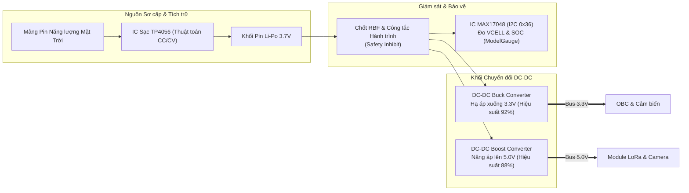

# Lab 2: Phân hệ Năng lượng (EPS) & Quản lý Nguồn Quỹ đạo

---

## 📖 Doc 2.1: Tổng quan Phân hệ Năng lượng EPS, Công nghệ Pin & Mạch Đo Dung Lượng MAX17048

### 1. Vai trò Sinh tồn của Phân hệ Năng lượng (EPS - Electrical Power System)
Phân hệ Năng lượng được ví như "Trái tim" của vệ tinh CubeSat. Trong không gian vũ trụ, nếu hệ thống năng lượng bị gián đoạn dù chỉ vài mili-giây, toàn bộ máy tính và tải trọng sẽ sập nguồn tức thì. EPS gánh vác các trọng trách cốt lõi:
- **Tích trữ Năng lượng Sơ cấp (Energy Storage):** Lưu trữ điện năng trong các cell pin hóa học để duy trì sự sống cho vệ tinh khi đi qua vùng tối của Trái Đất (Eclipse).
- **Quản lý Nạp Năng lượng Thông minh (Battery Charging):** Điều phối dòng sạc từ các tấm pin quang điện (Solar Panels) vào khối pin theo thuật toán an toàn, bảo vệ chống quá nạp hoặc quá nhiệt.
- **Biến đổi & Ổn định Điện áp (Power Conversion & Conditioning):** Chuyển đổi điện áp không ổn định của pin thành các đường bus điện áp sạch ($3.3\text{V}$ và $5.0\text{V}$) cung cấp cho các tải tiêu thụ.
- **Giám sát Năng lượng Thời gian thực (Fuel Gauging):** Đo đạc liên tục điện áp, dòng điện tiêu thụ và phần trăm dung lượng còn lại (State of Charge - SOC) để OBC ra quyết định sa thải phụ tải khi pin yếu.
- **Cơ chế Cách ly An toàn Phóng (Launch Safety Inhibit):** Đảm bảo vệ tinh hoàn toàn "chết điện" trong suốt quá trình phóng tên lửa cho tới khi được đẩy ra ngoài vũ trụ.



### 2. Đặc tính Hóa học và Vận hành của Pin Lithium Polymer (Li-Po)
Kit vệ tinh PTITCube sử dụng pin sạc **Lithium-ion Polymer (Li-Po)** dạng túi phẳng (Pouch Cell) với các đặc tính kỹ thuật quan trọng:
- **Điện áp Danh định (Nominal Voltage):** $3.7\text{V}$ trên mỗi cell.
- **Điện áp Sạc Đầy (Fully Charged Cut-off):** $4.20\text{V} \pm 0.05\text{V}$. Không bao giờ được sạc vượt quá $4.25\text{V}$ vì sẽ gây phân hủy chất điện phân, sinh khí áp suất cao làm phồng nổ pin.
- **Điện áp Xả Kiệt Nguy hiểm (Cut-off Threshold):** $3.00\text{V}$. Nếu xả dưới $2.7\text{V}$, cấu trúc tinh thể của các điện cực sẽ bị phá hủy vĩnh viễn (Dead Cell), pin không thể hồi phục dung lượng.
- **Đồ thị Phóng điện (Discharge Curve):** Đường cong điện áp xả của pin Li-Po rất dốc ở vùng 10% đầu ($4.2\text{V} \to 3.8\text{V}$), cực kỳ phẳng ở vùng 80% dung lượng trung tâm ($3.8\text{V} \to 3.65\text{V}$), và rơi tự do cắm đầu ở 10% cuối ($3.65\text{V} \to 3.0\text{V}$). Do đó, không thể ước lượng chính xác phần trăm dung lượng pin chỉ bằng cách đo điện áp tĩnh đơn thuần!

### 3. Thuật toán Sạc Chuẩn CC/CV với IC Sạc Chuyên Dụng TP4056
Khối nạp nguồn sử dụng vi mạch điều khiển sạc tuyến tính chuyên dụng **TP4056** thực hiện chu trình sạc hai giai đoạn hoàn hảo:
1. **Giai đoạn Dòng không đổi (Constant Current - CC):**
   - Khi pin có điện áp từ $3.0\text{V}$ đến dưới $4.2\text{V}$, mạch bơm một dòng điện sạc không đổi tối đa $I_\text{chg}$ vào pin.
   - Dòng sạc được thiết lập thông qua điện trở gắn ở chân `PROG` ($R_\text{prog}$) theo công thức của nhà sản xuất:
     $$I_\text{chg} = \frac{1200\text{ V}}{R_\text{prog}}$$
     Ví dụ: Với điện trở $R_\text{prog} = 1.2\text{ k}\Omega$, dòng nạp tối đa là $I_\text{chg} = 1000\text{ mA} = 1.0\text{ A}$.
2. **Giai đoạn Áp không đổi (Constant Voltage - CV):**
   - Khi điện áp pin đạt chính xác ngưỡng $4.20\text{V}$, mạch tự động chuyển sang chế độ áp không đổi, giữ điện áp ở mức $4.20\text{V}$ và để dòng điện giảm dần theo hàm mũ.
   - Khi dòng điện giảm xuống dưới $1/10$ dòng sạc định mức ($C/10 \approx 100\text{ mA}$), chip TP4056 ngắt sạc hoàn toàn, chân trạng thái `CHRG` tắt và chân `STDBY` bật sáng báo pin đầy.

### 4. Mạch Chuyển đổi Nguồn Chuyển mạch DC-DC Buck và Boost
Để cấp nguồn cho các phân hệ, bo mạch EPS tích hợp hai mạch ổn áp chuyển mạch (Switching Regulators) với hiệu suất vượt trội so với ổn áp tuyến tính LDO:
- **DC-DC Buck Converter (Hạ áp $V_\text{bat} \to 3.3\text{V}$):** Cung cấp dòng điện liên tục lên tới $2\text{A}$ cho OBC, bộ nhớ Flash và các cảm biến. Hiệu suất chuyển đổi đạt $\sim 92\%$, giảm thiểu tối đa tổn hao nhiệt sinh ra bên trong lòng vệ tinh.
- **DC-DC Boost Converter (Nâng áp $V_\text{bat} \to 5.0\text{V}$):** Khi điện áp pin xả xuống $3.4\text{V}$, mạch Boost vẫn duy trì điện áp $5.0\text{V}$ ổn định cấp nguồn cho tầng khuếch đại công suất phát sóng của module LoRa và module Camera.

### 5. IC Giám Sát Nhiên Liệu Pin MAX17048 qua Giao thức I2C
Trên bo EPS, chip **MAX17048** của hãng Maxim Integrated đo đạc liên tục dung lượng pin với độ chính xác cao:
- **Địa chỉ I2C Cố định:** `0x36` (dạng 7-bit).
- **Thuật toán Độc quyền ModelGauge:** Theo dõi hành vi động học của cell pin, liên tục bù trừ theo nhiệt độ và tốc độ xả để tính toán chính xác tỷ lệ phần trăm dung lượng pin còn lại (State of Charge - SOC) mà **không cần mắc điện trở Shunt nối tiếp gây suy hao dòng điện**.
- **Các Thanh ghi Trọng yếu:**
  - Thanh ghi Điện áp Cell (`VCELL` - Địa chỉ `0x02` và `0x03`): Giá trị 16-bit. Độ phân giải là $78.125\text{ }\mu\text{V}$ trên mỗi bit (tương đương $1.25\text{ mV} / 16\text{ LSB}$).
    $$V_\text{cell}\text{ (V)} = \text{RegValue} \times 0.000078125\text{ V}$$
  - Thanh ghi Tỷ lệ Dung lượng (`SOC` - Địa chỉ `0x04` và `0x05`): Giá trị 16-bit. Byte cao thể hiện phần nguyên phần trăm ($0 - 100\%$), byte thấp thể hiện phần thập phân với độ phân giải $1/256\% \approx 0.0039\%$.

---

### ❓ Câu Hỏi Củng Cố Kiến Thức (Doc 2.1)
1. **IC sạc chuyên dụng TP4056 thực hiện thuật toán nạp cho cell pin Li-Po 3.7V theo quy trình nào?**
   - A. Nạp xung gián đoạn tần số cao liên tục
   - B. Nạp xả luân phiên để chống chai điện cực
   - C. Nạp hai giai đoạn: Dòng không đổi (CC) rồi Áp không đổi (CV)
   - D. Tăng áp tuyến tính không giới hạn dòng nạp
   - *Đáp án:* **C**
   - *Giải thích:* TP4056 nạp dòng không đổi (Constant Current) đến khi điện áp đạt 4.2V, sau đó chuyển sang áp không đổi (Constant Voltage) cho tới khi dòng nạp giảm về ngưỡng ngắt an toàn.

2. **IC giám sát pin MAX17048 giao tiếp với vi điều khiển OBC qua giao thức nào và tại địa chỉ I2C mặc định nào?**
   - A. Giao thức I2C tại địa chỉ 0x36
   - B. Giao tiếp SPI tại địa chỉ 0x68
   - C. Cổng UART2 ở tốc độ 9600 baud
   - D. Giao tiếp 1-Wire tại địa chỉ 0x1A
   - *Đáp án:* **A**
   - *Giải thích:* MAX17048 sử dụng giao thức I2C với địa chỉ 7-bit cố định là 0x36 để cung cấp số đo điện áp cell pin và tỷ lệ phần trăm dung lượng (SOC).

---

## 📖 Doc 2.2: Quản lý Rủi ro Sụt áp (Brownout), Cơ chế Ngắt An toàn Phóng & Điều Khiển Mạch Hạ Áp Cấp Nguồn Cảm Biến

### 1. Cơ chế Ngắt An toàn Phóng (Safety Inhibits)
Để được các cơ quan hàng không vũ trụ (NASA, JAXA, ESA) cấp phép đưa lên tên lửa đẩy, vệ tinh bắt buộc phải có tối thiểu 2 cơ chế ngắt nguồn độc lập nhằm bảo đảm an toàn tuyệt đối cho tên lửa mẹ:
1. **Chốt Rút Trước Giờ Bay (Remove-Before-Flight - RBF Pin):**
   - Một chốt cơ khí cách điện được cắm xuyên qua vỏ vệ tinh, ngắt đường nguồn chính của pin.
   - Khi chuẩn bị đưa vệ tinh vào ống phóng tại bãi phóng, kỹ sư thao tác rút chốt này ra. Dải cờ đỏ rực rỡ "REMOVE BEFORE FLIGHT" gắn liền với chốt giúp kiểm tra trực quan, loại bỏ nguy cơ quên kích hoạt.
2. **Công tắc Hành trình Chân Ray (Deployment / Separation Switch):**
   - Bố trí ở đầu mút của thanh ray dẫn hướng.
   - Khi vệ tinh được trượt vào trong lòng ống phóng P-POD, cần gạt công tắc bị nén chặt xuống bởi thành ống phóng, giữ tiếp điểm ở trạng thái ngắt mạch điện.
   - Khi cửa P-POD mở và lò xo đẩy vệ tinh bay ra ngoài không gian, cần gạt bật bung ra, đóng tiếp điểm cấp điện toàn bộ hệ thống EPS.

### 2. Hiện tượng Sụt áp Nguồn (Brownout) & Cơ chế Bảo vệ Của ESP32
Khi tải tiêu thụ đột ngột đòi hỏi dòng điện lớn (như khi module LoRa bắt đầu phát sóng công suất cao hoặc module Camera nạp tụ), nội trở của pin và điện cảm đường mạch sẽ gây ra hiện tượng sụt áp tức thời (Voltage Sag):
- Nếu điện áp cấp cho vi điều khiển sụt xuống dưới ngưỡng an toàn tối thiểu (thường là $2.7\text{V}$), CPU sẽ thực thi sai tập lệnh, bộ nhớ Flash có thể bị ghi đè dữ liệu rác làm hỏng hệ điều hành.
- **Mạch Phát hiện Sụt áp Phần cứng (Brownout Detector - BOD):** Tích hợp bên trong ESP32, liên tục so sánh điện áp nguồn $V_{\text{dd}}$ với các mức ngưỡng tham chiếu. Khi phát hiện điện áp tụt dưới ngưỡng định sẵn, BOD kích hoạt tín hiệu Reset khẩn cấp bằng phần cứng để bảo vệ vi xử lý khỏi trạng thái bất định.
- **Biện pháp Khắc phục Phần cứng:** Bố trí các tụ điện hóa Tantalum dung lượng lớn ($100\mu\text{F} - 470\mu\text{F}$) có nội trở ESR cực thấp ngay sát chân nguồn của module phát sóng và camera để xả năng lượng bù đắp cho các đỉnh dòng tức thời.

### 3. Nguyên Lý Điều Khiển Mạch Hạ Áp (Buck Converter) & Kỹ Thuật Power Gating Tiết Kiệm Năng Lượng
Trong một vệ tinh CubeSat, việc duy trì cấp nguồn liên tục cho toàn bộ các mạch tải ngoại vi là nguyên nhân hàng đầu gây hao tổn dung lượng pin do dòng tĩnh (Quiescent Current) và dòng rò vi mạch.
- **Đầu ra Mạch Hạ Áp Cấp Nguồn Cho Tải Ngoại Vi:** Trên bo mạch EPS, đầu ra của mạch hạ áp DC-DC Buck Converter chịu trách nhiệm cung cấp đường nguồn $3.3\text{V}$ sạch riêng biệt cho toàn bộ cụm tải tiêu thụ ngoại vi.
- **Kỹ thuật Cắt Nguồn Phân Hệ (Power Gating):** Trên bo mạch phân hệ nguồn EPS, đường tín hiệu điều khiển dòng điện đi vào mạch hạ áp hoạt động theo logic phần cứng:
  - **Mức 1 (`HIGH`):** Ngắt dòng điện đi vào mạch hạ áp $\rightarrow$ Cắt toàn bộ nguồn cấp cho tải ngoại vi, đưa dòng tiêu thụ của khối tải về $0\text{ mA}$ trong thời gian nghỉ.
  - **Mức 0 (`LOW`):** Cho phép dòng điện đi vào mạch hạ áp $\rightarrow$ Kích hoạt mạch hạ áp cấp nguồn $3.3\text{V}$ ổn định cho tải tiêu thụ.
  - *Thời gian ổn định nguồn:* Sau khi kích hoạt mức 0 để cho phép dòng vào hạ áp, cần chờ một khoảng trễ nhỏ ($50\text{ ms} - 100\text{ ms}$) để điện áp ngõ ra mạch hạ áp đạt trạng thái cân bằng và tụ nguồn nạp đầy trước khi tải bắt đầu làm việc.
  - *Hoạt động & Ngắt nguồn:* Sau khi hoàn tất chu kỳ làm việc, vi điều khiển lập tức xuất mức 1 để ngắt dòng vào mạch hạ áp, bảo toàn tối đa dung lượng pin.
- **Hiệu quả Tiết kiệm Năng lượng (Duty Cycling):**
  - Giả sử tổng dòng tiêu thụ của khối tải ngoại vi khi hoạt động là $25\text{ mA}$.
  - Nếu bật liên tục trong 1 chu kỳ quỹ đạo 95 phút, năng lượng tiêu thụ là:
    $$E_{\text{continuous}} = 3.3\text{ V} \times 25\text{ mA} \times 1.583\text{ h} \approx 130.6\text{ mWh}$$
  - Nếu chỉ bật 1.5 giây mỗi 6.5 giây (chu kỳ hoạt động với Duty Cycle $\approx 23\%$):
    $$E_{\text{gating}} \approx 130.6\text{ mWh} \times 0.23 \approx 30.0\text{ mWh}$$
  - Kỹ thuật điều khiển dòng mạch hạ áp giúp giảm thiểu tới **$77\%$** lượng điện năng tiêu hao của tải ngoại vi, kéo dài tuổi thọ của pin trong pha bóng tối Trái Đất (Eclipse).

---

### ❓ Câu Hỏi Củng Cố Kiến Thức (Doc 2.2)
1. **Chức năng an toàn bắt buộc của công tắc RBF (Remove Before Flight) hoặc Release Switch trên phân hệ EPS là gì?**
   - A. Tự động xả cạn năng lượng pin trước khi đưa lên quỹ đạo
   - B. Kích hoạt chế độ truyền dữ liệu công suất cực đại
   - C. Chuyển đổi qua lại giữa pin chính và pin dự phòng
   - D. Ngắt hoàn toàn nguồn điện khi vệ tinh nằm trong ống phóng
   - *Đáp án:* **D**
   - *Giải thích:* Quy chuẩn an toàn phóng đòi hỏi toàn bộ hệ thống điện vệ tinh phải bị cô lập hoàn toàn khi còn nằm trong ống phóng Pod, chỉ kích hoạt khi công tắc cơ học bung ra sau khi tách tầng.

2. **Trên bo mạch EPS, vai trò cốt lõi của mạch hạ áp DC-DC Buck Converter là gì?**
   - A. Chuyển điện áp một chiều DC thành xoay chiều AC
   - B. Ổn định điện áp 3.3V cấp cho vi xử lý với hiệu suất cao
   - C. Tăng điện áp pin từ 3.7V lên 12V để nạp nhanh
   - D. Đo đạc dòng điện rò rỉ của khung sườn cơ học
   - *Đáp án:* **B**
   - *Giải thích:* Mạch Buck Converter biến đổi điện áp biến thiên của pin (3.0V - 4.2V) xuống mức ổn định 3.3V cấp cho OBC và cảm biến với hiệu suất chuyển đổi vượt trội (>90%) so với IC tuyến tính.

---

## 💻 Hướng Dẫn Thực Hành: Lập Trình Giám Sát Phân Hệ Nguồn EPS

### 1. Kỹ thuật Đọc Thanh Ghi I2C Thuần trên Chip MAX17048
Chương trình C++ giao tiếp trực tiếp với các thanh ghi nội của MAX17048 thông qua thư viện `Wire.h`:

```cpp
#include <Wire.h>

#define MAX17048_ADDR 0x36
#define REG_VCELL      0x02
#define REG_SOC        0x04

float readBatteryVoltage() {
    Wire.beginTransmission(MAX17048_ADDR);
    Wire.write(REG_VCELL); // Trỏ tới thanh ghi VCELL
    if (Wire.endTransmission(false) != 0) return -1.0f; // Báo lỗi truyền tin

    Wire.requestFrom(MAX17048_ADDR, 2); // Yêu cầu 2 byte dữ liệu
    if (Wire.available() == 2) {
        uint8_t msb = Wire.read();
        uint8_t lsb = Wire.read();
        uint16_t raw = (msb << 8) | lsb;
        // Mỗi LSB tương ứng với 78.125 uV (1.25mV / 16)
        return (float)raw * 0.000078125f;
    }
    return -1.0f;
}

float readBatterySOC() {
    Wire.beginTransmission(MAX17048_ADDR);
    Wire.write(REG_SOC); // Trỏ tới thanh ghi SOC
    if (Wire.endTransmission(false) != 0) return -1.0f;

    Wire.requestFrom(MAX17048_ADDR, 2);
    if (Wire.available() == 2) {
        uint8_t msb = Wire.read();
        uint8_t lsb = Wire.read();
        // Byte cao là phần nguyên %, byte thấp là phần thập phân chia 256
        return (float)msb + ((float)lsb / 256.0f);
    }
    return -1.0f;
}
```

### 2. Danh mục Bài Thực hành Lab 2
- `Lab2-01a_Battery_I2C`: Thực hành lập trình đọc trực tiếp thanh ghi điện áp `VCELL` và dung lượng `SOC` từ IC MAX17048 qua giao tiếp I2C thuần.
- `Lab2-01b_Battery_Library`: Khởi tạo và quản lý phân hệ nguồn EPS thông qua lớp đối tượng đóng gói cấp cao của thư viện PTITCube, in báo cáo định kỳ ra Serial Monitor.
- `Lab2-02_Power_Saving`: Lập trình điều khiển bật/tắt dòng ra vào mạch hạ áp (Buck Converter) cấp nguồn tải ngoại vi (Mức 0: cấp nguồn tải, Mức 1: ngắt nguồn) theo chu kỳ (Power Gating), tối ưu hóa dòng tiêu thụ trên quỹ đạo.

### ❓ Câu Hỏi Đánh Giá Kỹ Năng Thực Hành (Lab 2)
1. **Công thức chuyển đổi giá trị thô 16-bit đọc từ thanh ghi VCELL (0x02) của MAX17048 sang điện áp thực tế (Volt) là:**
   - A. $V = 	ext{raw} 	imes 78.125 mu	ext{V} / 1000000$
   - B. $V = 	ext{raw} 	imes 1.25	ext{ mV}$
   - C. $V = 	ext{raw} / 1024.0$
   - D. $V = 	ext{raw} 	imes 3.3 / 4096.0$
   - *Đáp án:* **A**
   - *Giải thích:* Theo datasheet của MAX17048, mỗi LSB của thanh ghi VCELL tương ứng với $78.125 mu	ext{V}$ (hoặc nhân với 1.25mV cho 16 LSB sau khi dịch 4 bit).

2. **Khi điện áp pin sụt giảm dưới ngưỡng an toàn (ví dụ 3.4V), phần mềm bay trên OBC cần thực hiện hành động khẩn cấp nào?**
   - A. Tăng công suất phát sóng vô tuyến để gửi cầu cứu
   - B. Ghi đè toàn bộ dữ liệu thẻ nhớ để giải phóng bộ nhớ
   - C. Ngắt tải ngoại vi và chuyển hệ thống sang chế độ Sleep tiết kiệm điện
   - D. Khởi động lại liên tục để phục hồi dung lượng pin
   - *Đáp án:* **C**
   - *Giải thích:* Để tránh làm chai pin hoặc kích hoạt mạch bảo vệ Undervoltage Lockout, OBC phải ngắt các cảm biến tiêu thụ điện lớn và chuyển vi xử lý về chế độ tiết kiệm năng lượng.
