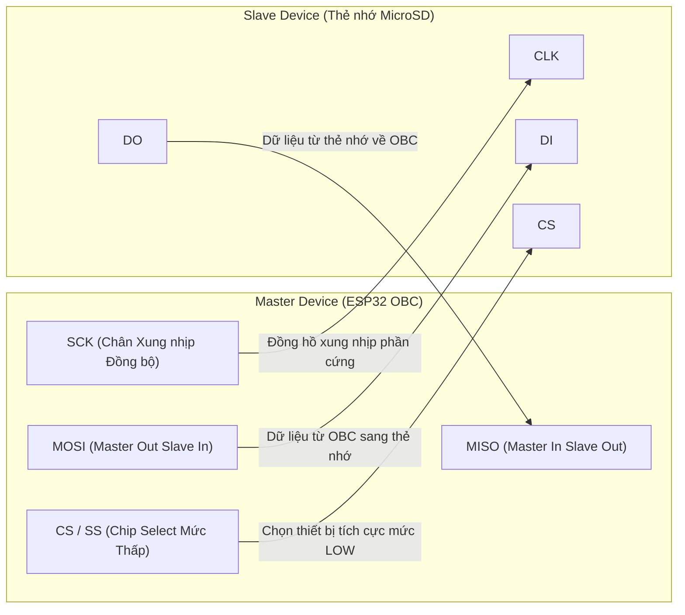
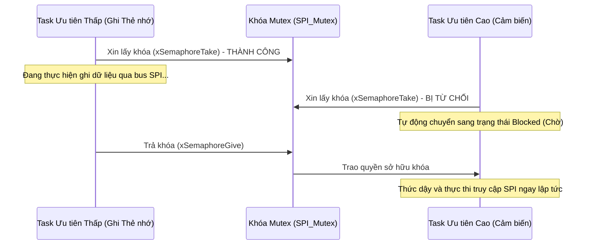
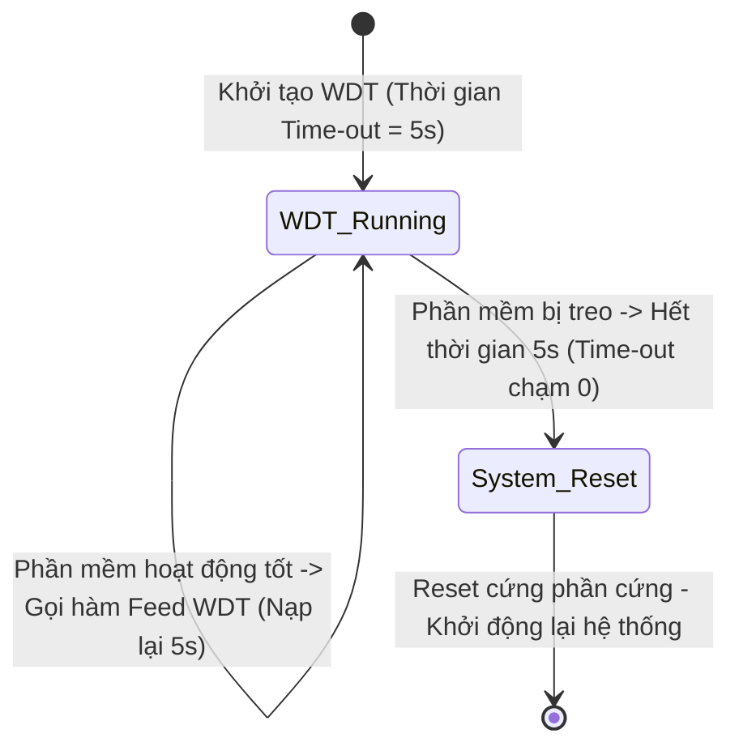

# Lab 3: Xử lý Dữ liệu và Lệnh (C&DH) & Hệ thống Lưu trữ Hộp Đen

---

## 📖 Doc 3.1: Giao thức Giao tiếp SPI Tốc độ cao & Kiến trúc Hệ thống Tập tin FAT32 trên Thẻ MicroSD

### 1. Vai trò của Phân hệ C&DH và Hệ thống Hộp Đen (Black Box Storage)
Phân hệ Xử lý Dữ liệu và Lệnh (**Command and Data Handling - C&DH**) là xương sống luân chuyển thông tin của vệ tinh CubeSat. Trong một vòng quỹ đạo kéo dài 95 phút, vệ tinh chỉ có khoảng thời gian kết nối với trạm mặt đất từ 8 đến 12 phút (Ground Pass). Trong suốt hơn 80 phút còn lại, vệ tinh hoàn toàn cô độc ngoài vùng phủ sóng. Phân hệ C&DH phải đảm đương:
- **Lưu trữ dữ liệu viễn trắc liên tục:** Ghi lại toàn bộ hành trình điện áp, dòng điện, nhiệt độ, tư thế quán tính và tọa độ vào thẻ nhớ MicroSD.
- **Lưu trữ tệp dữ liệu sứ mệnh:** Lưu giữ các tệp ảnh chụp Trái Đất và số liệu quan trắc khoa học để sẵn sàng trút dữ liệu (Data Dump) khi bay qua trạm mặt đất.
- **Nhật ký sự kiện (Flight Event Log):** Ghi lại chi tiết thời điểm xuất hiện các cảnh báo bất thường, lỗi vi xử lý, và các lần phục hồi hệ thống.



### 2. Giao thức Truyền thông Đồng bộ SPI (Serial Peripheral Interface)
Chuẩn giao tiếp **SPI** là một bus truyền thông nối tiếp đồng bộ 4 dây, hoạt động theo mô hình Master-Slave ở chế độ song công toàn phần (Full-duplex):
- **4 Đường tín hiệu Vật lý:**
  - **SCLK / SCK (Serial Clock):** Do Master tạo ra để đồng bộ hóa việc dịch từng bit dữ liệu. Tần số xung nhịp có thể lên tới $20\text{ MHz} - 40\text{ MHz}$, mang lại tốc độ truyền dữ liệu vượt trội so với I2C.
  - **MOSI (Master Out Slave In):** Đường dữ liệu từ vi điều khiển Master gửi sang thiết bị Slave.
  - **MISO (Master In Slave Out):** Đường dữ liệu từ thiết bị Slave trả về Master.
  - **CS / SS (Chip Select / Slave Select):** Đường tín hiệu chọn chip tích cực ở mức logic `LOW`. Mỗi thiết bị Slave trên cùng đường bus cần một chân CS riêng biệt.
- **4 Chế độ Hoạt động SPI (SPI Modes 0, 1, 2, 3):**
  Xác định bởi hai thông số cấu hình: Cực tính xung nhịp (**CPOL - Clock Polarity**) và Pha xung nhịp (**CPHA - Clock Phase**):
  - **Mode 0 (CPOL=0, CPHA=0):** Xung nhịp ở mức `LOW` khi rảnh rỗi. Dữ liệu được lấy mẫu (Sample) ở cạnh lên đầu tiên và dịch chuyển (Shift) ở cạnh xuống tiếp theo. Thẻ nhớ MicroSD tiêu chuẩn vận hành ở chế độ này.
  - **Mode 1 (CPOL=0, CPHA=1):** Xung nhịp rảnh ở mức `LOW`. Dữ liệu được dịch chuyển ở cạnh lên và lấy mẫu ở cạnh xuống.
  - **Mode 2 (CPOL=1, CPHA=0):** Xung nhịp rảnh ở mức `HIGH`. Dữ liệu được lấy mẫu ở cạnh xuống và dịch chuyển ở cạnh lên.
  - **Mode 3 (CPOL=1, CPHA=1):** Xung nhịp rảnh ở mức `HIGH`. Dữ liệu được dịch chuyển ở cạnh xuống và lấy mẫu ở cạnh lên.

### 3. Cấu trúc Vật lý Thẻ Nhớ & Hệ thống Tập tin FAT32
- **Tổ chức Vật lý Thẻ Nhớ:** Bộ nhớ Flash NAND của thẻ nhớ MicroSD không thể ghi từng byte đơn lẻ mà được phân chia thành các cung từ vật lý (**Sectors**) có kích thước cố định là $512\text{ bytes}$. Thư viện phần mềm gom nhiều Sector thành một khối cấp phát dữ liệu (**Cluster**).
- **Cơ chế Đệm Dữ liệu RAM (RAM Buffer Cache):** Khi chương trình thực hiện lệnh `file.print()` hoặc `file.write()`, các byte dữ liệu thực chất chỉ mới được ghi tạm vào mảng đệm nội bộ $512\text{ bytes}$ trên bộ nhớ RAM của ESP32. Chỉ khi mảng đệm này đầy đủ 512 bytes, phần cứng mới phát lệnh SPI đẩy toàn bộ Sector xuống thẻ nhớ.
- **Tầm quan trọng Cốt tử của hàm `file.flush()` và `file.close()`:**
  - Nếu vệ tinh bất ngờ bị sụt áp (Brownout) hoặc bị reset bởi chó canh trong khi mảng đệm RAM chưa đầy 512 bytes, toàn bộ số liệu đo đạc gần nhất sẽ biến mất hoàn toàn!
  - Thậm chí nghiêm trọng hơn: Bảng phân bổ tệp (**File Allocation Table - FAT**) chưa kịp cập nhật kích thước tệp mới sẽ khiến tệp tin bị hỏng (File Corruption) và không thể đọc lại.
  - **Quy tắc Bắt buộc:** Sau mỗi chu kỳ ghi dữ liệu định kỳ, phần mềm bay bắt buộc phải gọi hàm `file.flush()` để ép buộc vi điều khiển xả sạch bộ đệm RAM xuống ô nhớ vật lý của thẻ nhớ ngay lập tức.

---

### ❓ Câu Hỏi Củng Cố Kiến Thức (Doc 3.1)
1. **Bus giao tiếp SPI 4 dây chuẩn kết nối thẻ nhớ MicroSD trên kit OBC bao gồm các chân tín hiệu nào?**
   - A. SDA, SCL, INT, RST
   - B. TX (GPIO 16), RX (GPIO 17), CTS, RTS
   - C. CS (GPIO 13), SCK (GPIO 18), MISO (GPIO 19), MOSI (GPIO 23)
   - D. D0, D1, D2, CLK
   - *Đáp án:* **C**
   - *Giải thích:* Bus SPI phần cứng kết nối thẻ nhớ MicroSD sử dụng CS=13, SCK=18, MISO=19, MOSI=23 với định dạng hệ thống tệp FAT32.

2. **Khi ghi dữ liệu viễn trắc vào thẻ MicroSD, tại sao sau khi gọi `dataFile.println()` bắt buộc phải gọi `dataFile.flush()`?**
   - A. Để đẩy dữ liệu từ đệm RAM xuống thẻ nhớ vật lý ngay lập tức
   - B. Để xóa sạch toàn bộ nội dung vừa ghi
   - C. Để đóng tệp tin và giải phóng con trỏ bộ nhớ
   - D. Để chuyển đổi định dạng tệp tin từ nhị phân sang văn bản
   - *Đáp án:* **A**
   - *Giải thích:* Thư viện SD sử dụng bộ đệm 512 byte trong RAM; hàm flush() bảo đảm dữ liệu được đẩy xuống thẻ flash, tránh mất mát khi mất nguồn đột ngột.

---

## 📖 Doc 3.2: Kiến trúc Hệ thống Lệnh Shell CLI & Tổng quan Hệ Điều Hành trong Vệ Tinh

### 1. Kiến trúc Giao diện Dòng lệnh Shell CLI (Command Line Interface)
Để phục vụ việc kiểm thử, vận hành và trút dữ liệu từ trạm mặt đất, phân hệ C&DH cài đặt một bộ phân tích cú pháp dòng lệnh tương tự hệ điều hành Linux thông qua cổng nối tiếp UART:
- **`ls` (List Directory):** Duyệt cây thư mục trên thẻ MicroSD, liệt kê tên tệp, ngày giờ tạo và dung lượng tệp tin (bytes).
- **`cat <filename>` (Concatenate / Read):** Mở tệp tin nhật ký và in toàn bộ nội dung dạng chuỗi ASCII ra màn hình Serial Monitor.
- **`rm <filename>` (Remove):** Xóa bỏ một tệp tin dữ liệu cũ trên thẻ nhớ để giải phóng không gian lưu trữ.
- **`df` (Disk Free):** Tính toán và in ra tổng dung lượng của thẻ nhớ, dung lượng đã sử dụng và dung lượng còn trống.
- **`reboot`:** Kích hoạt phần mềm khởi động lại toàn bộ hệ thống bằng lệnh `ESP.restart()`.

### 2. Tổng quan Hệ Điều Hành: Tuần Tự (Super-Loop) vs Đa Nhiệm Thời Gian Thực (RTOS)
Trong các dự án nhúng đơn giản, kỹ sư thường sử dụng kiến trúc vòng lặp tuần tự (Bare-metal Super-Loop). Tuy nhiên, trên một vệ tinh không gian hiện đại, khối lượng công việc đòi hỏi phải chuyển sang sử dụng Hệ điều hành Thời gian thực (**Real-Time Operating System - RTOS**):

| Tiêu chí So sánh | Vòng lặp Tuần tự (Super-Loop) | Hệ điều hành Thời gian thực (FreeRTOS) |
| :--- | :--- | :--- |
| **Cơ chế Thực thi** | Thực hiện tuần tự từng hàm trong `loop()`, hết việc này đến việc khác | Đa nhiệm giả lập (Multitasking) phân chia thời gian CPU cho nhiều tác vụ độc lập |
| **Đáp ứng Sự kiện Khẩn cấp** | Chậm chạp, phụ thuộc vào thời gian hoàn thành của các hàm trước đó | Tức thời, tác vụ ưu tiên cao có quyền ngắt ngang (Preempt) tác vụ ưu tiên thấp |
| **Quản lý Bộ nhớ** | Toàn bộ chương trình dùng chung một ngăn xếp Stack duy nhất | Mỗi tác vụ (Task) được cấp phát một vùng ngăn xếp bộ nhớ riêng biệt |
| **Độ phức tạp Thiết kế** | Dễ viết nhưng khó bảo trì và mở rộng quy mô khi hệ thống lớn | Phức tạp hơn, đòi hỏi cơ chế đồng bộ hóa an toàn (Mutex, Queue, Semaphore) |

### 3. Cấu trúc Tác vụ (Task) & Bộ Điều phối Chiếm trước (Preemptive Scheduler)
- **Tác vụ (Task):** Mỗi chức năng độc lập của vệ tinh được đóng gói thành một luồng thực thi vô tận (ví dụ: `TaskTelemetry`, `TaskSensors`, `TaskCommand`, `TaskStorage`).
- **Mức Ưu tiên (Priority):** Mỗi tác vụ được gán một con số ưu tiên (từ 0 đến $N-1$). Con số càng lớn, độ ưu tiên càng cao.
- **Bộ điều phối Chiếm trước (Preemptive Scheduler):** Cứ sau mỗi chu kỳ nhịp tích tắc hệ thống (System Tick, thường là $1\text{ ms}$), bộ điều phối kiểm tra danh sách các tác vụ sẵn sàng. Tác vụ nào có mức ưu tiên cao nhất sẽ giành quyền sở hữu CPU ngay lập tức.

---

### ❓ Câu Hỏi Củng Cố Kiến Thức (Doc 3.2)
1. **Bộ phân tích cú pháp dòng lệnh Shell CLI trên vệ tinh đóng vai trò then chốt nào trong quản trị hệ thống?**
   - A. Thay thế hoàn toàn hệ điều hành thời gian thực
   - B. Tăng tốc độ ghi dữ liệu nhị phân lên thẻ MicroSD
   - C. Tự động điều chỉnh góc quay hướng tấm pin mặt trời
   - D. Cung cấp giao diện tương tác thực thi lệnh chẩn đoán và quản lý tệp tin
   - *Đáp án:* **D**
   - *Giải thích:* CLI cho phép kỹ sư mặt đất hoặc môi trường thử nghiệm nhập các lệnh tiêu chuẩn (ls, cat, rm, status) để kiểm tra tình trạng vệ tinh một cách trực quan.

2. **Kiến trúc phần mềm bay Command-Centric Architecture (C2A) vận hành theo nguyên lý nào?**
   - A. Mọi cảm biến đều tự ghi thẳng vào thẻ nhớ không qua CPU
   - B. Toàn bộ tiến trình và hành vi của vệ tinh đều quy về xử lý lệnh
   - C. Chỉ duy nhất một tác vụ chạy liên tục từ lúc phóng
   - D. Cấm sửa đổi cấu hình logic sau khi phóng lên quỹ đạo
   - *Đáp án:* **B**
   - *Giải thích:* C2A coi mọi hành động của vệ tinh là phản hồi đối với các lệnh (Commands) nội bộ hoặc từ trạm đất, giúp mã nguồn module hóa cao và dễ dàng tái cấu hình trên quỹ đạo.

---

## 📖 Doc 3.3: Tranh Chấp Tài Nguyên, Cơ Chế Khóa Bảo Vệ & Kỹ Thuật Ngăn Ngừa Deadlock

### 1. Hiện tượng Tranh chấp Tài nguyên (Race Condition)
Khi hệ thống chạy đa tác vụ, các tài nguyên phần cứng duy nhất (như bus SPI của thẻ nhớ, cổng Serial Monitor, bus I2C) trở thành **Tài nguyên Dùng chung (Shared Resources)**:
- Nếu `TaskTelemetry` đang mở tệp và ghi dở 50 byte đầu tiên thì bị `TaskCommand` có độ ưu tiên cao hơn chiếm quyền CPU và cũng nhảy vào ghi tệp trên cùng thẻ nhớ qua bus SPI, dữ liệu của hai tác vụ sẽ bị trộn lẫn vào nhau gây lỗi vỡ khung tệp tin nghiêm trọng.

### 2. Khóa Loại trừ Tương hỗ Mutex (Mutual Exclusion)
Để bảo vệ tài nguyên dùng chung, FreeRTOS cung cấp cơ chế khóa **Mutex** (`SemaphoreHandle_t`):
- Quy tắc: "Ai giữ chìa khóa thì mới được vào phòng".
- Trước khi truy cập thẻ nhớ hoặc bus SPI, tác vụ bắt buộc phải gọi hàm xin khóa: `xSemaphoreTake(xSPIMutex, portMAX_DELAY)`.
- Sau khi hoàn thành việc ghi dữ liệu, tác vụ bắt buộc phải nhả khóa: `xSemaphoreGive(xSPIMutex)`.
- Các tác vụ khác muốn truy cập tài nguyên trong thời gian này sẽ tự động chuyển sang trạng thái chờ (Blocked), giải phóng chu kỳ CPU cho các công việc khác.



### 3. Vấn đề Nghịch đảo Mức Ưu tiên (Priority Inversion) & Cơ chế Thừa kế Ưu tiên (Priority Inheritance)
- **Sự cố Lịch sử Mars Pathfinder (1997):** Tàu đổ bộ Sao Hỏa liên tục bị reset phần mềm bí ẩn giữa sa mạc Sao Hỏa do một lỗi thiết kế RTOS kinh điển:
  - Tác vụ ưu tiên thấp giữ khóa tài nguyên chung.
  - Tác vụ ưu tiên cao cần tài nguyên nên bị chặn lại chờ đợi.
  - Một tác vụ ưu tiên trung bình (không cần tài nguyên đó) bất ngờ thức dậy và chiếm quyền CPU suốt một thời gian dài, gián tiếp ngăn không cho tác vụ ưu tiên thấp nhả khóa, khiến tác vụ ưu tiên cao bị "bỏ đói" (Starvation) dẫn tới vi phạm deadline khẩn cấp.
- **Giải pháp Thừa kế Ưu tiên (Priority Inheritance):** Khi tác vụ ưu tiên cao bị chặn bởi một Mutex do tác vụ ưu tiên thấp nắm giữ, hệ điều hành tạm thời **nâng mức ưu tiên của tác vụ thấp lên ngang bằng với tác vụ cao**, giúp nó nhanh chóng hoàn thành công việc và nhả khóa, sau đó trả lại mức ưu tiên ban đầu.

### 4. Hiện tượng Bế tắc (Deadlock / Deadly Embrace)
Xảy ra khi hai tác vụ cùng chờ tài nguyên mà tác vụ kia đang nắm giữ:
- `Task 1` đang giữ khóa Mutex A và muốn lấy khóa Mutex B.
- `Task 2` đang giữ khóa Mutex B và muốn lấy khóa Mutex A.
- Hậu quả: Cả hai tác vụ bị treo vĩnh viễn, kéo sập hệ điều hành.
- **Quy tắc Phòng ngừa:** Luôn luôn chiếm giữ các khóa theo một thứ tự phân cấp cố định trong toàn bộ dự án phần mềm.

---

### ❓ Câu Hỏi Củng Cố Kiến Thức (Doc 3.3)
1. **Trong hệ điều hành FreeRTOS, cơ chế Khóa Mutex (Mutual Exclusion) được áp dụng nhằm mục đích gì?**
   - A. Ngăn chặn hiện tượng tranh chấp tài nguyên dùng chung giữa các tác vụ
   - B. Tăng xung nhịp xử lý của lõi vi điều khiển
   - C. Tự động xóa các tác vụ bị lỗi khỏi danh sách chờ
   - D. Hạ điện áp cấp cho các cảm biến ngoại vi
   - *Đáp án:* **A**
   - *Giải thích:* Mutex đảm bảo tại một thời điểm chỉ có một tác vụ duy nhất được phép truy cập tài nguyên phần cứng chia sẻ (như bus SPI hay cổng console `cdh`), tránh làm sai lệch dữ liệu.

2. **Hiện tượng nghịch đảo độ ưu tiên (Priority Inversion) trong hệ thống thời gian thực được khắc phục bằng kỹ thuật nào?**
   - A. Chuyển sang mô hình vòng lặp đơn tuần tự
   - B. Xóa bỏ hoàn toàn các tác vụ có mức ưu tiên thấp
   - C. Kế thừa độ ưu tiên (Priority Inheritance)
   - D. Giảm tần số xung nhịp của CPU
   - *Đáp án:* **C**
   - *Giải thích:* Khi tác vụ ưu tiên thấp giữ Mutex mà tác vụ ưu tiên cao đang cần, hệ thống tạm thời nâng mức ưu tiên của tác vụ giữ khóa lên bằng tác vụ chờ để nó giải phóng tài nguyên nhanh nhất.

---

## 📖 Doc 3.4: Bộ Định Thời Giám Sát Phần Cứng Watchdog Timer (WDT) & Kiến Trúc Tự Phục Hồi FDIR

### 1. Nguyên lý Hoạt động của Bộ định thời Chó Canh Watchdog (WDT)
Trong môi trường bức xạ quỹ đạo LEO, các hạt ion mang điện tích năng lượng cao có thể gây hiện tượng lật bit dữ liệu ngẫu nhiên (Single Event Upset - SEU), làm con trỏ chương trình (Program Counter) nhảy vào vùng nhớ rác khiến vi điều khiển bị treo cứng hoàn toàn:
- **Watchdog Timer (WDT)** là một mạch đếm lùi phần cứng độc lập với CPU, hoạt động nhờ nguồn xung nhịp xung nội riêng biệt.
- Khi khởi tạo, WDT được nạp một khoảng thời gian giới hạn (ví dụ: $5000\text{ ms}$). Mạch đếm liên tục giảm giá trị về $0$.
- Trong điều kiện hoạt động bình thường, phần mềm bay định kỳ thực hiện thao tác **"Đá chó canh" (Pat the Dog / Feed Watchdog / Reset WDT)** để nạp lại giá trị ban đầu cho bộ đếm.
- Nếu phần mềm bị treo hoặc rơi vào vòng lặp vô tận, thao tác đá chó canh không được thực hiện. Bộ đếm chạm mức $0$, ngay lập tức kéo chân Reset phần cứng của vi điều khiển xuống mức thấp, ép buộc toàn bộ hệ thống khởi động lại sạch sẽ.



### 2. Hai Phân Cấp Chó Canh trong ESP32
1. **Hardware Interrupt Watchdog (IWDT):** Giám sát ở cấp độ vi xử lý phần cứng cấp thấp. Nếu một ngắt (Interrupt Handler) chạy quá lâu hoặc CPU bị khóa hoàn toàn, IWDT kích hoạt.
2. **Task Watchdog Timer (TWDT):** Giám sát ở cấp độ hệ điều hành FreeRTOS. Từng tác vụ riêng lẻ phải đăng ký với TWDT (`esp_task_wdt_add(NULL)`). Nếu bất kỳ tác vụ quan trọng nào bị kẹt và không gọi hàm `esp_task_wdt_reset()` trong khoảng thời gian cấu hình, TWDT sẽ in báo cáo lỗi ngăn xếp và reset hệ thống.

---

### ❓ Câu Hỏi Củng Cố Kiến Thức (Doc 3.4)
1. **Bộ định thời giám sát Task Watchdog Timer (TWDT) trên ESP32 sẽ tự động thực hiện hành động gì nếu một tác vụ bị treo?**
   - A. Tự động ngắt kết nối WiFi và Bluetooth
   - B. Kích hoạt Reset phần cứng toàn bộ vi điều khiển
   - C. Xóa sạch dữ liệu trên thẻ nhớ ngoài
   - D. Chuyển vi điều khiển về chế độ nạp Bootloader
   - *Đáp án:* **B**
   - *Giải thích:* Nếu tác vụ không kịp "nuôi chó" (feed/reset TWDT) trước khi bộ đếm thời gian hết hạn (timeout), TWDT sẽ kích hoạt tín hiệu Reset vi xử lý để phục hồi hệ thống khỏi trạng thái treo.

2. **Quy trình FDIR (Fault Detection, Isolation, and Recovery) trong thiết kế phần mềm vệ tinh là:**
   - A. Quy trình kiểm tra lỗi cơ học trước khi phóng
   - B. Thuật toán định vị quỹ đạo vệ tinh dựa trên GNSS
   - C. Giao thức nén ảnh viễn thám không gian
   - D. Cơ chế tự động phát hiện, cô lập lỗi và tái khởi động phục hồi hệ thống
   - *Đáp án:* **D**
   - *Giải thích:* FDIR là triết lý an toàn không gian cho phép vệ tinh tự chẩn đoán lỗi phần cứng/phần mềm, cô lập phân hệ hỏng và chuyển sang trạng thái an toàn (Safe Mode) để tự phục hồi.

---

## 💻 Hướng Dẫn Thực Hành: Xây Dựng Hệ Thống Lưu Trữ Dữ Liệu & Thao Tác Thẻ Nhớ

### 1. Kỹ thuật Đọc/Ghi Thẻ Nhớ An Toàn với `flush()`
Đoạn mã C++ minh họa chu trình ghi dữ liệu cảm biến kèm đóng dấu thời gian và xả bộ đệm RAM an toàn:

```cpp
#include <SPI.h>
#include <SD.h>

#define SD_CS_PIN 5

void logTelemetryData(float vbat, float temp, float pressure) {
    File dataFile = SD.open("/telemetry.csv", FILE_APPEND);
    if (dataFile) {
        dataFile.printf("%lu,%.2f,%.2f,%.2f\n", millis(), vbat, temp, pressure);
        // Ép buộc ghi dữ liệu từ bộ đệm RAM 512-byte xuống bộ nhớ Flash vật lý
        dataFile.flush();
        dataFile.close();
    } else {
        Serial.println("Loi: Khong the mo tep telemetry.csv de ghi!");
    }
}
```

### 2. Danh mục Bài Thực hành Lab 3
- `Lab3-01a_MicroSD_SPI`: Thực hành khởi tạo bus SPI phần cứng ở tốc độ cao, nhận diện thẻ nhớ MicroSD và đọc thông tin dung lượng.
- `Lab3-01b_MicroSD_Library`: Ghi log dữ liệu tự động định dạng CSV thông qua thư viện PTITCube.
- `Lab3-02_Linux_FS_Commands`: Lập trình bộ phân tích cú pháp dòng lệnh CLI nhận các lệnh `ls`, `cat`, `rm`, `df`, `reboot` từ máy tính.
- `Lab3-03_Multitasking_Scheduler`: Thiết lập 3 tác vụ FreeRTOS chạy song song (Nháy LED nhịp tim GPIO 2, Sinh dữ liệu viễn trắc giả lập, Tự chẩn đoán hệ thống trên Core 0) được đồng bộ an toàn bằng khóa Mutex.
- `Lab3-04_Watchdog_Timer`: Kích hoạt Task Watchdog Timer (TWDT), nạp lại định kỳ trong tác vụ nhịp tim, mô phỏng lỗi treo vi xử lý qua Nút nhấn GPIO 4 / Serial và kiểm chứng cơ chế tự động reset phục hồi (FDIR).
- `Lab3-05_Event_Driven_Queue`: Xây dựng kiến trúc hướng sự kiện (Event-Driven) với hàng đợi FreeRTOS Queue, tiếp nhận sự kiện ngắt nút nhấn, cảnh báo viễn trắc vượt ngưỡng và lệnh điều khiển Serial mà không cần vòng lặp thăm dò (Polling).

### ❓ Câu Hỏi Đánh Giá Kỹ Năng Thực Hành (Lab 3)
1. **Kể từ Lab 3, mọi thao tác xuất log debug ra màn hình Console được chuẩn hóa qua đối tượng nào?**
   - A. Đối tượng `Serial` mặc định của Arduino core
   - B. Đối tượng `Wire` qua bus giao tiếp I2C
   - C. Đối tượng `cdh` (`PTIT_CDH cdh;`) kế thừa từ lớp Stream/Print
   - D. Đối tượng `File` ghi trực tiếp vào thẻ nhớ
   - *Đáp án:* **C**
   - *Giải thích:* Theo chuẩn hóa của khóa học, từ Lab 3 trở đi toàn bộ luồng console debug sử dụng đối tượng `cdh` để đóng gói nhất quán phân hệ C&DH.

2. **Chế độ mở tệp nào sau đây trong C++ được sử dụng để ghi nối tiếp dữ liệu viễn trắc mà không làm mất nội dung cũ?**
   - A. `FILE_APPEND`
   - B. `FILE_WRITE`
   - C. `FILE_READ`
   - D. `FILE_TRUNC`
   - *Đáp án:* **A**
   - *Giải thích:* `FILE_APPEND` mở tệp và đặt con trỏ ghi ở cuối tệp tin, giúp ghi tiếp các dòng dữ liệu mới mà không ghi đè xóa mất các bản ghi đã lưu trước đó.
