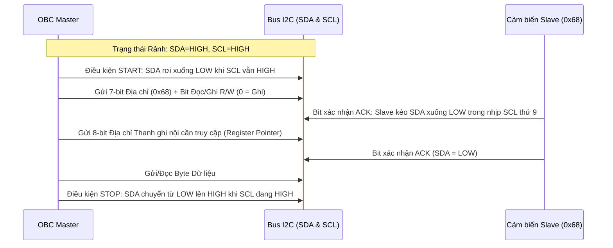
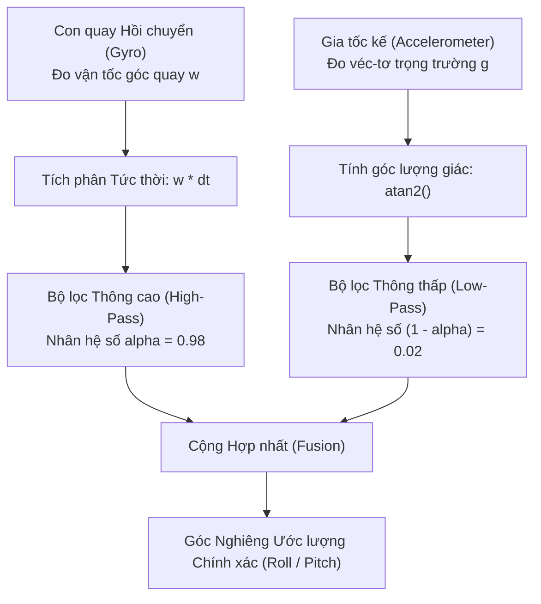

# Lab 4: Phân hệ Cảm biến (Sensors) & Tải trọng Quang học

---

## 📖 Doc 4.1: Đi Sâu Giao thức I2C Chuẩn Công Nghiệp & Mạng Cảm Biến Đa Điểm

### 1. Vai trò của Phân hệ Cảm biến & Tải trọng trong Sứ mệnh Không gian
Phân hệ Cảm biến đóng vai trò là "Giác quan" của vệ tinh CubeSat, cho phép vệ tinh cảm nhận được các thông số vật lý của bản thân và môi trường quỹ đạo:
- **Quan trắc Khí quyển & Kín khí (Atmospheric & Seal Integrity):** Theo dõi áp suất và nhiệt độ bên trong lòng khung để phát hiện rò rỉ khí hoặc quá nhiệt linh kiện.
- **Xác định Tư thế Không gian (Attitude Determination):** Đo đạc vận tốc góc quay và véc-tơ gia tốc trọng trường/quán tính bằng cảm biến quán tính 6 bậc tự do (6-DOF IMU) để phục vụ thuật toán dập tắt chuyển động quay hỗn loạn (Detumbling).
- **Định vị & Đồng bộ Thời gian (Navigation & Timing):** Cung cấp kinh độ, vĩ độ, độ cao quỹ đạo và tín hiệu nhịp thời gian nguyên tử UTC chuẩn xác cho các sự kiện khoa học.
- **Tải trọng Quang học Viễn thám (Earth Observation Payload):** Chụp ảnh màu độ phân giải cao bề mặt Trái Đất, nén dữ liệu ảnh phục vụ các nhiệm vụ nghiên cứu khoa học.

### 2. Nguyên lý Hoạt động Chi tiết của Giao thức Nối tiếp I2C (Inter-Integrated Circuit)
Bus **I2C** do hãng Philips (nay là NXP) phát triển là một bus truyền thông nối tiếp đồng bộ 2 dây hai chiều, cực kỳ phổ biến trong các hệ thống vệ tinh nhỏ nhờ khả năng kết nối nhiều IC cảm biến chỉ với hai chân vi điều khiển duy nhất:
- **Hai Đường Tín hiệu:**
  - **SDA (Serial Data):** Đường truyền dữ liệu bit nối tiếp hai chiều.
  - **SCL (Serial Clock):** Đường truyền xung nhịp đồng bộ do Master phát ra.
- **Cấu trúc Phần cứng Cực thu Hở (Open-Drain) & Điện trở Kéo lên (Pull-up Resistors):**
  - Cả Master và tất cả các thiết bị Slave đều không có tầng đệm kéo lên nguồn tích cực bên trong chân chip mà sử dụng bóng bán dẫn cực máng/cực thu hở (Open-Drain / Open-Collector). Chân chip chỉ có thể chủ động kéo đường dây xuống mức `LOW` (nối mass GND) hoặc thả nổi.
  - Một cặp điện trở kéo lên ngoài ($R_p$, thông thường từ $2.2\text{ k}\Omega$ đến $4.7\text{ k}\Omega$) bắt buộc phải được mắc từ đường SDA và SCL lên nguồn $3.3\text{V}$.
  - Khi không có thiết bị nào truyền tin, điện trở kéo lên giữ cho đường bus luôn ở mức logic `HIGH`.
  - Thiết kế này tạo ra cổng logic "HOẶC có dây" (Wired-AND), triệt tiêu hoàn toàn nguy cơ đoản mạch làm cháy chip khi hai thiết bị vô tình phát xung đối nghịch cùng lúc.



### 3. Khung Truyền Dữ liệu & Các Trạng thái Điều khiển
1. **Điều kiện START và STOP (Bắt đầu và Kết thúc):**
   - Trong quá trình truyền dữ liệu bình thường, đường SDA chỉ được phép thay đổi trạng thái khi SCL đang ở mức `LOW`. Khi SCL ở mức `HIGH`, đường SDA bắt buộc phải giữ ổn định.
   - **START Condition:** SDA chuyển trạng thái từ `HIGH` xuống `LOW` trong khi SCL đang ở mức `HIGH`. Báo hiệu đường bus bắt đầu bận.
   - **STOP Condition:** SDA chuyển trạng thái từ `LOW` lên `HIGH` trong khi SCL đang ở mức `HIGH`. Báo hiệu kết thúc phiên truyền tin, trả bus về trạng thái rảnh rỗi.
2. **Địa chỉ Thiết bị 7-bit & Bit R/W:**
   - Byte đầu tiên sau điều kiện START bao gồm 7 bit địa chỉ thiết bị Slave ($2^7 = 128$ địa chỉ khả dĩ) và bit thứ 8 là bit chọn chiều dữ liệu:
     - Bit 8 = `0`: Thao tác Ghi dữ liệu từ Master sang Slave.
     - Bit 8 = `1`: Thao tác Đọc dữ liệu từ Slave về Master.
3. **Bit Xác nhận ACK và Phản hồi NACK:**
   - Trong nhịp xung SCL thứ 9, thiết bị nhận dữ liệu phải phản hồi một bit:
     - **ACK (Acknowledge):** Kéo đường SDA xuống mức `LOW`, báo hiệu đã nhận byte dữ liệu thành công và sẵn sàng nhận tiếp.
     - **NACK (Not Acknowledge):** Thả nổi đường SDA ở mức `HIGH`, báo hiệu thiết bị bận, gặp lỗi hoặc Master muốn kết thúc phiên đọc chuỗi byte.
4. **Kỹ thuật Kéo dãn Xung nhịp (Clock Stretching):**
   - Khi một cảm biến Slave chậm chưa kịp chuẩn bị xong dữ liệu hoặc đang bận chuyển đổi ADC nội bộ, nó có quyền kéo đường SCL xuống mức `LOW`. Master phát hiện đường SCL bị giữ ở mức thấp sẽ tự động tạm dừng đồng hồ xung nhịp cho tới khi Slave nhả SCL lên mức cao mới truyền tiếp.
5. **Kỹ thuật Đọc Khối Dữ liệu Nhanh (Burst Read / Auto-Increment):**
   - Hầu hết các cảm biến hiện đại (BMP280, MPU6500) đều hỗ trợ con trỏ địa chỉ tự tăng. Master chỉ cần gửi địa chỉ thanh ghi khởi đầu một lần duy nhất, sau đó phát liên tục các xung nhịp đọc; cảm biến sẽ tự động đẩy tuần tự toàn bộ mảng dữ liệu (ví dụ 14 byte từ 0x3B đến 0x48 của MPU6500) mà không cần lặp lại điều kiện START/STOP, giúp tăng tốc độ đọc dữ liệu lên gấp 5 lần.

---

### 4. Cảm biến Môi trường Khí áp & Nhiệt độ BMP280
- **Nhà sản xuất & Địa chỉ I2C:** Bosch Sensortec. Địa chỉ I2C cấu hình bằng chân SDO: `0x76` (SDO nối GND) hoặc `0x77` (SDO nối VDD).
- **Dải Đo & Độ phân giải:** Đo áp suất khí quyển từ $300\text{ hPa}$ đến $1100\text{ hPa}$ (tương đương độ cao từ $-500\text{m}$ dưới mực nước biển đến $+9000\text{m}$ trên đỉnh Everest) với độ phân giải siêu cao $0.16\text{ Pa}$ và độ phân giải nhiệt độ $0.01^\circ\text{C}$.
- **Bảng Hệ số Hiệu chuẩn Nội bộ (Trimming Parameters):**
  - Màng cảm biến áp suất gốm áp điện (Piezoresistive) có đặc tính phi tuyến tính cao theo nhiệt độ. Trong quá trình sản xuất tại nhà máy, mỗi chip BMP280 được đo kiểm riêng lẻ và nạp sẵn 24 byte hằng số hiệu chuẩn vào bộ nhớ ROM không khả biến (từ thanh ghi `0x88` đến `0xA1`: `dig_T1` đến `dig_T3` cho nhiệt độ, `dig_P1` đến `dig_P9` cho áp suất).
  - Thuật toán giải mã bắt buộc phải đọc toàn bộ mảng 24 byte hằng số này và áp dụng công thức bù trừ nhiệt độ bậc cao theo tài liệu chuẩn của Bosch để quy đổi giá trị ADC thô thành giá trị áp suất thực tế.
- **Công thức Tính Độ cao Khí quyển (Barometric Hypsometric Formula):**
  $$h = 44330 \times \left[ 1 - \left(\frac{P}{P_0}
ight)^{\frac{1}{5.255}} 
ight]$$
  Trong đó: $h$ là độ cao tính bằng mét, $P$ là áp suất khí quyển đo được, $P_0$ là áp suất chuẩn tại mực nước biển ($1013.25\text{ hPa}$).

### ❓ Câu Hỏi Củng Cố Kiến Thức (Doc 4.1)
1. **Bus I2C chuẩn công nghiệp yêu cầu cấu hình phần cứng đặc thù nào trên hai đường tín hiệu SDA và SCL?**
   - A. Cấu hình ngõ ra Push-Pull trực tiếp
   - B. Nối đất trực tiếp cả hai chân tín hiệu
   - C. Cấu hình cực máng hở (Open-Drain) kết hợp điện trở kéo lên Pull-up
   - D. Nối tiếp tụ điện cách ly một chiều
   - *Đáp án:* **C**
   - *Giải thích:* Open-Drain kết hợp điện trở kéo lên (Pull-up resistors) cho phép nhiều thiết bị cùng chia sẻ một đường bus mà không gây ngắn mạch khi truyền dữ liệu.

2. **Cảm biến khí quyển BMP280 đo đạc và cung cấp các thông số vật lý nào thông qua giao thức I2C?**
   - A. Áp suất khí quyển, Nhiệt độ môi trường và Độ cao khí áp
   - B. Vận tốc góc và từ trường Trái Đất
   - C. Nồng độ khí oxy và độ ẩm tương đối
   - D. Tọa độ kinh độ và vĩ độ vị trí
   - *Đáp án:* **A**
   - *Giải thích:* BMP280 là cảm biến áp suất khí quyển và nhiệt độ độ chính xác cao, từ đó vi điều khiển tính toán ra độ cao khí áp theo công thức thủy tĩnh.

---

## 📖 Doc 4.2: Cảm Biến Quán Tính 6 Trục IMU MPU6500 & Thuật Toán Bộ Lọc Bù

### 1. Cảm biến Quán tính IMU 6 Trục MPU6500
- **Nhà sản xuất & Địa chỉ I2C:** InvenSense / TDK. Địa chỉ I2C là `0x68` (AD0 = GND) hoặc `0x69` (AD0 = VCC).
- **Cấu trúc Phần cứng:** Tích hợp một vi cơ điện tử gia tốc kế 3 trục (MEMS 3-axis Accelerometer) và con quay hồi chuyển 3 trục (MEMS 3-axis Gyroscope) trên cùng một đế silicon.
- **Thanh ghi Dữ liệu Thô:** 14 thanh ghi liên tiếp từ `0x3B` đến `0x48` chứa các giá trị số nguyên có dấu 16-bit (`int16_t`):
  - `0x3B - 0x40`: Gia tốc 3 trục $A_x, A_y, A_z$ (độ nhạy cấu hình $\pm 2\text{g}, \pm 4\text{g}, \pm 8\text{g}, \pm 16\text{g}$).
  - `0x41 - 0x42`: Nhiệt độ nội bộ của chip silicon.
  - `0x43 - 0x48`: Vận tốc góc 3 trục $G_x, G_y, G_z$ (độ nhạy cấu hình $\pm 250, \pm 500, \pm 1000, \pm 2000^\circ\text{/s}$).

### 3. Thuật toán Lọc Bù (Complementary Filter) Ước lượng Tư thế
Để tính toán góc nghiêng (Roll $\phi$, Pitch $\theta$) của vệ tinh, mỗi cảm biến đơn lẻ đều có nhược điểm chí mạng:
- **Gia tốc kế:** Đo véc-tơ gia tốc trọng trường $g$. Cho góc nghiêng chính xác tuyệt vời khi ở trạng thái tĩnh dài hạn, nhưng lại cực kỳ nhạy cảm với các rung động cơ học ngắn hạn và lực quán tính lúc chuyển động (Nhiễu tần số cao).
- **Con quay hồi chuyển:** Đo vận tốc góc quay tức thời $\omega$. Tích phân góc quay $\theta = \int \omega \, dt$ đáp ứng cực nhanh và không bị ảnh hưởng bởi rung lắc cơ học, nhưng lại bị hiện tượng trôi dạt điểm không (Gyro Drift / DC Bias) khiến góc tính toán bị sai lệch tích lũy tăng dần theo thời gian (Nhiễu tần số thấp).
- **Bộ Lọc Bù (Complementary Filter):** Kết hợp một bộ lọc thông cao (High-pass Filter) cho con quay và một bộ lọc thông thấp (Low-pass Filter) cho gia tốc kế theo công thức hợp nhất:
  $$\theta_t = \alpha \cdot (\theta_{t-1} + \omega \cdot \Delta t) + (1 - \alpha) \cdot \theta_\text{accel}$$
  Trong đó: $\Delta t$ là chu kỳ lấy mẫu, $\alpha$ là trọng số lọc (thường chọn $\alpha = 0.96 - 0.98$). Thuật toán chạy siêu nhanh trên vi điều khiển, triệt tiêu hoàn toàn độ trôi của con quay và lọc sạch nhiễu rung lắc của gia tốc kế.



---

### ❓ Câu Hỏi Củng Cố Kiến Thức (Doc 4.2)
1. **Cảm biến quán tính IMU được tích hợp trên bộ kit PTITCube thuộc dòng cảm biến nào và có địa chỉ I2C mặc định là gì?**
   - A. MPU6050 địa chỉ 0x68
   - B. LSM9DS1 địa chỉ 0x1E
   - C. BNO055 địa chỉ 0x28
   - D. MPU6500 địa chỉ 0x68
   - *Đáp án:* **D**
   - *Giải thích:* Phân hệ Sensor của kit CubeSat sử dụng vi mạch MPU6500 (6-DoF gồm 3 trục gia tốc kế và 3 trục con quay hồi chuyển) ở địa chỉ I2C 0x68.

2. **Bộ lọc bù (Complementary Filter) giải quyết bài toán tính góc nghiêng tư thế (Roll/Pitch) theo nguyên lý nào?**
   - A. Tắt hoàn toàn tín hiệu đo của gia tốc kế
   - B. Kết hợp lọc thông cao cho con quay hồi chuyển và thông thấp cho gia tốc kế
   - C. Lấy trung bình cộng số học của hai giá trị thô
   - D. Chỉ dùng tích phân con quay hồi chuyển theo thời gian
   - *Đáp án:* **B**
   - *Giải thích:* Bộ lọc bù kết hợp tỷ trọng lớn (ví dụ 98%) từ tích phân Gyro mượt mà trong ngắn hạn và 2% từ góc gia tốc kế tuyệt đối để triệt tiêu hiện tượng trôi góc (drift).

3. **Cảm biến từ trường QMC5883L (địa chỉ 0x0D) cung cấp dữ liệu nào phục vụ phân hệ xác định tư thế vệ tinh?**
   - A. Cường độ từ trường 3 trục dùng để tính góc hướng La bàn (Heading)
   - B. Vận tốc quay quanh trục Z
   - C. Độ ẩm môi trường xung quanh vỏ vệ tinh
   - D. Gia tốc trọng trường dọc theo trục thẳng đứng
   - *Đáp án:* **A**
   - *Giải thích:* QMC5883L đo từ trường Trái Đất trên 3 trục X, Y, Z, giúp thuật toán xác định góc hướng la bàn (Heading = atan2(Y, X) * 180 / PI).

---

## 📖 Doc 4.3: Nguyên lý Phần Cứng Module Định Vị GNSS L76X & Giao Tiếp UART Đọc Dữ Liệu Thô

### 1. Kiến trúc Phần cứng Module Định vị Toàn cầu GNSS L76X
Module Quectel **L76X** là khí tài định vị không gian tích hợp đồng thời hai hệ thống vệ tinh: **GPS** (Hoa Kỳ - tần số L1 $1575.42\text{ MHz}$) và **GLONASS** (Nga - tần số L1 $1602\text{ MHz}$):
- **Ăng-ten Gốm Tích hợp (Ceramic Patch Antenna):** Thu sóng vô tuyến phân cực tròn thuận (RHCP) từ các chòm vệ tinh trên quỹ đạo.
- **Tầng Tiền Khuếch đại Nhiễu Thấp (LNA):** Khuếch đại tín hiệu vệ tinh cực kỳ yếu ớt (mức thu chỉ từ $-130\text{ dBm}$ đến $-165\text{ dBm}$) trước khi đưa vào bộ giải mã RF.
- **Các Chế độ Khởi động Định vị:**
  - *Cold Start (~35 giây):* Khi module vừa cấp nguồn và chưa có dữ liệu lịch thiên văn (Almanac/Ephemeris), nó phải quét toàn bộ các kênh tần số để tìm vệ tinh.
  - *Hot Start (~1 giây):* Khi module đã có sẵn dữ liệu quỹ đạo và đồng hồ UTC chính xác trong bộ nhớ tạm RTC, thời gian chốt vị trí diễn ra gần như tức thời.
- **Giao tiếp Nối tiếp UART Phần cứng:**
  - Kết nối với cổng `Serial2` của ESP32 qua 2 chân: `RX = GPIO16`, `TX = GPIO17`.
  - Tốc độ baud tiêu chuẩn: $9600\text{ bps}$, cấu hình khung truyền `8-N-1`.
  - **Đặc tính phát dữ liệu tự động:** Ngay khi được cấp nguồn $3.3\text{V}$, module tự động phát ra luồng ký tự ASCII chứa các dòng bản tin NMEA định kỳ mỗi giây ($1\text{ Hz}$) qua chân TX mà không cần OBC phải gửi bất kỳ lệnh kích hoạt nào.

### 2. Kỹ thuật Lập trình: Đọc Luồng Ký Tự NMEA Thô qua UART
Trong bài thực hành đọc dữ liệu thô, mục tiêu là kiểm tra thông mạch phần cứng và quan sát trực tiếp luồng ký tự thô đổ về từ không gian:
```cpp
void setup() {
    Serial.begin(115200);
    // Khởi tạo UART2 nối với GPS L76X ở tốc độ 9600 baud
    Serial2.begin(9600, SERIAL_8N1, 16, 17);
    Serial.println("[RAW] Dang doc luong byte thô NMEA truc tiep tu GPS...");
}

void loop() {
    // Đọc từng byte thô từ GPS và in thẳng ra màn hình máy tính
    while (Serial2.available() > 0) {
        char c = Serial2.read();
        Serial.print(c);
    }
}
```

---

### ❓ Câu Hỏi Củng Cố Kiến Thức (Doc 4.3)
1. **Module định vị vệ tinh GNSS L76X kết nối với vi điều khiển OBC thông qua cổng giao tiếp và tốc độ baud mặc định nào?**
   - A. Bus SPI ở tần số 10 MHz
   - B. Bus I2C ở tốc độ 400 kHz
   - C. Cổng UART2 ở tốc độ 9600 baud
   - D. Giao tiếp 1-Wire ở tốc độ 115200 baud
   - *Đáp án:* **C**
   - *Giải thích:* Module L76X truyền luồng ký tự ASCII các bản tin NMEA định kỳ mỗi giây qua cổng nối tiếp phần cứng UART2 (RX=16, TX=17) ở tốc độ 9600 baud.

2. **Bản tin NMEA nào sau đây của module GPS chứa thông tin kinh độ, vĩ độ và số lượng vệ tinh đang khóa?**
   - A. `$GPVTG`
   - B. `$GPGGA`
   - C. `$GPGSV`
   - D. `$GPGLL`
   - *Đáp án:* **B**
   - *Giải thích:* Bản tin `$GPGGA` (Global Positioning System Fix Data) cung cấp đầy đủ thông tin: thời gian UTC, tọa độ vĩ độ/kinh độ, chỉ số chất lượng định vị và số vệ tinh bắt được.

---

## 📖 Doc 4.4: Phân Tích Chuyên Sâu Chuẩn Giao Thức NMEA 0183 & Kỹ Thuật Chuyển Đổi Dữ Liệu Có Ý Nghĩa

### 1. Tại Sao Bắt Buộc Phải Chuyển Đổi Dữ Liệu NMEA Thô?
Luồng dữ liệu thô thu được từ cổng UART là các dòng chuỗi văn bản ASCII thuần túy. Vi điều khiển OBC không thể sử dụng trực tiếp chuỗi ký tự này để tính toán quỹ đạo, kiểm tra hàng rào địa lý (Geofencing) hay đóng gói vào bản tin Telemetry nếu không chuyển đổi thành các kiểu dữ liệu số thực (`float`, `double`) và số nguyên (`int`).

### 2. Cấu Trúc Chi Tiết Từng Trường của Bản Tin NMEA Chuẩn
Mỗi câu tin NMEA bắt đầu bằng ký tự `$`, theo sau là mã định danh nguồn phát (`GP` cho GPS, `GL` cho GLONASS, `GN` cho đa hệ thống), tên câu lệnh 3 ký tự, các trường dữ liệu ngăn cách bằng dấu phẩy `,` và kết thúc bằng mã Checksum sau dấu `*`:

#### A. Câu tin `$GPRMC` (Recommended Minimum Specific GNSS Data)
Đây là câu tin cốt lõi cung cấp dữ liệu chuyển động và tọa độ vị trí tối thiểu:
```
$GPRMC,083559.00,A,2102.1234,N,10547.5678,E,0.05,84.4,121126,,,A*76
```
- **Trường 1 (`083559.00`):** Thời gian chuẩn quốc tế UTC theo định dạng `hhmmss.ss` ($08\text{ giờ } 35\text{ phút } 59.00\text{ giây}$).
- **Trường 2 (`A`):** Trạng thái định vị (`Status`):
  - `A` = Active: Tín hiệu vệ tinh hợp lệ, tọa độ tin cậy.
  - `V` = Void: Chưa khóa được vệ tinh, tọa độ không hợp lệ.
- **Trường 3 & 4 (`2102.1234,N`):** Vĩ độ định dạng Độ - Phút thập phân `ddmm.mmmm` và bán cầu (`N` = Bắc, `S` = Nam).
- **Trường 5 & 6 (`10547.5678,E`):** Kinh độ định dạng Độ - Phút thập phân `dddmm.mmmm` và bán cầu (`E` = Đông, `W` = Tây).
- **Trường 7 (`0.05`):** Vận tốc di chuyển mặt đất tính bằng Hải lý trên giờ (Knots).
- **Trường 8 (`84.4`):** Góc hướng di chuyển (Course over ground) tính bằng độ ($0^\circ - 360^\circ$).
- **Trường 9 (`121126`):** Ngày tháng năm UTC định dạng `ddmmyy` (Ngày 12 tháng 11 năm 2026).

#### B. Công Thức Chuyển Đổi Tọa Độ NMEA sang Độ Thập Phân (Decimal Degrees)
Định dạng NMEA biểu diễn theo Độ và Phút (`ddmm.mmmm`). Để đưa lên bản đồ số (Google Maps, Leaflet, Dashboard), bắt buộc phải đổi sang Độ Thập Phân:
$$\text{Decimal Degrees} = \text{Degrees} + \frac{\text{Minutes}}{60.0}$$
*Ví dụ cụ thể:*
- Vĩ độ thô: `2102.1234, N` $\implies$ Số độ nguyên là $21^\circ$, số phút là $02.1234'$.
  $$\text{Latitude} = 21 + \frac{2.1234}{60.0} = \mathbf{21.03539^\circ\text{ N}}$$
- Kinh độ thô: `10547.5678, E` $\implies$ Số độ nguyên là $105^\circ$, số phút là $47.5678'$.
  $$\text{Longitude} = 105 + \frac{47.5678}{60.0} = \mathbf{105.79279^\circ\text{ E}}$$
*(Quy ước: Nếu là bán cầu Nam `S` hoặc bán cầu Tây `W`, giá trị tọa độ mang dấu âm)*.

#### C. Câu tin `$GPGGA` (Global Positioning System Fix Data)
Cung cấp thông tin độ cao và chất lượng hình học của tín hiệu vệ tinh:
```
$GPGGA,083559.00,2102.1234,N,10547.5678,E,1,08,1.05,45.2,M,-28.9,M,,*5A
```
- **Trường 6 (`1`):** Chỉ số phẩm chất Fix (`Fix Quality`):
  - `0`: Chưa chốt được vị trí (Invalid).
  - `1`: Định vị GPS tiêu chuẩn (SPS Fix).
  - `2`: Định vị vi sai độ chính xác cao (DGPS Fix).
- **Trường 7 (`08`):** Số lượng vệ tinh đang bám khóa thành công (khuyến nghị $\ge 4$ vệ tinh để tính toán tọa độ không gian 3 chiều).
- **Trường 8 (`1.05`):** Hệ số suy giảm độ chính xác hình học mặt phẳng (**HDOP - Horizontal Dilution of Precision**):
  - $\text{HDOP} < 1.0$: Chất lượng vị trí lý tưởng.
  - $1.0 \le \text{HDOP} \le 2.0$: Rất tốt (đủ tiêu chuẩn điều hướng).
  - $2.0 < \text{HDOP} \le 5.0$: Mức chấp nhận được.
  - $\text{HDOP} > 5.0$: Vệ tinh phân bố góc hẹp, sai số vị trí lớn, phần mềm bay nên tạm thời loại bỏ mẫu đo này.
- **Trường 9 (`45.2,M`):** Cao độ so với mực nước biển trung bình (MSL Altitude) tính bằng mét.

### 3. Thuật Toán Kiểm Tra Toàn Vẹn Checksum XOR
Để bảo đảm đường truyền UART không bị suy hao biến dạng bit làm sai lệch tọa độ:
- Hai ký tự Hex sau dấu `*` ở cuối câu tin chính là mã Checksum 8-bit.
- **Giải thuật:** Duyệt qua tất cả các byte nằm giữa ký tự `$` và ký tự `*`, thực hiện phép toán logic `XOR (^)` liên tục:
  $$\text{Checksum} = \bigoplus_{i=1}^{N} \text{byte}[i]$$
- Nếu mã tính toán khớp với 2 ký tự Hex cuối dòng, câu tin được xác nhận hợp lệ.

### 4. Kỹ thuật Lập trình: Bộ Giải Mã Stream Parser (TinyGPS++ / PTIT_GPS)
Thay vì dùng biến chuỗi `String` gây phân mảnh bộ nhớ Heap của ESP32, bộ giải mã chuyên dụng sử dụng máy trạng thái hữu hạn xử lý từng ký tự đến trong thời gian thực:
```cpp
#include <PTITCube.h>

PTIT_GPS myGPS;

void setup() {
    Serial.begin(115200);
    myGPS.init(); // Khởi tạo UART2 và cấu hình parser
}

void loop() {
    // Đẩy từng byte từ UART vào máy trạng thái giải mã NMEA
    myGPS.update();

    static unsigned long lastPrint = 0;
    if (millis() - lastPrint > 2000) {
        lastPrint = millis();
        if (myGPS.getSatellites() > 0 && myGPS.getLat() != 0.0) {
            Serial.printf("Toa do: %.6f, %.6f | Cao do: %.1f m | Ve tinh: %d | HDOP: %.2f\n",
                          myGPS.getLat(), myGPS.getLng(), 
                          myGPS.getAltitude(), myGPS.getSatellites(), myGPS.getHDOP());
        } else {
            Serial.println("[GPS] Dang tim tin hieu ve tinh ngoai troi...");
        }
    }
}
```

---

### ❓ Câu Hỏi Củng Cố Kiến Thức (Doc 4.4)
1. **Công thức toán học chuyển đổi tọa độ từ định dạng NMEA độ-phút (`ddmm.mmmm`) sang số thập phân chuẩn WGS-84 (`dd.dddddd`) là:**
   - A. $\text{Decimal} = \text{Degrees} \times 60 + \text{Minutes}$
   - B. $\text{Decimal} = \frac{\text{Degrees} + \text{Minutes}}{100.0}$
   - C. $\text{Decimal} = \text{Degrees} \times \text{Minutes}$
   - D. $\text{Decimal} = \text{Degrees} + \frac{\text{Minutes}}{60.0}$
   - *Đáp án:* **D**
   - *Giải thích:* Trong tọa độ địa lý, 1 độ bằng 60 phút góc, nên phần phút phải chia cho 60.0 rồi cộng dồn vào phần nguyên độ để có giá trị số thập phân.

2. **Mã kiểm tra toàn vẹn Checksum trong bản tin NMEA 0183 được tính toán bằng phép toán logic nào trên các ký tự giữa `$` và `*`?**
   - A. Phép cộng dồn modulo 256
   - B. Phép toán XOR từng byte ký tự ASCII
   - C. Mã đa thức CRC-32 tiêu chuẩn mạng
   - D. Phép nhân băm chuỗi ký tự MD5
   - *Đáp án:* **B**
   - *Giải thích:* Tiêu chuẩn NMEA 0183 quy định Checksum là phép XOR nhị phân 8-bit liên tiếp của toàn bộ các ký tự nằm giữa dấu `$` và `*`.

---

## 📖 Doc 4.5: Tải Trọng Camera Viễn Thám OV2640 & Nén JPEG Phần Cứng

### 1. Tải trọng Camera OV2640
- **Đặc tính Tải trọng:** Cảm biến ảnh màu CMOS Omnivision **OV2640** độ phân giải 2 Megapixel ($1600 \times 1200\text{ UXGA}$), tích hợp bộ mã hóa nén phần cứng JPEG giúp giảm dung lượng tệp ảnh từ hàng Megabytes xuống còn $30 - 60\text{ KB}$, rất phù hợp với băng thông hạn chế của kênh truyền sóng không gian.
- **Yêu cầu Xung nhịp Ngoài XCLK:** Để mạch xử lý tín hiệu hình ảnh (ISP) bên trong OV2640 hoạt động, nó đòi hỏi vi điều khiển OBC phải phát ra một đường xung nhịp tần số cao ổn định từ $10\text{ MHz}$ đến $20\text{ MHz}$ tại chân `XCLK`.

---

## 📖 Doc 4.6: IC Chuyển Mạch Multiplexer 74HC4066 & Kỹ Thuật Đa Hóa Cổng UART

### 1. Khóa Chuyển Mạch Tương Tự 74HC4066
- **Xung đột Phần cứng khi Dùng chung Cổng UART:**
  - Cả module Camera OV2640 và module GNSS L76X đều có nhu cầu giao tiếp nối tiếp tốc độ cao với vi điều khiển OBC, nhưng số lượng chân UART phần cứng trên vi điều khiển bị giới hạn do phải ưu tiên chân cho kết nối máy tính và module thu phát sóng LoRa.
- **Giải pháp Kỹ thuật bằng IC Chuyển mạch 74HC4066:**
  - Kit tích hợp vi mạch khóa chuyển mạch tương tự 4 kênh độc lập **74HC4066** (Quad Bilateral Switch) đóng vai trò là một bộ dồn kênh (Multiplexer):
    - *Chế độ Định vị (GNSS Mode):* OBC điều khiển chân chọn đóng khóa kênh GPS vào đường UART của OBC. Bộ thu GNSS thu thập chuỗi bản tin NMEA và chốt tọa độ vị trí.
    - *Chế độ Chụp ảnh (Camera Mode):* Sau khi đã chốt xong tọa độ, OBC ngắt kết nối UART của GPS và đóng khóa kênh Camera vào đường UART để nhận luồng byte ảnh JPEG.

---

## 📖 Doc 4.7: Kiến Trúc Thu Thập & Xử Lý Dữ Liệu Đa Cảm Biến Toàn Diện

---

## 💻 Hướng Dẫn Thực Hành: Danh Mục Các Bài Thực Hành Lab 4
- `Lab4-01a_Environment_I2C`: Khởi tạo bus I2C, đọc trực tiếp 24 byte hằng số hiệu chuẩn và các thanh ghi áp suất thô của BMP280.
- `Lab4-01b_Environment_Library`: Đọc và tính toán áp suất khí quyển, nhiệt độ môi trường và độ cao ước lượng thông qua thư viện PTITCube.
- `Lab4-02a_IMU_I2C`: Đọc dữ liệu gia tốc và vận tốc góc 6 trục thô từ thanh ghi `0x3B` của chip MPU6500.
- `Lab4-02b_IMU_Library`: Cài đặt thuật toán bộ lọc bù (Complementary Filter) tính toán góc nghiêng Roll và Pitch ổn định.
- `Lab4-03a_GPS_UART`: Đọc trực tiếp luồng ký tự ASCII bản tin NMEA thô từ module GNSS L76X qua cổng UART2 thuần.
- `Lab4-03b_GPS_Library`: Thu nhận, phân loại câu tin NMEA thô và kiểm tra mã Checksum XOR (*hh) bằng bộ đệm dòng.
- `Lab4-03c_GPS_PTITCube`: Sử dụng thư viện PTITCube chuyển đổi luồng dữ liệu NMEA thô thành các trường số thực có ý nghĩa mà người dùng có thể hiểu được (Kinh độ, Vĩ độ, Cao độ m, Vận tốc km/h, Hướng đi, Số vệ tinh, HDOP, Thời gian UTC).
- `Lab4-04a_Camera_UART`: Giao tiếp UART thuần bắt tay (`p` -> `SIZE` -> `OK` -> stream -> `DONE`) với module ESP32-CAM và ghi trực tiếp luồng byte ảnh JPEG vào thẻ nhớ MicroSD qua bus SPI.
- `Lab4-04b_Camera_Library`: Sử dụng thư viện `PTITCube` (`PTIT_Camera`) để chụp ảnh và tự động quản lý lưu trữ vào thẻ nhớ MicroSD qua hàm tiện ích cấp cao.
- `Lab4-05_Read_All_Sensors`: Tổng hợp đọc đồng thời tất cả các cảm biến môi trường (BMP280), quán tính (MPU6500, QMC5883) và định vị (GPS L76X) trong một chu trình khép kín.
- `Lab4-06_Camera_Multiplexer`: Lập trình điều khiển IC chuyển mạch 74HC4066 luân phiên giữa Camera và GNSS, giải quyết xung đột cổng UART.

### ❓ Câu Hỏi Đánh Giá Kỹ Năng Thực Hành (Lab 4)
1. **Cặp byte đánh dấu bắt đầu (SOI) và kết thúc (EOI) của một tệp ảnh nén JPEG nhận được từ Camera OV2640 là:**
   - A. `0xFFD8` và `0xFFD9`
   - B. `0x0000` và `0xFFFF`
   - C. `0x1234` và `0x5678`
   - D. `0xAA55` và `0x55AA`
   - *Đáp án:* **A**
   - *Giải thích:* Chuẩn JPEG quốc tế sử dụng cặp byte nhị phân `0xFF 0xD8` để báo hiệu bắt đầu luồng dữ liệu ảnh (Start of Image) và `0xFF 0xD9` để kết thúc ảnh (End of Image).

2. **Trong bài thực hành Camera UART (Lab4-04a), điều kiện tiên quyết về phần cứng để lưu trữ ảnh chụp là gì?**
   - A. Phải có kết nối Internet WiFi tốc độ cao
   - B. Phải tắt toàn bộ các cảm biến I2C còn lại
   - C. Phải cấp nguồn 12V riêng cho module Camera
   - D. Bắt buộc phải có thẻ nhớ MicroSD cắm trên bo mạch
   - *Đáp án:* **D**
   - *Giải thích:* Do ảnh chụp JPEG có dung lượng vài chục kilobyte vượt quá khả năng lưu trữ tạm thời an toàn trong SRAM, ảnh nhận từ UART phải được ghi trực tiếp vào thẻ nhớ MicroSD qua bus SPI.
