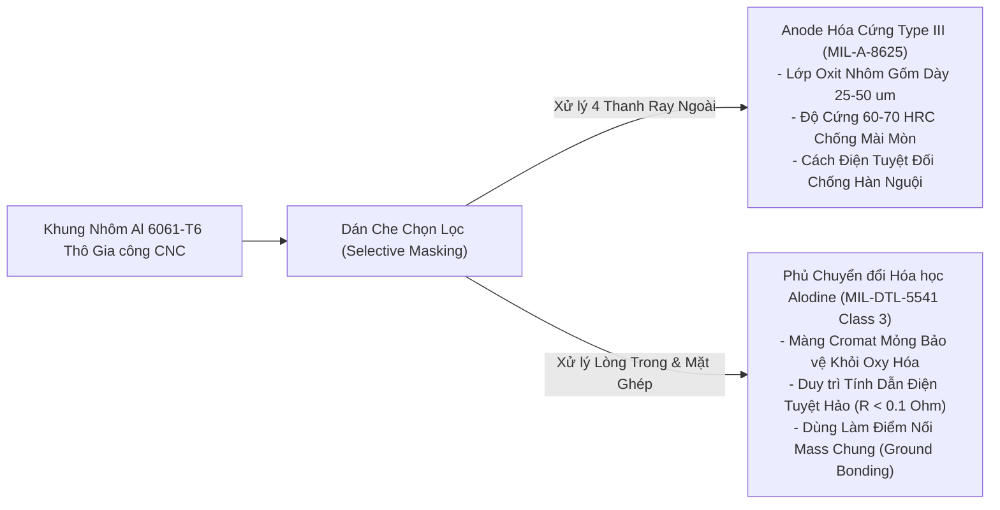

# Lab 6: Phân hệ Cấu trúc Cơ khí (Structure) & Tích hợp Vật lý

---

## 📖 Doc 6.1: Vai Trò Khung Cơ Khí & Tác Động Đa Chiều Lên Các Phân Hệ Khác

### 1. Vai trò Cốt lõi của Phân hệ Cấu trúc Cơ khí (Structure Subsystem)
Trong kỹ thuật vệ tinh CubeSat, Phân hệ Cấu trúc thường bị nhầm lẫn là một "chiếc hộp thụ động" chỉ đơn thuần làm nhiệm vụ chứa linh kiện. Thực tế trong môi trường hàng không vũ trụ, khung cấu trúc là một hệ thống cơ điện tử - nhiệt phức tạp, đảm nhận các chức năng sống còn:
- **Chịu Tải Trọng Phóng Cực Đại (Launch Load Withstanding):** Trong giai đoạn tên lửa cất cánh, khung vệ tinh phải chịu gia tốc tĩnh liên tục lên tới $10 - 15\text{g}$, tải trọng dao động âm thanh (Acoustic Loads) và các rung động ngẫu nhiên (Random Vibration) với gia tốc hiệu dụng lên tới $14\text{ g}_\text{rms}$. Khung phải giữ vững độ bền cơ học, không được biến dạng vĩnh viễn hoặc gãy nứt làm tổn hại khoang hàng tên lửa.
- **Duy trì Giao diện Cơ học Tiêu chuẩn với Ống Phóng P-POD:** Định hình chính xác bao hình kích thước bên ngoài, dẫn hướng vệ tinh trượt êm ái ra khỏi ống phóng mà không bị kẹt dính.
- **Khối Tản Nhiệt Thụ Động Chủ Đạo (Primary Thermal Heat Sink):** Dẫn nhiệt lượng tỏa ra từ các chip công suất bên trong truyền ra các bề mặt ngoài để bức xạ vào vũ trụ.

### 2. Tác động Đa chiều của Khung Cơ khí lên các Phân hệ Khác
Một thay đổi nhỏ trong thiết kế cơ khí sẽ ngay lập tức gây ra hiệu ứng domino ảnh hưởng trực tiếp tới hoạt động của tất cả các phân hệ còn lại:

```mermaid
flowchart TD
    FRAME["🔩 KHUNG CẤU TRÚC CƠ KHÍ CUBESAT"]
    
    FRAME -->|1. Cung cấp Tấm tản nhiệt & Vách nén tế bào pin| EPS["🔋 Phân hệ Năng lượng (EPS)"]
    FRAME -->|2. Lồng Faraday che chắn bức xạ & Tiếp mass tĩnh điện| OBC["🖥️ Phân hệ Xử lý (OBC)"]
    FRAME -->|3. Mặt đất phẳng phản xạ nhân tạo (Ground Plane 50 Ohm)| COM["📡 Phân hệ Truyền thông (COM)"]
    FRAME -->|4. Mặt phẳng tham chiếu cơ học siêu cứng, chống uốn| SENSORS["🔬 Phân hệ Cảm biến (Sensors)"]
    FRAME -->|5. Bề mặt tiếp xúc ray trượt dẫn hướng chịu mài mòn| PPOD["🚀 Ống phóng Tên lửa (P-POD)"]
```

1. **Tác động lên Phân hệ Năng lượng (EPS):**
   - *Tản nhiệt cho Khối Pin:* Pin Li-Po chỉ hoạt động an toàn trong dải nhiệt độ hẹp ($0^\circ\text{C} - 45^\circ\text{C}$). Khung cơ khí phải cung cấp các cầu nhiệt kim loại dẫn nhiệt sinh ra khi sạc/xả pin ra vỏ ngoài.
   - *Vách Nén Tế bào Pin (Pouch Cell Containment):* Pin Li-Po dạng túi có xu hướng giãn nở cơ học khi sạc xả trong chân không. Khung cơ khí phải cung cấp một lực nén đồng đều ($10 - 20\text{ kPa}$) lên bề mặt cell pin để chống hiện tượng tách lớp điện cực (Delamination).
   - *Tích hợp Công tắc Tách tầng:* Chân đế của thanh ray cơ khí là vị trí lắp đặt công tắc hành trình (Deployment Switch). Độ nhô và hành trình đàn hồi của công tắc phụ thuộc $100\%$ vào dung sai gia công cơ khí của khung.
2. **Tác động lên Phân hệ Xử lý Trung tâm (OBC):**
   - *Che chắn Bức xạ & Lồng Faraday (EMI/Radiation Shielding):* Vách nhôm của khung dày $1.5 - 2.0\text{ mm}$ đóng vai trò là một lồng Faraday triệt tiêu các xung nhiễu điện từ bên ngoài và làm suy giảm đáng kể liều bức xạ ion hóa tích lũy (TID) tác động vào chip vi xử lý.
   - *Liên kết Mass Khung Vỏ (Chassis Ground Bonding):* Toàn bộ các tấm khung nhôm phải được nối thông điện liên tục về đường mass GND của bo mạch OBC với điện trở cực nhỏ ($R < 0.1\Omega$) để tiêu tán toàn bộ điện tích tĩnh điện vũ trụ (Spacecraft Plasma Charging), ngăn chặn hiện tượng phóng tia hồ quang tĩnh điện phá hủy vi mạch.
3. **Tác động lên Phân hệ Truyền thông (COM):**
   - *Mặt Đất Phản Xạ Nhân Tạo (Artificial Ground Plane):* Ăng-ten phát sóng LoRa trên CubeSat thường là loại ăng-ten đơn cực một phần tư bước sóng ($\lambda/4$ Monopole Antenna). Loại ăng-ten này bắt buộc phải có một mặt phẳng kim loại dẫn điện bên dưới chân ăng-ten để tạo thành một "hình ảnh gương" của cực còn lại, giúp phối hợp trở kháng chuẩn $50\Omega$. Bản thân bề mặt khung nhôm chính là mặt phẳng đất phản xạ này; nếu khung tiếp xúc điện kém, sóng phản xạ ngược sẽ làm cháy tầng khuếch đại công suất PA của module LoRa.
4. **Tác động lên Phân hệ Cảm biến & Tải trọng (Sensors & Payload):**
   - *Độ Cứng Vững và Căn Chỉnh Cơ học (Rigidity & Boresight Alignment):* Thấu kính Camera và cảm biến quán tính IMU đòi hỏi một mặt phẳng tham chiếu cơ học siêu cứng. Nếu khung bị uốn cong hoặc vặn xoắn dưới biến thiên nhiệt độ quỹ đạo, trục quang học của Camera sẽ bị lệch góc và cảm biến gia tốc kế/con quay hồi chuyển sẽ đo sai tư thế không gian.

---

### ❓ Câu Hỏi Củng Cố Kiến Thức (Doc 6.1)
1. **Ngoài vai trò chịu tải trọng cơ học và va đập khi phóng, khung cơ khí vệ tinh còn đóng vai trò then chốt nào?**
   - A. Tạo lực đẩy phản lực giúp vệ tinh giữ quỹ đạo
   - B. Tự động thu thập năng lượng mặt trời không cần quang điện
   - C. Cung cấp đường dẫn tản nhiệt ra không gian và mặt phẳng tiếp địa chung chống nhiễu
   - D. Tăng độ nhạy thu của anten vô tuyến lên gấp đôi
   - *Đáp án:* **C**
   - *Giải thích:* Khung nhôm hoạt động như bộ tản nhiệt thụ động dẫn nhiệt lượng từ vi xử lý ra các bề mặt bức xạ, đồng thời tạo mặt phẳng đất chung (Chassis Ground) ngăn ngừa tích tụ tĩnh điện và can nhiễu EMI.

2. **Phân bố khối lượng và vị trí trọng tâm (Center of Gravity - CoG) của CubeSat 1U cần đáp ứng yêu cầu kỹ thuật nào?**
   - A. Trọng tâm phải nằm trong bán kính 2 cm tính từ tâm hình học khối 1U
   - B. Trọng tâm phải nằm lệch hẳn về một góc đáy
   - C. Toàn bộ trọng lượng phải dồn hết về thanh ray trượt
   - D. Khối lượng vệ tinh không được vượt quá 100 gram
   - *Đáp án:* **A**
   - *Giải thích:* Tiêu chuẩn CubeSat CDS quy định tâm khối lượng phải nằm rất gần tâm hình học để tránh mô-men quay quán tính bất đối xứng làm vệ tinh bị xoay lộn mất kiểm soát khi phóng khỏi ống Pod.

---

## 📖 Doc 6.2: Vật Liệu Hợp Kim Không Gian & Xử Lý Bề Mặt Chuyên Dụng

### 1. Lựa chọn Hợp kim Nhôm Hàng không Al 6061-T6 và Al 7075-T6
Vật liệu sử dụng cho khung CubeSat phải đáp ứng đồng thời 4 tiêu chí khắt khe: Tỷ số độ bền trên khối lượng cao, tính dẫn nhiệt tốt, khả năng gia công cắt gọt CNC chính xác và không có từ tính:
- **Nhôm Hợp kim Al 6061-T6:**
  - Thành phần hợp kim chính: Nhôm, Magie ($1.0\%$) và Silic ($0.6\%$).
  - Trạng thái nhiệt luyện `-T6`: Được tôi dung dịch và hóa già nhân tạo (Artificially Aged) để tạo mạng kết tủa pha liên kim phân tán mịn.
  - Giới hạn chảy (Yield Strength): $276\text{ MPa}$; Giới hạn bền kéo (Tensile Strength): $310\text{ MPa}$.
  - Đặc tính: Dễ gia công phay CNC, hàn được, chống ăn mòn xuất sắc trong môi trường biển, là vật liệu kinh điển chiếm hơn $80\%$ khối lượng khung CubeSat.
- **Nhôm Hợp kim Al 7075-T6:**
  - Thành phần hợp kim chính: Nhôm và Kẽm ($5.6\%$).
  - Giới hạn chảy: $503\text{ MPa}$; Giới hạn bền kéo: $572\text{ MPa}$ (tương đương với một số loại thép kết cấu nhưng nhẹ hơn thép gần 3 lần).
  - Ứng dụng: Dành riêng cho 4 thanh ray dẫn hướng góc hoặc các chi tiết chịu lực cắt và tải trọng va đập lớn nhất.

### 2. Quy trình Xử lý Bề mặt Chọn lọc: Anodize Cứng Type III vs Lớp Phủ Alodine
Khung nhôm CubeSat bắt buộc phải trải qua quy trình xử lý bề mặt chọn lọc hai giai đoạn (Selective Masking) theo tiêu chuẩn quân sự Hoa Kỳ:



1. **Anodize Hóa Cứng Type III (Hard Anodizing - Tiêu chuẩn MIL-A-8625):**
   - Áp dụng trên: **4 thanh ray dẫn hướng ở 4 góc** tiếp xúc trực tiếp với lòng ống phóng P-POD.
   - Nguyên lý: Điện phân trong dung dịch axit sulfuric ở nhiệt độ thấp ($0^\circ\text{C}$), tạo ra lớp màng gốm nhôm oxit $Al_2O_3$ dày $25 - 50\mu\text{m}$ ăn sâu vào bề mặt kim loại.
   - Đặc tính: Độ cứng bề mặt cực cao ($60 - 70\text{ HRC}$, cứng như đá sapphire), chống cào xước cơ học khi trượt trong ống phóng và **cách điện tuyệt đối**, triệt tiêu hoàn toàn nguy cơ **Hàn nguội (Cold Welding)** giữa thanh ray vệ tinh và lòng ống phóng trong môi trường chân không nhiệt.
2. **Lớp Phủ Chuyển Đổi Hóa Học Alodine (Chromate Conversion Coating - Tiêu chuẩn MIL-DTL-5541 Class 3):**
   - Áp dụng trên: **Toàn bộ lòng trong của khung và các bề mặt lắp ghép bo mạch**.
   - Nguyên lý: Nhúng trong dung dịch muối cromat tạo màng thụ động hóa cực mỏng ($< 1\mu\text{m}$).
   - Đặc tính cốt lõi: Khác với Anodize là chất cách điện, **lớp phủ Alodine Class 3 vẫn duy trì tính dẫn điện tiếp xúc tuyệt hảo**. Cho phép bu lông và các cọc tiếp địa nối thông điện các tấm khung về mass chung của hệ thống với điện trở tiếp xúc $< 0.1\Omega$.

### 3. Tiêu chuẩn Quốc tế Thoát Khí Chân Không ASTM E595
Trong môi trường chân không sâu ($< 10^{-5}\text{ Torr}$) và nhiệt độ cao, các vật liệu polyme hữu cơ (keo dán, băng dính, lớp phủ dây điện) bị bốc hơi giải phóng các phân tử khí (hiện tượng Outgassing). Tiêu chuẩn **ASTM E595** của NASA/ESA quy định 2 chỉ số kiểm định nghiêm ngặt:
- **TML (Total Mass Loss - Tổng Khối Lượng Hao Hụt):** Phải $\le \mathbf{1.0\%}$ sau 24 giờ sấy nhiệt ở $125^\circ\text{C}$ trong buồng chân không.
- **CVCM (Collected Volatile Condensable Material - Vật Chất Bay Hơi Ngưng Tụ):** Phải $\le \mathbf{0.10\%}$ khi ngưng tụ lên một tấm gương lạnh ở $25^\circ\text{C}$. Chỉ số này bảo vệ các thấu kính quang học của Camera và bề mặt pin mặt trời không bị màng dầu polyme bám đục làm hỏng sứ mệnh.

---

### ❓ Câu Hỏi Củng Cố Kiến Thức (Doc 6.2)
1. **Tại sao 4 thanh ray trượt (Rails) của CubeSat bắt buộc phải được xử lý bề mặt bằng công nghệ Anodized cứng (Hard Anodize Type III)?**
   - A. Để khung có màu sắc thẩm mỹ bắt mắt
   - B. Để giảm trọng lượng của vật liệu nhôm xuống
   - C. Để tăng tính dẫn điện giữa vệ tinh và tên lửa
   - D. Ngăn chặn hiện tượng hàn nguội (Cold Welding) và ma sát kẹt trong ống phóng
   - *Đáp án:* **D**
   - *Giải thích:* Trong chân không cao, hai bề mặt kim loại nhôm trần tiếp xúc có thể tự kết dính dính chặt (hàn nguội); lớp phủ oxit nhôm dày và cứng của Anodize Type III ngăn cách tiếp xúc kim loại và triệt tiêu nguy cơ kẹt ray phóng.

2. **Vật liệu hợp kim nhôm nào sau đây thường được ưu tiên lựa chọn để gia công khung cấu trúc vệ tinh nhỏ?**
   - A. Nhôm tạp chất tái chế thông thường
   - B. Hợp kim nhôm hàng không Al 6061-T6 hoặc Al 7075
   - C. Gang đúc xám công nghiệp
   - D. Thép carbon cường độ thấp
   - *Đáp án:* **B**
   - *Giải thích:* Hợp kim Al 6061-T6 và 7075 có tỷ số độ bền trên khối lượng rất cao, chống ăn mòn tốt, dễ gia công CNC chính xác và có hệ số giãn nở nhiệt phù hợp với bo mạch điện tử.

---

## 📖 Doc 6.3: Tiêu Chuẩn Ngăn Xếp PC/104, Chốt Khóa Ren & Cân Bằng Trọng Tâm CoM

### 1. Kiến trúc Ngăn xếp Bo Mạch Chuẩn PC/104
Bên trong lòng khối lập phương 1U, các tầng bo mạch điện tử (OBC, EPS, Cảm biến, COM) được xếp chồng lên nhau theo chuẩn kết cấu công nghiệp **PC/104**:
- **Kích thước Bo mạch Chuẩn:** $90.17 \times 95.89\text{ mm}$ với 4 lỗ bắt bu lông ở 4 góc đối xứng.
- **Trụ Ren Cách Tầng (Standoffs):** Các tầng bo mạch được cách ly khoảng cách bằng các trụ lục giác kim loại bằng đồng hoặc nhôm (chiều cao tiêu chuẩn $15.0\text{ mm}$).
- **Thanh Ren Chịu Lực Xâu Suốt (Threaded Rods):** Sử dụng 4 thanh ren bằng thép không gỉ Inox M3 xâu xuyên suốt từ tấm đáy lên tấm nóc của khung, kẹp chặt toàn bộ khối bo mạch thành một khối vững chắc nguyên khối (Monolithic Block), phân tán đều ứng suất rung động của tên lửa đẩy.

### 2. Bu lông Inox A2-70, Keo Khóa Ren Loctite 222 & Bu lông Thông Hơi
- **Cấp bền Bu lông Inox A2-70:** Chế tạo bằng thép không gỉ austenit AISI 304, giới hạn bền kéo tối thiểu $700\text{ MPa}$.
- **Keo Khóa Ren Chuyên dụng Không gian Loctite 222 (Tím / Low Strength):** Rung động tần số cao của tên lửa dễ làm nới lỏng các vòng ren cơ khí. Tất cả các mối ghép ren bắt buộc phải được tra keo khóa kỵ khí Loctite 222. Keo tự đông cứng khi không có không khí giữa các khe ren kim loại, khóa chặt bu lông không bị xoay lỏng nhưng vẫn cho phép kỹ sư tháo mở bằng dụng cụ cầm tay khi cần sửa chữa trong phòng lab.
- **Bu lông Thông Hơi (Drilled-core Vented Screws):**
  - Khi vặn một bu lông thông thường vào một lỗ ren kín đáy (Blind Hole), một lượng không khí khí quyển bị nén chặt ở đáy lỗ ren.
  - Khi đưa vệ tinh vào buồng thử nghiệm chân không nhiệt (TVAC), lượng khí nén này sẽ rò rỉ cực kỳ chậm chạp qua các khe hở vi mô của đường ren ra ngoài (hiện tượng **Rò rỉ ảo - Virtual Leak**), khiến buồng thử nghiệm không bao giờ đạt được mức chân không mong muốn và làm sai lệch kết quả đo.
  - Bu lông thông hơi được khoan một lỗ rỗng siêu nhỏ xuyên suốt tâm dọc trục bu lông, cho phép toàn bộ không khí ở đáy lỗ ren thoát ra ngay lập tức khi buồng hút chân không.

```mermaid
flowchart LR
    VENT["Lỗ Khoan Xuyên Tâm Dọc Trục Bu lông (Vented Hole)"]
    BLIND["Đáy Lỗ Ren Kín (Blind Hole) Bị Kẹt Khí"]
    
    BLIND -->|Khí Thoát Tự Do Qua Tâm Ốc| VENT
    VENT --> VACUUM["Không gian Chân không Siêu cao TVAC"]
    Note over VENT,VACUUM: Triệt tiêu Hoàn toàn Hiện tượng Rò rỉ Ảo (Virtual Leak)
```

### 3. Bảng Cân Đối Khối Lượng (Mass Budget) & Cân Bằng Trọng Tâm (Center of Mass - CoM)
- **Bảng Cân đối Khối lượng (Mass Budget):** Tổng khối lượng của một CubeSat 1U bị khống chế nghiêm ngặt không được vượt quá $1.330\text{ kg}$ (hoặc $2.000\text{ kg}$). Trong giai đoạn thiết kế, kỹ sư phải duy trì một biên độ khối lượng dự phòng (**Mass Margin** $\ge 15 - 20\%$) để bù đắp cho sự tăng khối lượng thực tế của dây dẫn, màng bọc và keo dán trong quá trình lắp ráp.
- **Quy chuẩn Trọng tâm CoM Khắt khe:**
  - Tiêu chuẩn CalPoly quy định: Vị trí trọng tâm thực tế của CubeSat 1U không được phép lệch quá **$\pm 2.0\text{ cm}$ ($\pm 20\text{ mm}$)** so với tâm hình học lý thuyết của khối lập phương trên cả 3 trục $X, Y, Z$:
    $$|X_\text{cm}| \le 20\text{ mm}, \quad |Y_\text{cm}| \le 20\text{ mm}, \quad |Z_\text{cm}| \le 20\text{ mm}$$
  - Nếu trọng tâm bị lệch quá giới hạn, khi lò xo P-POD đẩy vào mặt đáy vệ tinh, lực đẩy không đi qua trọng tâm sẽ tạo ra một mô-men ngẫu lực (Tip-off Torque) cực lớn, khiến vệ tinh bị quay lộn vòng hỗn loạn với vận tốc góc hàng trăm độ trên giây ngay khi vừa rời ống phóng, gây tê liệt hệ thống ăng-ten và pin mặt trời.

---

## 💻 Hướng Dẫn Kỹ Thuật: Quy Trình Lắp Ráp Khung Bộ Kit & Báo Cáo Thực Hành

### 1. Quy trình Lắp ráp Khung Vệ tinh của Bộ Kit
- Học viên theo dõi video hướng dẫn **Video 6.2** để thực hiện từng bước lắp ráp cơ khí:
  - Lắp ráp các trụ ren cách tầng (Standoffs) và các tầng bo mạch ngăn xếp PC/104 theo đúng thứ tự.
  - Luồn 4 thanh ren chịu lực inox M3 qua các góc để cố định khối bo mạch.
  - Ghép nối các tấm vách khung nhôm bên ngoài và 4 thanh ray dẫn hướng của bộ kit.
  - Siết đều các bu lông bằng tua-vít cầm tay, bảo đảm các mối ghép chắc chắn và không bị vênh.

### 2. Thực Hành & Chụp Hình Ảnh Báo Cáo Kết Quả
- Sau khi hoàn thành quá trình lắp ráp khung vệ tinh của bộ kit:
  1. Kiểm tra độ vững chắc của toàn bộ khung cơ khí và các đầu nối dây dẫn.
  2. Quan sát độ đồng phẳng của 4 thanh ray dẫn hướng ở các góc.
  3. Chụp hình ảnh sản phẩm hoàn thiện cuối cùng rõ nét làm kết quả thực hành để nộp lên hệ thống LMS.

### ❓ Câu Hỏi Đánh Giá Kỹ Năng Thực Hành (Lab 6)
1. **Trong quy trình lắp ráp các tầng bo mạch chuẩn PC/104 của kit vệ tinh, nguyên tắc siết ốc cơ học nào phải được tuân thủ?**
   - A. Siết đều đối xứng theo hình chữ X và kiểm soát lực siết vừa đủ
   - B. Siết chặt tối đa từng góc một trước khi sang góc khác
   - C. Dùng keo dán sắt cố định thay cho việc vặn ốc
   - D. Không cần sử dụng vòng đệm chống rung lắc
   - *Đáp án:* **A**
   - *Giải thích:* Siết chéo theo đường chéo chữ X với lực siết đều giúp ứng suất phân bố đồng đều trên các cọc đồng, tránh làm vênh bo mạch nhiều lớp và ngăn ngừa nứt gãy mối hàn linh kiện dán.

2. **Mục đích của việc kiểm tra thông mạch và đo điện trở cách điện giữa khung nhôm và các đường nguồn (3.3V, 5V, VBAT) trước khi cấp nguồn là gì?**
   - A. Kiểm tra độ bóng bề mặt của khung kim loại
   - B. Đo nhiệt độ hoạt động của các cọc đỡ cơ học
   - C. Phát hiện sớm sự cố chạm chập ngắn mạch gây cháy linh kiện khi bật nguồn
   - D. Xác định trọng lượng tổng thể của khung máy
   - *Đáp án:* **C**
   - *Giải thích:* Bước kiểm tra cách điện vỏ khung đảm bảo không có bất kỳ chân linh kiện hay mối hàn nào vô tình chạm vào khung nhôm, ngăn chặn nguy cơ cháy nổ mạch nguồn khi kết nối pin.
