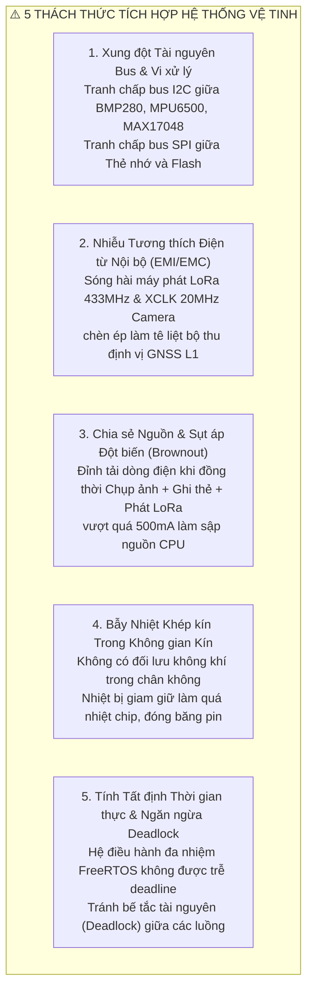
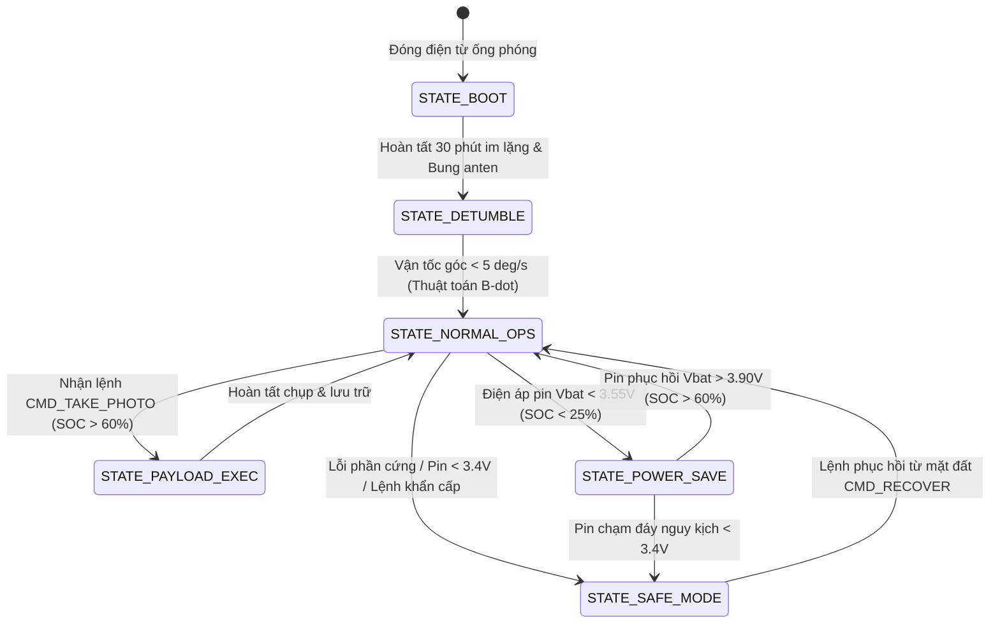

# Lab 7: Tích hợp Hệ thống Toàn diện, Thách thức Tích hợp & Vận hành Sứ mệnh Bay

---

## 📖 Doc 7.1: Năm Thách Thức Kỹ Thuật Khốc Liệt Khi Tích Hợp Đa Phân Hệ vào Khối 1U

### 1. Tổng quan Bài toán Tích hợp Hệ thống (System Integration)
Giai đoạn Tích hợp Hệ thống là thời điểm quyết định của toàn bộ dự án vệ tinh, chuyển hóa các phân hệ phần cứng và phần mềm hoạt động riêng rẽ (OBC, EPS, C&DH, Sensors, COM, Khung cơ khí) thành một **thực thể vệ tinh duy nhất, tự chủ, bền bỉ và đồng bộ** có khả năng hoàn thành xuất sắc sứ mệnh trong môi trường khắc nghiệt ngoài không gian.

Khi nhồi nhét tất cả các phân hệ vào không gian chật hẹp của khối lập phương 1U ($10 \times 10 \times 11.35\text{ cm}$), kỹ sư tích hợp phải đối mặt và giải quyết đồng thời 5 thách thức kỹ thuật lớn:



### 2. Chi tiết Giải pháp Kỹ thuật Khắc phục 5 Thách thức
1. **Giải quyết Xung đột Bus I2C/SPI:**
   - *Vấn đề:* Bus I2C là tài nguyên dùng chung nối tiếp; nếu hai tác vụ phần mềm cùng truy cập đồng thời sẽ làm vỡ khung truyền tin và treo cứng cảm biến.
   - *Giải pháp:* Sử dụng khóa tương hỗ **Mutex (`xI2CMutex`)** trong FreeRTOS với cơ chế Thừa kế Ưu tiên (Priority Inheritance). Tác vụ nào muốn đọc cảm biến bắt buộc phải lấy Mutex (`xSemaphoreTake`), hoàn thành giao tiếp xong phải nhả khóa (`xSemaphoreGive`) mới cho tác vụ khác truy cập.
2. **Khắc phục Nhiễu Tương thích Điện từ (EMI Nội bộ):**
   - *Vấn đề:* Bộ phát sóng LoRa công suất cao ($100\text{ mW}$) và xung nhịp camera $20\text{ MHz}$ phát xạ điện từ làm giảm độ nhạy máy thu GPS.
   - *Giải pháp:* Bố trí mạch đất hình sao (**Star Grounding**), bọc màng đồng shield cách ly các đường tín hiệu RF và áp dụng cơ chế bật tắt On-Demand ngắt xung nhịp camera khi định vị GPS bằng IC chuyển mạch 74HC4066.
3. **Chống Sụt áp Nguồn (Brownout Mitigation):**
   - *Vấn đề:* Nếu camera nạp điện ($250\text{ mA}$), thẻ nhớ ghi khối ($100\text{ mA}$) và LoRa phát sóng ($120\text{ mA}$) cùng xảy ra trong 1 mili-giây, tổng dòng đỉnh vượt quá $500\text{ mA}$ sẽ làm sụt áp pin xuống dưới $2.7\text{V}$ gây sập nguồn OBC.
   - *Giải pháp:* Lập trình giãn cách thời gian kích hoạt các phụ tải công suất cao (Time-staggered execution) kết hợp mảng tụ lọc Tantalum dung lượng lớn.
4. **Quản lý Cân bằng Nhiệt Toàn diện:**
   - *Vấn đề:* Trong chân không, nhiệt lượng sinh ra từ OBC và mạch phát sóng bị giữ lại bên trong khung.
   - *Giải pháp:* Thiết kế lớp Anodize đen bên trong để hấp thụ nhiệt bức xạ, cầu nhiệt kim loại dẫn nhiệt trực tiếp ra khung nhôm ngoài để tản nhiệt vào vũ trụ, duy trì nhiệt độ pin luôn trong dải an toàn từ $0^\circ\text{C}$ đến $+45^\circ\text{C}$.
5. **Tính Tất định Thời gian thực & Ngăn ngừa Deadlock:**
   - *Vấn đề:* Phần mềm điều hành bay phải xử lý đồng thời nhiều luồng tín hiệu (chu kỳ đọc cảm biến 10Hz, ghi thẻ nhớ 1Hz, phát beacon 30s, ngắt nhận viễn lệnh vô tuyến bất kỳ lúc nào). Nếu thiết kế khóa không cẩn thận sẽ xảy ra hiện tượng kẹt bế tắc Deadlock.
   - *Giải pháp:* Thiết kế cấu trúc phân cấp khóa tài nguyên cố định và áp dụng kỹ thuật FreeRTOS Queue truyền dữ liệu bất đồng bộ.

---

### ❓ Câu Hỏi Củng Cố Kiến Thức (Doc 7.1)
1. **Một trong những thách thức kỹ thuật lớn nhất khi tích hợp toàn bộ các phân hệ vào không gian 1U là gì?**
   - A. Khó tìm kiếm cổng kết nối màn hình ngoài
   - B. Không thể gắn được nút nhấn khởi động
   - C. Can nhiễu điện từ (EMI) giữa module phát sóng LoRa và các cảm biến nhạy
   - D. Bộ nhớ vi điều khiển quá nhỏ không chứa đủ tên sinh viên
   - *Đáp án:* **C**
   - *Giải thích:* Khi module LoRa phát xung công suất cao (+20 dBm), bức xạ điện từ và xung sụt áp đột ngột trên đường nguồn có thể gây nhiễu loạn đường truyền I2C của IMU và cảm biến khí quyển đặt sát cạnh.

2. **Bài toán cân đối ngân sách năng lượng (Power Budget) trong pha tích hợp hệ thống đòi hỏi:**
   - A. Tổng năng lượng tấm pin tạo ra trong chu kỳ bay phải lớn hơn tổng tiêu thụ của các tải
   - B. Pin phải luôn được nạp đầy 100% trong suốt thời gian bay
   - C. Vệ tinh phải tắt hoàn toàn bộ vi xử lý khi đi vào vùng tối
   - D. Chỉ cấp điện cho phân hệ truyền thông còn tắt toàn bộ cảm biến
   - *Đáp án:* **A**
   - *Giải thích:* Ngân sách năng lượng dương bảo đảm năng lượng thu được trong ~60 phút nhận ánh sáng mặt trời đủ để bù đắp năng lượng tiêu hao trong cả chu kỳ, bao gồm ~35 phút vùng tối Trái Đất (Eclipse).

---

## 📖 Doc 7.2: Kiến Trúc Phân Lớp Phần Mềm Bay (FSW) & Máy Trạng Thái Hữu Hạn (Mission FSM)

### 1. Kiến trúc Phân tầng Phần mềm Bay (FSW Layered Architecture)
Để hệ thống phần mềm có tính module hóa cao, dễ kiểm thử và độc lập phần cứng, phần mềm bay được tổ chức theo 5 tầng phân cấp:
1. **Tầng Trừu tượng Phần cứng (HAL - Hardware Abstraction Layer):** Cung cấp các hàm API truy cập thanh ghi chân GPIO, ADC, PWM, UART, I2C, SPI.
2. **Tầng Trình điều khiển Thiết bị (Device Drivers):** Các lớp driver điều khiển trực tiếp từng IC cụ thể (Driver BMP280, Driver MPU6500, Driver MAX17048, Driver LoRa E32, Driver MicroSD).
3. **Tầng Hệ điều hành Thời gian thực (OS / Kernel Layer):** FreeRTOS quản lý bộ điều phối tác vụ (Scheduler), hàng đợi tin nhắn (Queue), bộ đếm thời gian (Software Timers) và khóa bảo vệ (Mutex).
4. **Tầng Dịch vụ Hệ thống (System Services):** Phân tích cú pháp viễn lệnh (Command Parser), Quản lý đóng khung bản tin (Telemetry Service), Ghi nhật ký thẻ nhớ (Storage Service), Chó canh giám sát (Watchdog Manager).
5. **Tầng Ứng dụng & Điều khiển Sứ mệnh (Mission Application Layer):** Máy trạng thái hữu hạn (Mission FSM) ra quyết định chuyển đổi chế độ hoạt động của toàn bộ vệ tinh.

### 2. Máy Trạng Thái Hữu Hạn Điều Khiển Sứ Mệnh (Mission FSM)
Phần mềm bay được điều hành bởi một Máy Trạng Thái Hữu Hạn (**Finite State Machine - FSM**) chuẩn mực:



### 3. Chi tiết 6 Trạng thái Bay Cốt lõi
- **`STATE_BOOT`:**
  - Khởi động hệ thống, kiểm tra ngoại vi, khôi phục tham số từ NVS.
  - Đếm ngược thời gian **30 phút im lặng vô tuyến (30-Minute Radio Silence)** theo luật quốc tế của Liên minh Viễn thông Quốc tế (ITU) trước khi được phép bung ăng-ten và phát sóng RF đầu tiên.
- **`STATE_DETUMBLE`:**
  - Giảm tốc độ xoay hỗn loạn sinh ra khi rời ống phóng xuống dưới $5^\circ\text{/s}$ bằng thuật toán điều khiển từ tính B-dot và thanh giảm chấn trễ từ.
- **`STATE_NORMAL_OPS`:**
  - Vận hành quỹ đạo tiêu chuẩn: Định kỳ thu thập dữ liệu cảm biến (10Hz), ghi nhật ký thẻ nhớ SD (1Hz), phát gói tin Beacon (mỗi 30-60s) và lắng nghe lệnh viễn lệnh từ trạm mặt đất.
- **`STATE_PAYLOAD_EXEC`:**
  - Kích hoạt tải trọng camera chụp ảnh viễn thám Trái Đất, nén JPEG và phân mảnh tệp dữ liệu. Chỉ cho phép kích hoạt khi dung lượng pin $\text{SOC} > 60\%$ và nhiệt độ nằm trong dải an toàn.
- **`STATE_POWER_SAVE`:**
  - Khi pin yếu ($V_\text{bat} < 3.55\text{V}$, $\text{SOC} < 25\%$), hệ thống tự động sa thải phụ tải (Load Shedding): Tắt camera, tắt GPS, giãn chu kỳ phát Beacon lên $120\text{ giây}$, giảm xung nhịp CPU xuống $80\text{ MHz}$.
- **`STATE_SAFE_MODE`:**
  - Chế độ phòng thủ sống còn khi xảy ra sự cố nghiêm trọng (pin chạm đáy $< 3.4\text{V}$ hoặc cảm biến báo lỗi liên tục), chỉ duy trì nguồn tối thiểu cho bộ thu lệnh vô tuyến để chờ lệnh giải cứu từ mặt đất.

---

### ❓ Câu Hỏi Củng Cố Kiến Thức (Doc 7.2)
1. **Quy định an toàn quốc tế yêu cầu trạng thái khởi động (`STATE_BOOT`) của phần mềm bay phải duy trì thời gian trễ im lặng bao lâu sau khi rời ống phóng?**
   - A. Trễ chính xác 1 giây rồi phát sóng ngay
   - B. Phát sóng liên tục ngay khi công tắc RBF nhả
   - C. Chờ 24 giờ liên tục không thực hiện lệnh nào
   - D. Trễ im lặng tối thiểu 30 đến 45 phút trước khi kích hoạt thu phát RF
   - *Đáp án:* **D**
   - *Giải thích:* Tiêu chuẩn an toàn phóng (Range Safety) bắt buộc vệ tinh phải giữ im lặng vô tuyến 30-45 phút sau khi tách khỏi tên lửa đẩy để tránh làm nhiễu sóng hệ thống dẫn đường của tầng đẩy và các vệ tinh khác cùng cụm phóng.

2. **Máy trạng thái hữu hạn (Mission FSM) của phần mềm bay chuyển từ trạng thái `DETUMBLE` sang `MISSION` khi nào?**
   - A. Khi dung lượng pin sụt giảm dưới 20%
   - B. Khi vận tốc góc quay của vệ tinh trên các trục giảm xuống dưới ngưỡng an toàn
   - C. Khi có tín hiệu ngắt nguồn khẩn cấp từ trạm mặt đất
   - D. Khi thẻ nhớ MicroSD đã ghi đầy một nửa dung lượng
   - *Đáp án:* **B**
   - *Giải thích:* Quá trình Detumble sử dụng từ trường hoặc con quay để triệt tiêu chuyển động xoay lộn ban đầu; khi vận tốc góc ổn định (dưới ngưỡng ví dụ 5 deg/s), vệ tinh mới chuyển sang thực hiện sứ mệnh chính.

---

## 📖 Doc 7.3: Sổ Tay Vận Hành Bay (FOM) & Mô Phỏng Quỹ Đạo LEO 95 Phút

### 1. Sổ Tay Vận Hành Bay (Flight Operations Manual - FOM)
Sổ tay FOM là tài liệu quy chuẩn tác chiến dành cho kíp trực điều hành Trạm mặt đất:
- **Quy trình Kiểm tra Trước Phiên Liên lạc (Pre-Pass Checklist):** Kiểm tra hướng ăng-ten, hiệu chuẩn tần số SDR, tải tệp phần tử quỹ đạo TLE mới nhất từ Space-Track.org để tính toán thời điểm đón sóng (AOS - Acquisition of Signal) và mất sóng (LOS - Loss of Signal).
- **Giao thức Thông qua Trạm Mặt đất (Ground Pass Protocol):**
  1. *Giai đoạn Bắt sóng (AOS):* Vệ tinh mọc trên chân trời, trạm bắt tín hiệu Beacon đầu tiên, gửi lệnh xác thực `CMD_PING`.
  2. *Giai đoạn Trút Dữ liệu (Telemetry Dump):* Gửi lệnh `CMD_DUMP_LOG`, vệ tinh truyền tải nhanh các khối dữ liệu cảm biến tích lũy trong vòng quỹ đạo trước đó.
  3. *Giai đoạn Thực thi Nhiệm vụ:* Gửi các lệnh cấu hình hoặc yêu cầu chụp ảnh.
  4. *Giai đoạn Mất sóng (LOS):* Vệ tinh lặn xuống chân trời, trạm đóng phiên và lưu trữ nhật ký phiên liên lạc.

### 2. Mô phỏng Chu kỳ Quỹ đạo LEO 95 Phút
Bộ kit PTITCube hỗ trợ chế độ mô phỏng quỹ đạo thực tế để rèn luyện kỹ năng vận hành:
- **Pha Ban ngày Đón nắng (Sunlight - 60 phút):** Tấm pin mặt trời nhận ánh sáng, dòng nạp TP4056 đạt $+500\text{ mA}$, pin sạc tăng dần từ $3.7\text{V} \to 4.15\text{V}$, vệ tinh thoải mái thực hiện các tác vụ chụp ảnh và truyền thông công suất cao.
- **Pha Vùng tối Trái Đất (Eclipse - 35 phút):** Vệ tinh chìm vào bóng tối Trái Đất, dòng sạc mặt trời về $0\text{ mA}$. Toàn bộ năng lượng vận hành được rút từ khối pin Li-Po, điện áp pin xả dần. Học viên phải lập trình quản lý năng lượng thông minh để vệ tinh không bị cạn pin trước khi chu kỳ ban ngày tiếp theo bắt đầu.

---

### ❓ Câu Hỏi Củng Cố Kiến Thức (Doc 7.3)
1. **Khái niệm 'AOS' (Acquisition of Signal) và 'LOS' (Loss of Signal) trong sổ tay vận hành bay (FOM) có ý nghĩa gì?**
   - A. Mốc thời gian bắt đầu và kết thúc cửa sổ liên lạc vô tuyến khi vệ tinh bay qua trạm
   - B. Thời điểm bật và tắt nguồn khối pin mặt trời
   - C. Tín hiệu báo động lỗi bộ nhớ RAM và ROM
   - D. Lệnh chuyển đổi chế độ ngủ và chế độ thức
   - *Đáp án:* **A**
   - *Giải thích:* AOS là thời điểm trạm đất bắt đầu thu được tín hiệu khi vệ tinh nhô lên khỏi đường chân trời; LOS là thời điểm mất tín hiệu khi vệ tinh lặn xuống dưới đường chân trời (thường kéo dài khoảng 8-12 phút).

2. **Một chu kỳ bay quỹ đạo thấp LEO ở độ cao ~400 km mất khoảng bao lâu và vệ tinh trải qua bao nhiêu vòng bay mỗi ngày?**
   - A. Khoảng 24 giờ mỗi chu kỳ, 1 vòng mỗi ngày
   - B. Khoảng 12 giờ mỗi chu kỳ, 2 vòng mỗi ngày
   - C. Khoảng 90 - 95 phút mỗi chu kỳ, xấp xỉ 15 - 16 vòng mỗi ngày
   - D. Khoảng 45 phút mỗi chu kỳ, 32 vòng mỗi ngày
   - *Đáp án:* **C**
   - *Giải thích:* Với vận tốc quỹ đạo xấp xỉ 7.7 km/s, CubeSat hoàn thành một vòng quanh Trái Đất trong ~92-95 phút, tương đương 15 đến 16 vòng bay mỗi ngày đêm.

---

## 💻 Hướng Dẫn Thực Hành: Lập Trình Vòng Lặp Tuần Tự vs Đa Nhiệm FreeRTOS

### 1. Kiến trúc Đa Nhiệm FreeRTOS Mô Phỏng Vận Hành Bay
Đoạn mã C++ minh họa cài đặt máy trạng thái FSM kết hợp hàng đợi sự kiện:

```cpp
enum SatelliteState {
    STATE_BOOT,
    STATE_DETUMBLE,
    STATE_NORMAL_OPS,
    STATE_PAYLOAD_EXEC,
    STATE_POWER_SAVE,
    STATE_SAFE_MODE
};

SatelliteState currentState = STATE_BOOT;

void handleFSM() {
    float vbat = readBatteryVoltage();
    float soc = readBatterySOC();

    switch (currentState) {
        case STATE_BOOT:
            Serial.println("[FSM] STATE_BOOT: Khoi tao va giu im lang vo tuyen...");
            currentState = STATE_DETUMBLE;
            break;

        case STATE_DETUMBLE:
            Serial.println("[FSM] STATE_DETUMBLE: On dinh goc quay...");
            currentState = STATE_NORMAL_OPS;
            break;

        case STATE_NORMAL_OPS:
            if (vbat < 3.55f || soc < 25.0f) {
                Serial.println("[FSM] Pin yeu -> Chuyen sang STATE_POWER_SAVE!");
                currentState = STATE_POWER_SAVE;
            }
            break;

        case STATE_POWER_SAVE:
            if (vbat > 3.90f && soc > 60.0f) {
                Serial.println("[FSM] Pin da hoi phuc -> Tro ve STATE_NORMAL_OPS!");
                currentState = STATE_NORMAL_OPS;
            } else if (vbat < 3.40f) {
                Serial.println("[FSM] Pin nguy cap -> Vao STATE_SAFE_MODE phong thu!");
                currentState = STATE_SAFE_MODE;
            }
            break;

        case STATE_SAFE_MODE:
            // Tat toan bo phu tai, chi duy tri bo thu vo tuyen
            break;
    }
}
```

### 2. Danh mục Bài Thực hành Lab 7
- `Lab7-01_Full_Satellite_Program`: Phiên bản phần mềm bay tích hợp chạy theo vòng lặp tuần tự Non-blocking (Super-Loop) kết hợp `millis()`.
- `Lab7-02_RTOS_Satellite_System`: Phiên bản phần mềm bay đa nhiệm thời gian thực FreeRTOS phân chia hai lõi vi xử lý, tích hợp mô phỏng chu kỳ quỹ đạo 95 phút (Sunlight/Eclipse).

### ❓ Câu Hỏi Đánh Giá Kỹ Năng Thực Hành (Lab 7)
1. **Trong chương trình vệ tinh đa nhiệm FreeRTOS (`Lab7-02_RTOS_Satellite_System`), ưu thế vượt trội so với vòng lặp tuần tự là:**
   - A. Giúp vệ tinh tiết kiệm được 100% dung lượng pin
   - B. Đảm bảo các tác vụ khẩn cấp (như nghe lệnh LoRa) được đáp ứng kịp thời không bị nghẽn
   - C. Không cần khai báo cấu hình phần cứng chân GPIO
   - D. Tự động sửa chữa phần cứng linh kiện bị hư hỏng
   - *Đáp án:* **B**
   - *Giải thích:* Bộ lập lịch ưu tiên của FreeRTOS cho phép tác vụ có độ ưu tiên cao chiếm quyền CPU ngay khi có sự kiện (như có gói tin đến qua ngắt UART), loại bỏ hoàn toàn độ trễ của vòng lặp tuần tự.

2. **Chuẩn hóa mã nguồn tích hợp trong Lab 7 yêu cầu đối tượng nào quản lý luồng in thông tin viễn trắc ra terminal?**
   - A. `Serial.println()` trực tiếp
   - B. `Wire.write()` qua bus truyền cảm biến
   - C. `printf()` qua cổng song song máy in
   - D. Đối tượng `cdh.println()` thuộc lớp PTIT_CDH của thư viện PTITCube
   - *Đáp án:* **D**
   - *Giải thích:* C&DH đóng vai trò phân hệ quản lý dữ liệu trung tâm; mọi thông điệp chẩn đoán và viễn trắc phải đi qua đối tượng `cdh` để đảm bảo tính nhất quán kiến trúc phần mềm bay.
