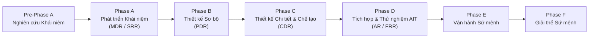
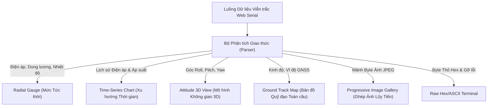

# Lab 8: Kỹ thuật Hệ thống Sứ mệnh, Khối Trực quan hóa Dashboard & Các Sứ mệnh CubeSat Thực tế

---

## 📖 Doc 8.1: Kỹ Thuật Hệ Thống Không Gian (Systems Engineering) & Vòng Đời Dự Án NASA/ESA

### 1. Phương pháp luận Kỹ thuật Hệ thống Không gian (Systems Engineering)
Kỹ thuật Hệ thống là phương pháp luận kỹ thuật và quản trị đa ngành được NASA, ESA và các cơ quan hàng không vũ trụ hàng đầu thế giới sử dụng để hiện thực hóa các sứ mệnh không gian phức tạp:
- Khác với kỹ thuật truyền thống tập trung vào từng phân hệ riêng lẻ, Kỹ thuật Hệ thống nhìn nhận vệ tinh như một thực thể thống nhất.
- Đảm bảo sự cân bằng tối ưu giữa các ràng buộc cạnh tranh khốc liệt: Khối lượng, Kích thước, Điện năng tiêu thụ, Chi phí và Thời gian triển khai.

### 2. Vòng đời Dự án Không gian theo Pha (NASA/ESA Project Lifecycle)
Chu trình phát triển một sứ mệnh vệ tinh được phân chia thành các pha kế tiếp với các cột mốc đánh giá kỹ thuật khắt khe (Gate Reviews):

- **Pre-Phase A (Nghiên cứu Khái niệm - Concept Studies):** Xác định mục tiêu khoa học, nghiên cứu tính khả thi kỹ thuật và đề xuất các phương án kiến trúc sơ khởi.
- **Phase A (Phát triển Khái niệm - Concept & Technology Development):** Chốt lại các yêu cầu sứ mệnh cấp hệ thống, kết thúc bằng cột mốc đánh giá **MDR / SRR (Mission Definition Review / System Requirements Review)**.
- **Phase B (Thiết kế Sơ bộ - Preliminary Design):** Phân rã yêu cầu xuống các phân hệ, xác định giao diện (ICD) và ngân sách kỹ thuật, kết thúc bằng cột mốc **PDR (Preliminary Design Review)**.
- **Phase C (Thiết kế Chi tiết & Chế tạo - Final Design & Fabrication):** Hoàn thiện bản vẽ CAD 3D, sơ đồ mạch, đóng băng phần mềm (Code Freeze), chế tạo mẫu thử nghiệm kỹ thuật (EM), kết thúc bằng cột mốc sống còn **CDR (Critical Design Review)**.
- **Phase D (Tích hợp Hệ thống & Thử nghiệm - System Assembly, Integration & Test - AIT):** Lắp ráp mẫu bay (FM), vượt qua các bài kiểm định môi trường (Rung động, TVAC, EMC), nghiệm thu **AR (Acceptance Review)** và đánh giá sẵn sàng phóng **FRR (Flight Readiness Review)**.
- **Phase E (Vận hành Sứ mệnh - Operations & Sustainment):** Điều hành bay trên quỹ đạo, thu thập dữ liệu khoa học và xử lý sự cố.
- **Phase F (Giải thể Sứ mệnh - Decommissioning & Disposal):** Xả cạn năng lượng pin, hạ quỹ đạo và hủy vệ tinh an toàn trong khí quyển theo công ước quốc tế về giảm thiểu rác thải không gian.

### 3. Ma Trận Kiểm Định Toàn Diện MECE (Mutually Exclusive, Collectively Exhaustive)
Nguyên tắc: "Không trùng lặp, Không bỏ sót" - Mọi thông số kỹ thuật của vệ tinh đều phải được phân bổ phương pháp kiểm chứng tương ứng trong 4 phương pháp chuẩn mực:
1. **Thử nghiệm (Test):** Kích thích hệ thống trong môi trường kiểm nghiệm (buồng rung, buồng TVAC) để thu thập số liệu đo định lượng chính xác.
2. **Phân tích (Analysis):** Sử dụng các mô hình toán học và phần mềm mô phỏng (tính toán Link Budget, mô phỏng truyền nhiệt, phân tích ứng suất kết cấu FEA).
3. **Kiểm tra Đo đạc (Inspection):** Quan sát trực quan, dùng kính hiển vi hoặc máy đo tọa độ quang học/tiếp xúc CMM để xác nhận kích thước hình học, độ sạch và tay nghề lắp ráp.
4. **Thực diễn Chức năng (Demonstration):** Quan sát định tính xem một chức năng có hoạt động đúng kỳ vọng hay không (cơ cấu bung mở ăng-ten, đèn LED chỉ thị sáng).

---

### ❓ Câu Hỏi Củng Cố Kiến Thức (Doc 8.1)
1. **Theo phương pháp luận Kỹ thuật Hệ thống NASA/ESA, cột mốc đánh giá PDR (Preliminary Design Review) có mục tiêu cốt lõi là gì?**
   - A. Bàn giao vệ tinh ra bãi phóng tên lửa
   - B. Thay thế toàn bộ linh kiện phần cứng sau khi thử nghiệm
   - C. Đánh giá tính khả thi kiến trúc sơ bộ và xác nhận thiết kế đáp ứng yêu cầu sứ mệnh
   - D. Công bố dữ liệu khoa học sau khi kết thúc sứ mệnh
   - *Đáp án:* **C**
   - *Giải thích:* PDR xác nhận kiến trúc thiết kế sơ bộ, phân bổ yêu cầu xuống các phân hệ và ngân sách kỹ thuật (khối lượng, năng lượng) có tính khả thi trước khi bước vào giai đoạn thiết kế chi tiết (CDR).

2. **Ma trận truy xuất yêu cầu (Requirements Traceability Matrix - RTM) trong dự án CubeSat dùng để làm gì?**
   - A. Liên kết từng yêu cầu nhiệm vụ với khối mã nguồn phần mềm và kịch bản thử nghiệm
   - B. Theo dõi vị trí quỹ đạo không gian của vệ tinh
   - C. Quản lý chi phí tài chính mua sắm linh kiện
   - D. Tự động sinh mã nguồn nhúng cho vi điều khiển
   - *Đáp án:* **A**
   - *Giải thích:* RTM bảo đảm không có yêu cầu nào của khách hàng/sứ mệnh bị bỏ sót trong thiết kế phần mềm, đồng thời mọi dòng mã nguồn đều phục vụ một mục tiêu kỹ thuật cụ thể đã được kiểm chứng.

---

## 📖 Doc 8.2: Hướng Dẫn Lựa Chọn & Thiết Kế Khối Trực Quan Hóa (Widgets) trên Dashboard LMS

### 1. Nguyên lý Lựa chọn Khối Trực quan hóa Phù hợp
Bảng điều khiển (Mission Dashboard) là giao diện duy nhất để kíp trực trạm mặt đất nắm bắt được sức khỏe của vệ tinh. Việc lựa chọn đúng loại Widget trực quan hóa cho từng đại lượng dữ liệu là yếu tố then chốt giúp tránh sai lầm trong vận hành:

| Loại Widget Trực quan hóa | Thuộc tính & Dữ liệu Ánh xạ | Ngữ cảnh Sử dụng Tối ưu nhất |
| :--- | :--- | :--- |
| **Đồng hồ Kim tròn (Radial Gauge)** | Ánh xạ biến đơn có ngưỡng: $V_\text{bat}$, SOC, Nhiệt độ | Giám sát các đại lượng sinh mệnh tức thời; đổi màu cảnh báo từ Xanh sang Đỏ khi chạm ngưỡng nguy hiểm |
| **Đồ thị Chuỗi Thời gian (Time-Series Chart)** | Chuỗi thời gian: $V_\text{bat}(t)$, $P(t)$, $\text{RSSI}(t)$ | Phân tích xu hướng biến thiên liên tục theo thời gian; đánh giá chu kỳ nạp xả pin qua các pha sáng/tối |
| **Mô hình 3D (Attitude 3D View)** | Bộ ba góc Euler: Roll, Pitch, Yaw | Trực quan hóa chuyển động quay và tư thế không gian 3 chiều của vệ tinh thu nhận từ thuật toán lọc bù IMU |
| **Bản đồ Quỹ đạo (Ground Track Map)** | Tọa độ địa lý: Vĩ độ, Kinh độ, Độ cao | Hiển thị vết quét quỹ đạo vệ tinh trên bản đồ thế giới và vùng phủ sóng vô tuyến (Footprint) |
| **Bảng Byte thô (Raw Terminal)** | Luồng byte nhị phân Hexadecimal & chuỗi ASCII | Dành riêng cho kỹ sư giao thức kiểm tra tính toàn vẹn dữ liệu, kiểm tra mã CRC-16 và gỡ lỗi cấp thấp |
| **Trung tâm Phát lệnh (Uplink Console)** | Danh mục lệnh và tham số kèm nút bấm Arm/Execute | Gửi các mệnh lệnh điều hành có cơ chế xác nhận an toàn hai bước để ngăn chặn thao tác bấm nhầm |
| **Khung Ảnh Lũy tiến (Image Gallery)** | Mảng bộ đệm byte ảnh: Image Chunk Stream | Ghép và hiển thị dần bức ảnh bề mặt Trái Đất theo thời gian thực khi các gói mảnh được tải về từ không gian |

---

### ❓ Câu Hỏi Củng Cố Kiến Thức (Doc 8.2)
1. **Khối Attitude 3D Widget trên Dashboard LMS sử dụng dạng dữ liệu toán học nào để tái hiện tư thế vệ tinh trong không gian?**
   - A. Nhiệt độ và áp suất môi trường
   - B. Tần số vô tuyến và mức công suất phát
   - C. Tỷ lệ phần trăm pin và dòng tiêu thụ
   - D. Ba góc xoay Euler (Roll, Pitch, Yaw) hoặc Vector Quaternion (q0, q1, q2, q3)
   - *Đáp án:* **D**
   - *Giải thích:* Tư thế góc nghiêng trong không gian 3 chiều được biểu diễn chính xác qua bộ 3 góc Euler (Roll quanh trục X, Pitch quanh trục Y, Yaw quanh trục Z) hoặc Quaternion để tránh hiện tượng khóa trục (Gimbal Lock).

2. **Khối GPS Map Widget trên giao diện mặt đất hiển thị thông tin thực địa nào của vệ tinh/trạm di động?**
   - A. Bản đồ nhiệt độ bên trong lõi vi xử lý
   - B. Quỹ đạo chuyển động mặt đất (Ground Track) và vị trí kinh độ/vĩ độ thời gian thực
   - C. Sơ đồ các đường mạch đồng trên bo mạch OBC
   - D. Danh sách các bài thực hành đã hoàn thành
   - *Đáp án:* **B**
   - *Giải thích:* GPS Map biểu diễn tọa độ thập phân WGS-84 nhận từ gói viễn trắc lên bản đồ số vệ tinh, giúp người vận hành theo dõi vết quét mặt đất của vệ tinh theo thời gian thực.

---

## 📖 Doc 8.3: Ba Đề Tài Đồ Án Capstone Mini-Project Chuyên Sâu Thực Chiến

### Đề tài 1: Hệ thống Vệ tinh Viễn thám Giám sát & Cảnh báo Cháy rừng (Wildfire Early Warning)
- **Mục tiêu:** Ứng dụng CubeSat 1U tích hợp Camera OV2640 và cảm biến môi trường để quan sát bề mặt Trái Đất, phát hiện sớm các đám cháy rừng, gắn nhãn tọa độ GPS và truyền cảnh báo khẩn cấp về trạm mặt đất.
- **Kỹ thuật Cốt lõi:**
  - Kích hoạt chụp ảnh tự động theo hàng rào địa lý ảo (**Geofencing Trigger**).
  - Phân tích không gian màu (HSV/YCbCr) hoặc mô hình học máy siêu nhẹ TFLite Micro nhận diện vùng khói lửa.
  - Nén ảnh JPEG, phân mảnh gói tin (**Packet Fragmentation**) và truyền qua kênh vô tuyến LoRa.

### Đề tài 2: Trạm Vệ tinh LEO Thu thập & Chuyển tiếp Dữ liệu Nông nghiệp Thông minh (Smart Agtech Relay)
- **Mục tiêu:** Xây dựng hệ thống vệ tinh chuyển tiếp dữ liệu phi thời gian thực (**Store-and-Forward LEO Gateway**) thu thập thông số vi khí hậu và độ ẩm đất từ các cụm cảm biến IoT nông nghiệp cắm ngoài đồng ruộng hẻo lánh và trút dữ liệu về trung tâm điều hành.
- **Kỹ thuật Cốt lõi:**
  - Cơ chế mời gọi thu thập dữ liệu (Polling Beacon) giúp các nút cảm biến mặt đất ngủ sâu tiết kiệm pin $99\%$ thời gian.
  - Thuật toán đa truy cập ngẫu nhiên ALOHA giải quyết xung đột kênh vô tuyến.
  - Cơ sở dữ liệu nhật ký trên thẻ nhớ MicroSD với cờ trạng thái chuyển tiếp (`isForwarded`) và lệnh trút dữ liệu lớn (`CMD_DUMP_AGTECH_DATA`).

### Đề tài 3: Mạng lưới Vệ tinh Tìm kiếm Cứu nạn Không gian Khẩn cấp (Search and Rescue - SAR)
- **Mục tiêu:** Mô phỏng mạng lưới cứu hộ không gian Cospas-Sarsat: Vệ tinh lắng nghe tín hiệu cầu cứu khẩn cấp từ các phao cứu nạn ngoài biển khơi, giải mã tức thời tọa độ định vị nạn nhân và phát cảnh báo ưu tiên cao nhất về trạm cứu hộ mặt đất.
- **Kỹ thuật Cốt lõi:**
  - Xử lý ưu tiên ngắt trước đối với gói tin có cờ `EMERGENCY_SOS_FLAG`.
  - Cấu hình độ nhạy thu cực đại (LoRa SF12, BW 125kHz) bắt tín hiệu phao cứu sinh yếu ớt từ cự ly hàng trăm kilomet.
  - Hiển thị thông báo báo động đỏ (SOS Red Alert Banner), còi báo động âm thanh và quy hoạch tuyến đường cứu nạn khẩn cấp trên Web Dashboard.

### ❓ Câu Hỏi Đánh Giá Kỹ Năng Thực Hành (Lab 8)
1. **Trong kịch bản thiết kế sứ mệnh tùy biến Capstone, khi dung lượng pin sụt giảm dưới ngưỡng báo động (ví dụ < 15%), phần mềm cần tự động kích hoạt hành động an toàn (Failsafe) nào?**
   - A. Chuyển sang Safe Mode: tắt camera, tắt tải phụ, chỉ phát beacon cấp cứu chu kỳ dài
   - B. Bật toàn bộ đèn LED và camera chụp ảnh liên tục
   - C. Tự động xóa sạch toàn bộ mã nguồn chương trình trong Flash
   - D. Tăng tần số xung nhịp CPU lên mức tối đa
   - *Đáp án:* **A**
   - *Giải thích:* Chế độ Safe Mode tối thiểu hóa dòng tiêu thụ xuống mức thấp nhất, bảo toàn năng lượng để duy trì mạch giám sát và chờ các tấm pin mặt trời nạp lại khi ra vùng có nắng.

2. **Quy trình nghiệm thu và bảo vệ đồ án Capstone trên hệ thống CubeSat-LMS bao gồm những nội dung chính nào?**
   - A. Chỉ nộp bản vẽ 3D mà không cần chạy code thực tế
   - B. Thi công lắp ráp tên lửa đẩy mô hình tại phòng lab
   - C. Trình diễn hoạt động firmware tích hợp, truyền nhận viễn trắc lên Dashboard và báo cáo kỹ thuật
   - D. Chờ vệ tinh thật trên quỹ đạo gửi tín hiệu về máy bay
   - *Đáp án:* **C**
   - *Giải thích:* Sinh viên bảo vệ đồ án thông qua việc nạp mã nguồn hoàn chỉnh vào bộ kit, vận hành kịch bản sứ mệnh thực tế, truyền dữ liệu không dây về Dashboard LMS và phân tích dữ liệu trong báo cáo kỹ thuật.
