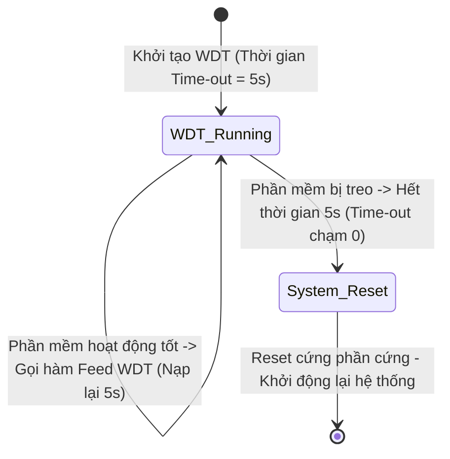

## 📖 Doc 3.4: Bộ Định Thời Giám Sát Phần Cứng Watchdog Timer (WDT) & Kiến Trúc Tự Phục Hồi FDIR

### 1. Nguyên lý Hoạt động của Bộ định thời Watchdog Timer Watchdog (WDT)
Trong môi trường bức xạ quỹ đạo LEO, các hạt ion mang điện tích năng lượng cao có thể gây hiện tượng lật bit dữ liệu ngẫu nhiên (Single Event Upset - SEU), làm con trỏ chương trình (Program Counter) nhảy vào vùng nhớ rác khiến vi điều khiển bị treo cứng hoàn toàn:
- **Watchdog Timer (WDT)** là một mạch đếm lùi phần cứng độc lập với CPU, hoạt động nhờ nguồn xung nhịp xung nội riêng biệt.
- Khi khởi tạo, WDT được nạp một khoảng thời gian giới hạn (ví dụ: $5000\text{ ms}$). Mạch đếm liên tục giảm giá trị về $0$.
- Trong điều kiện hoạt động bình thường, phần mềm bay định kỳ thực hiện thao tác **Làm tươi Watchdog Timer (Feed Watchdog / Reset WDT)** để nạp lại giá trị ban đầu cho bộ đếm.
- Nếu phần mềm bị treo hoặc rơi vào vòng lặp vô tận, thao tác làm tươi Watchdog Timer không được thực hiện. Bộ đếm chạm mức $0$, ngay lập tức kéo chân Reset phần cứng của vi điều khiển xuống mức thấp, ép buộc toàn bộ hệ thống khởi động lại sạch sẽ.

### 2. Hai Phân cấp Watchdog Timer trong ESP32
1. **Hardware Interrupt Watchdog (IWDT):** Giám sát ở cấp độ vi xử lý phần cứng cấp thấp. Nếu một ngắt (Interrupt Handler) chạy quá lâu hoặc CPU bị khóa hoàn toàn, IWDT kích hoạt.
2. **Task Watchdog Timer (TWDT):** Giám sát ở cấp độ hệ điều hành FreeRTOS. Từng tác vụ riêng lẻ phải đăng ký với TWDT (`esp_task_wdt_add(NULL)`). Nếu bất kỳ tác vụ quan trọng nào bị kẹt và không gọi hàm `esp_task_wdt_reset()` trong khoảng thời gian cấu hình, TWDT sẽ in báo cáo lỗi ngăn xếp và reset hệ thống.

---

### ❓ Câu Hỏi Củng Cố Kiến Thức (Doc 3.4)
1. **Bộ định thời giám sát Task Watchdog Timer (TWDT) trên ESP32 sẽ tự động thực hiện hành động gì nếu một tác vụ bị treo?**
   - A. Tự động ngắt kết nối WiFi và Bluetooth
   - B. Kích hoạt Reset phần cứng toàn bộ vi điều khiển
   - C. Xóa sạch dữ liệu trên thẻ nhớ ngoài
   - D. Chuyển vi điều khiển về chế độ nạp Bootloader

2. **Quy trình FDIR (Fault Detection, Isolation, and Recovery) trong thiết kế phần mềm vệ tinh là:**
   - A. Quy trình kiểm tra lỗi cơ học trước khi phóng
   - B. Thuật toán định vị quỹ đạo vệ tinh dựa trên GNSS
   - C. Giao thức nén ảnh viễn thám không gian
   - D. Cơ chế tự động phát hiện, cô lập lỗi và tái khởi động phục hồi hệ thống